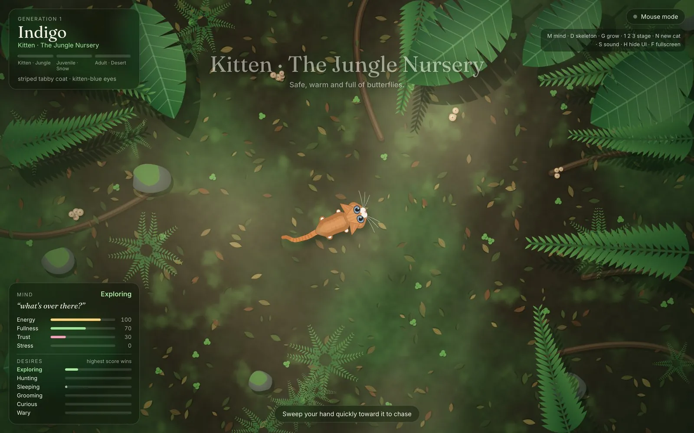
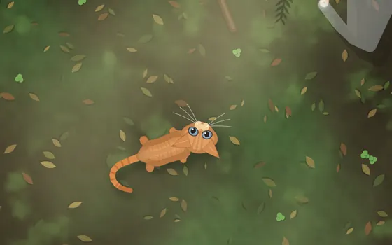
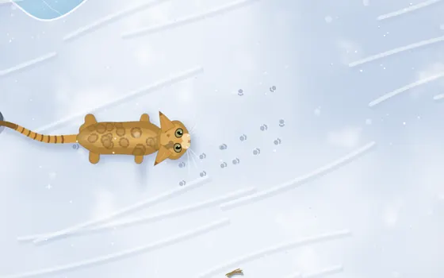
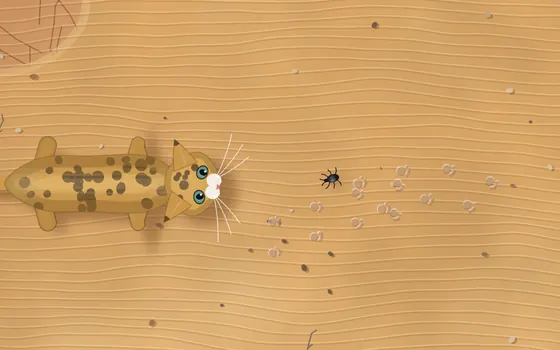
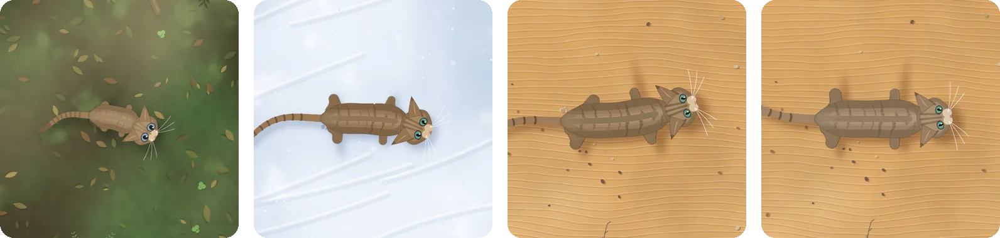
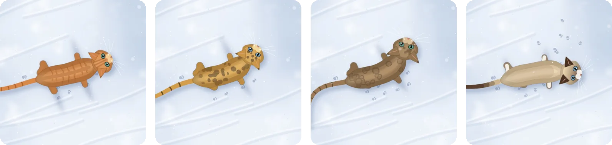
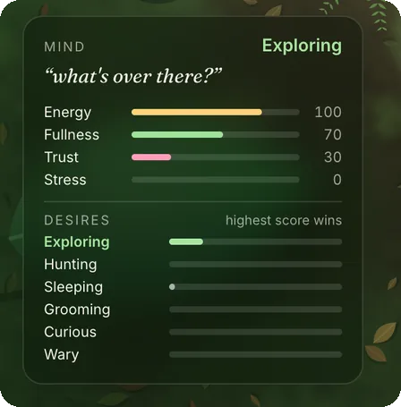
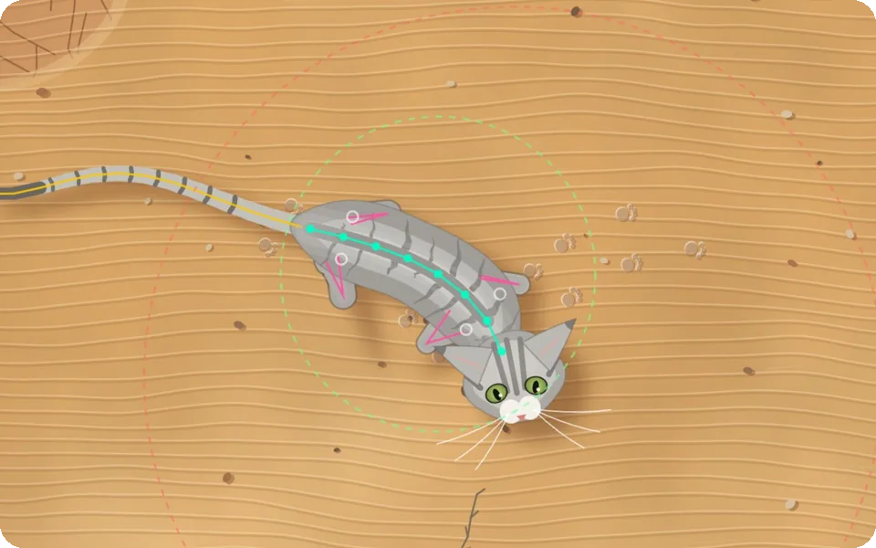

<p align="center">
  
</p>

<h1 align="center">Wildling</h1>

<p align="center"><em>A wild cat that grows up between your hands.</em></p>

<p align="center">
  <a href="https://katherine0292.github.io/wildling/"><b>▶&nbsp; Play it in your browser</b></a>
  &nbsp;·&nbsp; p5.js &nbsp;·&nbsp; ml5.js HandPose &nbsp;·&nbsp; Web Audio
</p>

<p align="center">
A procedurally generated cat, seen from above, that you raise with your bare hand through the webcam.<br>
It lives on its own, grows from kitten to elder across three habitats, and remembers how you treated it.
</p>

<br>

## Raise it with your hand

<table>
  <tr>
    <td width="33%" align="center"></td>
    <td width="33%" align="center"></td>
    <td width="33%" align="center"></td>
  </tr>
  <tr>
    <td align="center"><b>Pet</b><br><sub>A slow, open hand over its back.<br>It sits, squints and purrs, and its trust grows.</sub></td>
    <td align="center"><b>Chase</b><br><sub>A fast sweep toward it.<br>A wary cat hisses and flees; a trusting one plays.</sub></td>
    <td align="center"><b>Let it be</b><br><sub>Step away and it lives on its own:<br>it explores, hunts, grooms and naps.</sub></td>
  </tr>
</table>

Hand tracking runs entirely in the browser with ml5.js HandPose; no video is recorded or uploaded.
A mouse or a touchscreen works the same way.

## It grows up, and moves on

<p align="center">
  
</p>
<table>
  <tr>
    <td width="25%" align="center"><b>Kitten</b><br><sub>Jungle nursery · blue kitten eyes</sub></td>
    <td width="25%" align="center"><b>Juvenile</b><br><sub>Snowfields · tires faster in the cold</sub></td>
    <td width="25%" align="center"><b>Adult</b><br><sub>Desert · slit pupils, long shadows</sub></td>
    <td width="25%" align="center"><b>Elder</b><br><sub>Rests, and a mutated kitten is born</sub></td>
  </tr>
</table>

Each change of habitat is a migration: the cat walks off-screen and arrives somewhere new, with its own prey, sounds and paw prints.
When an elder rests, its kitten is born back in the jungle, carrying its genes and part of the trust you built.

## Every cat is different

<p align="center">
  
</p>

A small genome sets coat colour, pattern (tabby, spotted, rosette, colour-point), eye colour and body proportions.
Markings live in body coordinates, so the coat bends and stretches with the spine. Each new generation mutates a little.

## A mind you can read

<table>
  <tr>
    <td width="40%" align="center"></td>
    <td width="60%">
      The cat runs a small <b>utility AI</b>. Four needs (<i>energy, fullness, trust, stress</i>) drift over time and give every possible behaviour a score; the highest one wins.<br><br>
      Your hand can interrupt: a slow hand means <b>petted</b>, a fast hand means <b>flee</b>, or <b>play</b> once it trusts you.<br><br>
      The MIND panel shows all of this live, along with an inner thought, so you can always see <i>why</i> it is doing what it does.
    </td>
  </tr>
</table>

## A body made of motion

<p align="center">
  
</p>

Nothing is pre-drawn or pre-animated. The head steers, an 8-joint spine follows it, the legs are solved with inverse kinematics and the paws stay planted.
Sitting, curling up to sleep, crouching to stalk and a puffed-up tail all come from that same body. Press <kbd>D</kbd> to see the skeleton.

<br>

---

## Why it exists

**Care is remembered.** Trust is the one need you can change directly. A cat you only chase stays wary; a cat you pet learns to play, and passes part of that trust to its kittens.

It sits between the virtual pet (empathy through fragility) and artificial-life work, and treats the creature as an **agent whose reasoning is visible** rather than a black box.

**Influences:** Design I/O, *Connected Worlds* (2015) · W. Grey Walter's tortoises (1948–49) · Karl Sims, *Evolved Virtual Creatures* (1994) · Daniel Shiffman, *The Nature of Code* · procedural-animation spines and IK · Tamagotchi.

## Research and technical choices

| Part | What I looked at | What I chose, and why |
|---|---|---|
| **One creature, not a flock** | Boids and flocking: Craig Reynolds' steering behaviours, Shiffman's [*Nature of Code*](https://github.com/nature-of-code/noc-book-2) ch. 5, [Flocking-p5js](https://github.com/AidenBurgess/Flocking-p5js) | Flocks look beautiful, but no single boid has a personality. The concept is a relationship with *one* cat, so there is one creature, and the depth goes into its needs and choices. Reynolds' **seek** and **flee** steering is still used to move the cat (`Cat.seek`, `Cat.awayFrom`). |
| **Readable mind, not a neural net** | Neural-network visualisers: [netflow.js](https://github.com/hmkcode/netflow.js), [p5Perceptron](https://github.com/IainWinter/p5Perceptron) | A neural net needs training data and its reasons cannot be read. A **utility AI** (four needs score six behaviours; the highest wins) is shown live in the MIND panel, so you can always see *why* the cat acts. |
| **Procedural body** | Karl Sims, *Evolved Virtual Creatures*; argonaut's [animal-proc-anim](https://github.com/argonautcode/animal-proc-anim) (a chain of joints with angle limits, in Processing) | The same chain idea, rebuilt in p5.js for a cat seen from above, plus **2-bone inverse kinematics** for the legs. One body can sit, curl, stalk and puff up with no pre-drawn frames. |
| **Hand input** | [ml5.js](https://github.com/ml5js/ml5-next-gen) HandPose; the p5.js tutorial [*Speak With Your Hands*](https://p5js.org/tutorials/speak-with-your-hands/) | The standard way to use hand tracking in p5.js. It runs in the browser, so no video is uploaded. The mouse acts as the same hand when there is no camera. |
| **Sound** | The browser's Web Audio API | Synthesised live rather than recorded, so the voice can follow age (kitten squeak → adult meow) and the purr can follow trust. |
| **Genes and generations** | Genetic algorithms in *The Nature of Code* ch. 9; Karl Sims | Each kitten is a mutated copy of its parent and inherits part of the trust you built. |

## How it works

```
            ┌──────────── INPUT ────────────┐
 webcam ──► ml5 HandPose (21 keypoints) ─┐  │
 mouse / touch ─────────────────────────┴─► HandInput: position · presence · speed
                                               │  slow & over body = PET
                                               │  fast & near head = CHASE
                                               ▼
 ┌──────────────────────────── BRAIN (utility AI) ─────────────────────────────┐
 │ needs: energy · fullness · trust · stress   (drift every frame)             │
 │ desire scores: Wander · Hunt · Sleep · Groom · Curious · Wary → highest wins │
 │ hand overrides: PETTED · FLEE / PLAY (decided by trust)                     │
 │ life cycle overrides: MIGRATE · ARRIVE · REST                               │
 └──────────────────────────────────────┬──────────────────────────────────────┘
                                         ▼
 ┌──────────────────────────── BODY (procedural) ──────────────────────────────┐
 │ head steering → 8-joint spine (follow-the-leader, bend limits)              │
 │ → 4 legs with 2-bone IK + planted-foot stepping (diagonal trot)             │
 │ → 13-joint tail driven by a mood wave · ears / eyes / pupils / purr / puff   │
 │ → coat pattern projected onto the moving spine (genome)                     │
 └──────────────────────────────────────┬──────────────────────────────────────┘
                                         ▼
 WORLD: biome (ground, light, weather, plants) · prey · footprints · effects · audio
 LIFE CYCLE: Kitten/Jungle → Juvenile/Snow → Adult/Desert → rest → mutated kitten (Gen n+1)
```

### Environment shapes behaviour (abiotic elements)
| Biome | Life stage | Prey | Effect on the cat |
|---|---|---|---|
| Jungle Nursery | Kitten | butterflies | dappled light, swaying canopy shadows fall across the cat |
| Snowfields | Juvenile | snow buntings | energy drains 35% faster (cold), 12% slower movement, paw prints in snow |
| Desert | Adult → Elder | beetles | slit pupils in bright sun, long shadows, prints in sand, tumbleweeds |

### Audio (all synthesised live, no recordings)
- Ambience crossfades per biome: insects and bird chirps in the jungle, wind gusts and bell
  chimes in the snow, wind, sand hiss, a drone and a distant hawk in the desert.
- The cat's voice is pitched by age (kitten squeak → adult meow): trill when petted, yelp or
  **hiss** when startled, and a **purr** whose volume follows how long and how trusted the petting is.
- Footsteps change with the ground: leaf rustle, snow crunch, sand shush. There are also
  sounds for pounces (whoosh), catches (chomp), growth (chimes) and birth.

### Generative genome
Each cat has a genome: coat colour, pattern (tabby / spotted / rosette / colour-point),
pattern density and contrast, eye colour, ear, tail, leg and body proportions, white socks
or muzzle, and tail tip. Markings are stored in body-local coordinates and re-projected onto
the moving spine every frame, so the coat bends and stretches with the body. Kittens are
born with blue eyes that shift to their adult colour as they grow.

---

## Run it

### In the p5.js web editor
The sketch is seven files in one folder, nothing else:

`index.html` · `style.css` · `sketch.js` · `utils.js` · `cat.js` · `world.js` · `interface.js`

1. Open <https://editor.p5js.org> and create a new sketch.
2. Drag all seven files into the editor's file panel. Replace the editor's own `index.html`, `style.css` and `sketch.js` when asked.
3. Press ▶ Play. Allow the camera for hand tracking, or click **Use mouse / touch**.

The `docs/` folder only holds the images for this page and is not needed to run the sketch.

### Locally
Camera access needs `localhost` or `https`, so serve the folder rather than double-clicking the file:

```bash
cd wildling
python3 -m http.server 8790
```

Then open <http://localhost:8790> in **Chrome**.

### Controls
| Key | Action |
|---|---|
| `M` | show / hide the MIND panel |
| `D` | debug skeleton: spine, IK legs, foot targets, pet/chase radii |
| `G` | grow faster (+⅓ stage) — for demos |
| `1` `2` `3` | jump to Jungle / Snow / Desert stage |
| `N` | new random cat |
| `S` | mute · `H` hide UI · `C` camera preview · `F` fullscreen |

URL options for presenting: `?autostart=1&stage=1&pattern=rosette&coat=golden&wake=1&debug=1`

### Code structure (object-oriented)
| File | Classes / role |
|---|---|
| `sketch.js` | p5 `setup()` / `draw()`, keys, URL options |
| `cat.js` | `Genome` (inherited traits, mutation) · `Brain` (needs, utility scores, hand overrides) · `Cat` (procedural body, behaviours, drawing) |
| `world.js` | `World` (life cycle, migration, rebirth, footprints, effects) · `Biome` → `JungleBiome` / `SnowBiome` / `DesertBiome` · `Prey` |
| `interface.js` | `HandInput` (ml5 HandPose + mouse fallback) · `SoundEngine` (Web Audio synthesis) · `UI` (HUD, MIND panel, captions) |
| `utils.js` | small math, colour and drawing helpers |

---

## Status

### Working
- Complete life cycle: kitten → juvenile → adult → elder rest → mutated next generation.
- Migration between three hand-built procedural biomes, with captions and fades.
- Pet / chase interaction via mouse and touch, with trust deciding between flee and play.
- Autonomous life: exploring with pauses, stalk → wiggle → pounce → eat hunting (it can miss), grooming, curling up to sleep.
- Procedural body: spine, IK legs with planted feet, expressive tail, ears, eyes, pupils, breathing.
- Four coat patterns, colour inheritance and mutation; kitten blue eyes.
- Synthesised soundscape and cat voice.
- Live MIND panel (needs, desire scores, thought).
- Runs at about 60 fps at 1440×900 in Chrome on a MacBook.

### Not working yet / to test
- **Webcam hand tracking still needs a live test with a real camera.** The code follows the
  ml5.js v1 HandPose API and falls back to the mouse, but tracking jitter and the speed
  thresholds for pet vs chase (`PET_SPEED`, `CHASE_SPEED` at the top of the `Brain` section in `cat.js`) must be tuned by hand.
- Sound levels were balanced in code. They need a listening pass on speakers and on headphones.
- Gesture recognition is not yet sensitive enough: pet and chase are told apart only by hand speed and distance.
- The cat's drawing is still rough in places (body outline, fur, shading).
- When the cat flees and is cornered against a wall, it sometimes bends into a tight U-shape.
- No save state: refreshing starts a new lineage.

### Roadmap
1. **Deeper gesture recognition.** Tune the pet and chase thresholds with 3–5 people, and read the hand's shape as well as its speed (for example, an open palm for petting).
2. **Refine the cat's rendering.** A cleaner body outline, better fur and shading.
3. A short "family tree" strip of past generations, so the lineage is visible.
4. Record a 60–90 s demo video.

### Design decisions
- A **utility-based decision system shown in the MIND panel** instead of a black-box neural net, so the creature's choices can be read.
- Habitat changes are **tied to growth**, so each new background marks a life stage.
- **Two gestures only** (pet, chase), explored in depth rather than many shallow ones.
