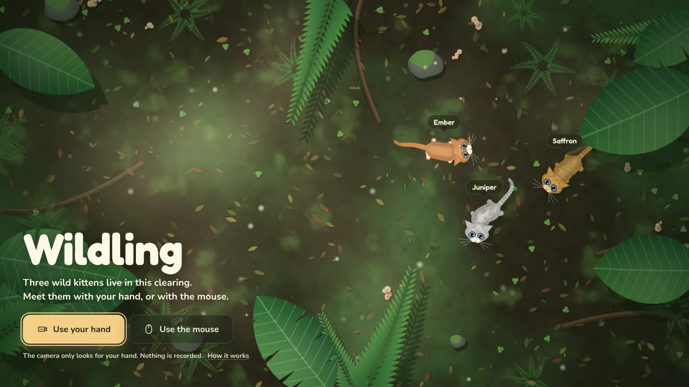
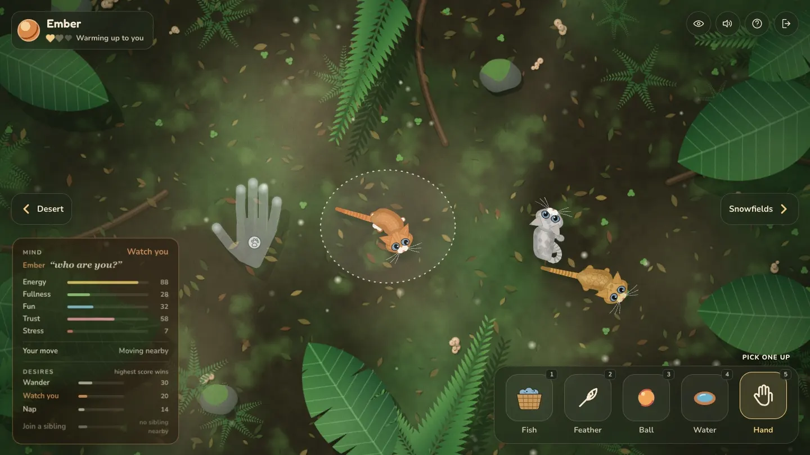
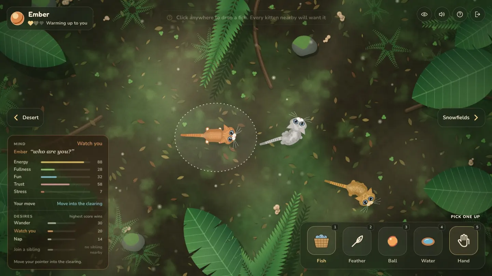
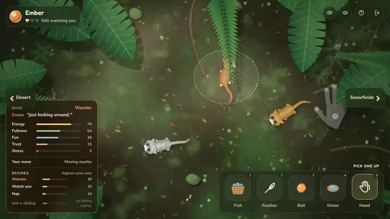
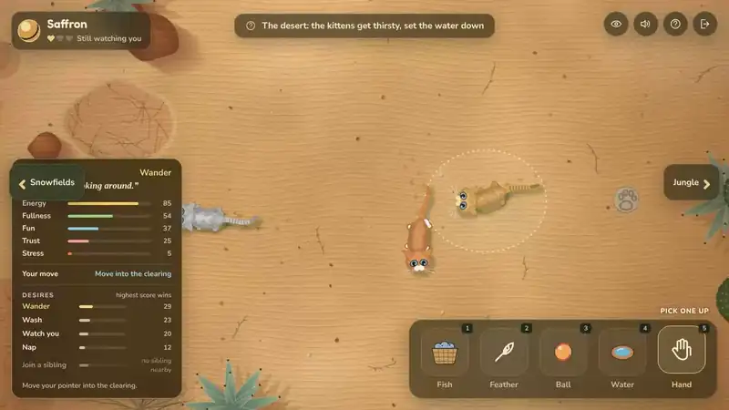
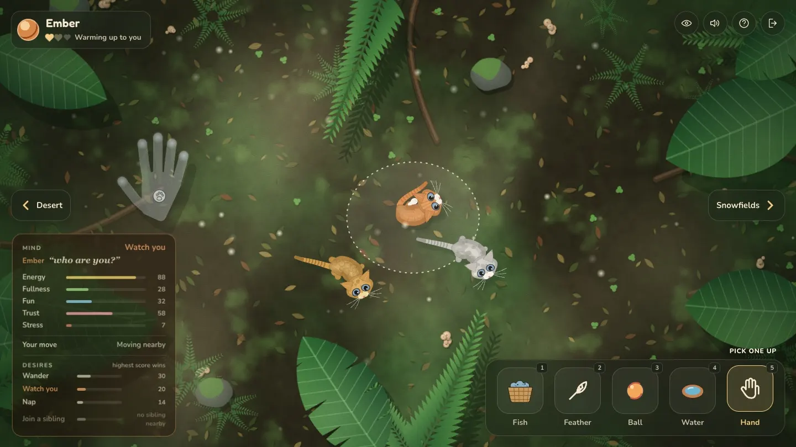
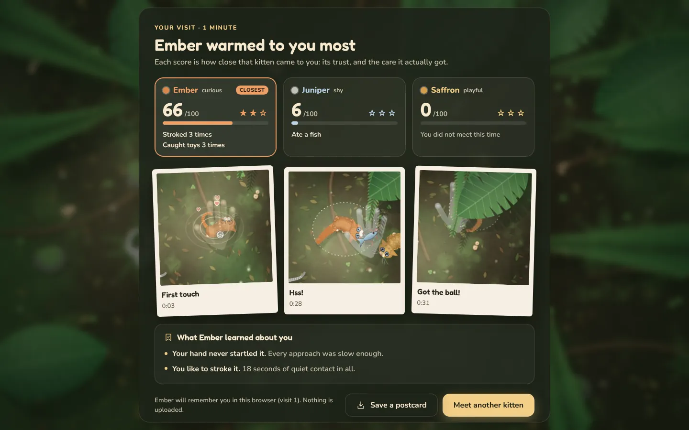
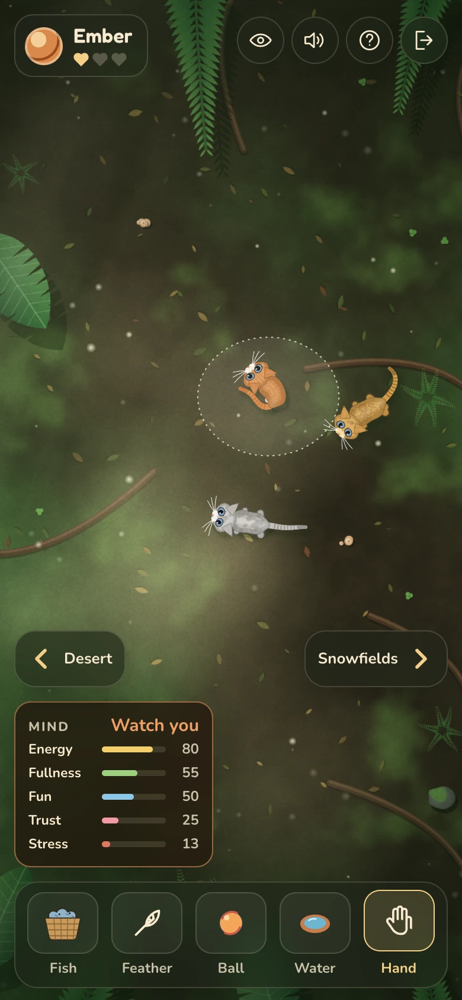

<p align="center">
  
</p>

<p align="center">
  <a href="https://katherine0292.github.io/wildling/"><b>▶ Play Wildling</b></a> &nbsp;·&nbsp;
  <a href="docs/design/experience-spec-v3.md">Experience spec V3</a> &nbsp;·&nbsp;
  <a href="docs/redesign/self-audit.zh.md">Self-audit</a> &nbsp;·&nbsp;
  <a href="docs/decisions/README.md">Decisions</a> &nbsp;·&nbsp;
  <a href="docs/ai-boundaries.md">AI boundaries</a> &nbsp;·&nbsp;
  <a href="docs/case-study-v2.md">V2 case study</a>
  <br><br>
  <a href="https://github.com/katherine0292/wildling/actions/workflows/test.yml"></a>
  
  
  
  
</p>

**Wildling** is an explainable AI creature for a public exhibition. Three wild kittens live in a clearing. You meet them **with your bare hand in front of a camera**, or with a mouse. Rest your palm on a kitten's back and it purrs. Drop a fish and the litter squabbles over it. Throw a ball, set down a bowl of water, or wave your hand and watch them scatter. Each kitten has its own needs, its own relationships with its siblings, and the right to say no. An always-on **MIND** panel shows what the nearest kitten is thinking and why. Whatever happens, it is clear **whether the system lost your hand or the kitten made a choice**.

<p align="center"></p>

## At a glance

| | |
|---|---|
| **Project** | An interactive installation for a Sydney game and interaction exhibition, built across three briefs: care and trust ([Brief V1](docs/brief/brief-v1.md)), an explainable AI upgrade ([Brief V2](docs/brief/brief-v2.md)), and a play-test-driven redesign ([V3 spec](docs/design/experience-spec-v3.md)). |
| **My role** | AI product and interaction designer, and developer: PRDs, AI behaviour, experience design, the build, and the evidence. |
| **What it is now** | **V3.1.** No tools to choose: the hand *is* the interface, and a pouch holds what it carries. Three habitats, a whole litter that reacts to the hand, food standoffs, an always-on MIND panel, a camera preview, a per-kitten score at the end, and full parity between hand and mouse. |
| **What it runs on** | Plain ES modules, p5.js and MediaPipe Hand Landmarker in a worker. Everything runs in the browser; camera frames never leave the device. |
| **Evidence** | 119 deterministic replay tests across 19 suites, run in CI. What has not been measured on real hands is labelled as such. |

## What you can do

The clips below are captured from the browser build using scripted inputs.

<table>
  <tr>
    <td width="50%"></td>
    <td width="50%"></td>
  </tr>
  <tr>
    <td><b>Drop a fish.</b> Every hungry kitten nearby wants it. Two of them face off and hiss until one backs down, and the MIND panel reads <i>“mine! hss!”</i>.</td>
    <td><b>Throw a ball.</b> Swing and pinch (or click) and the kittens give chase. In the snowfields the ball is a snowball.</td>
  </tr>
  <tr>
    <td width="50%"></td>
    <td width="50%"></td>
  </tr>
  <tr>
    <td><b>Set down water.</b> A thirsty kitten comes to drink, tongue lapping, and a litter-mate passing by may join it.</td>
    <td><b>Wave, and they scatter.</b> A fast hand near the kittens is a threat whichever way it moves. Stroking never counts as waving, and swinging a toy is play.</td>
  </tr>
  <tr>
    <td width="50%"></td>
    <td width="50%" align="center"></td>
  </tr>
  <tr>
    <td><b>A score for every kitten.</b> At the end, each kitten gets a card: half the trust it gained this visit, half the kinds of care it actually got, plus the photos taken at moments that mattered.</td>
    <td><b>Phones too.</b> The pouch becomes one even row and the MIND panel sits above it.</td>
  </tr>
</table>

Every habitat has the same pouch: **Fish**, **Feather**, **Ball** (a snowball in the snow), **Water** and **Hand**. An item stays in your hand until you take another one, and **Hand** empties it for stroking. Rest your hand on an edge arrow (or click it) to walk to the **Jungle**, **Snowfields** or **Desert**.

## One game, hand or mouse

| You do | With your hand | With the mouse | The kittens |
|---|---|---|---|
| **Stroke** | Rest your palm on a kitten's back | Hold the pointer on it | It purrs, trust grows; a tired, tense or hungry kitten can still say no |
| **Lead** | Point one finger | Press and hold | The kitten follows your fingertip |
| **Pick up** | Pinch a pouch slot. A pinch just beside one still counts | Click a slot, or <kbd>1</kbd>–<kbd>4</kbd>, <kbd>5</kbd> for Hand | |
| **Use it** | Pinch anywhere: drop a fish, throw the ball, set the water down | Click | Standoffs, chases, drinking |
| **Scare** | Wave or swat near them | A real lunge at them | They startle and scatter |
| **Change habitat** | Hold your hand on an edge arrow until its ring fills | Click an arrow, or <kbd>[</kbd> <kbd>]</kbd> | |
| **Any button** | Pinch it (pause, help, the journal) | Click | |

## The AI you can see

**The MIND panel is always on screen.** It follows whichever kitten is nearest your hand and turns that kitten's colour when it switches. It shows what the kitten is doing, a line of what it is thinking, its five needs as numbers, how it reads your move, and the desires it is weighing, with the winner highlighted and a reason next to every blocked option. Hold <kbd>V</kbd> to see the same judgement drawn in the scene.

**Two kinds of “no”, never confused.** When the camera loses your hand, the hand turns dashed blue, contact stops, and nothing is held against you. When a kitten refuses, it says why (*“I'm tired”*, *“Food first”*). A refusal never costs trust.

**Every choice has a recorded cause.** Each kitten runs the same core: hard constraints first (eating, retreating from pressure, energy too low), then hand-written utility over its behaviours, with inertia so it does not flicker. Every decision stores its candidates, blocked reasons and winner. The panel, the staff view (<kbd>D</kbd>) and the tests all read that same record.

| Capability | Kind | Why this kind |
|---|---|---|
| Hand keypoints | **Pre-trained model** (MediaPipe Hand Landmarker, on the device) | A solved problem; only 21 keypoints leave it |
| Openness, pinch, pointing, waving, stroking | **Rules** over the keypoints, with `unknown` | Explainable and testable; a trained model can drop in behind the same contract |
| What each kitten does | **Hard constraints → utility** with reason codes | Safety is provable, every choice is replayable |
| Rhythm, bonds, scores | **Bounded statistics** | Visible within one visit without claiming to know the visitor |
| What it learned about you | **Templates over real events** | Nothing is claimed that did not happen |

The full statement is in [`docs/ai-boundaries.md`](docs/ai-boundaries.md).

## How the hand is read

- **In 3D.** Openness and pinch are measured on the 3D landmarks, so a palm turned down to stroke still reads as open and a pinch reads the same from any angle. A fist never counts as a pinch.
- **Palm on the back.** When the centre of your palm rests on a kitten, that is stroking. No invitation or long wait is needed, only a moment's dwell so a hand sweeping past does not count.
- **Strokes move; swats are fast.** A hand on the kitten may sweep along its back and still be contact. A hand moving fast near the kittens, in any direction, startles them.
- **A reachable screen.** The camera is mapped so the bottom of the screen, where the pouch is, can be reached with the whole hand still in frame. Buttons have a small reach, so a tracked hand does not need pixel precision.
- **One hand size.** The drawn hand keeps the same size on screen however near or far you stand.
- **You can see what it sees.** A small mirrored camera preview shows the tracked hand and says *Hand found* or *Show one open hand*.

## How it changed

| Version | What it was | What we learned |
|---|---|---|
| **V1** · prototypes | Care tools (feed, play, pet) and a kitten with its own rhythm ([Prototype A](docs/prototype-a.md)) | Hand *speed* alone misread a public room; trust as one number explained nothing |
| **V2** · [case study](docs/case-study-v2.md) | Evidence, intent and choice separated; reason codes; growth, bonds, few-shot tricks, keepsakes | It answered the brief, but visitors spent their first minute reading: pick a kitten, pick a tool, learn hand shapes |
| **V3 → V3.1** · [spec](docs/design/experience-spec-v3.md) · [self-audit](docs/redesign/self-audit.zh.md) | No tools and no kitten to choose. The hand is the interface; the whole litter answers; three habitats with one pouch; MIND always on; a score per kitten | Real hands needed 3D features, a palm-on-back rule and bigger targets; those are in V3.1 |

## Evaluation

| What | How | Where it stands |
|---|---|---|
| Product logic | 119 deterministic replay tests in CI (fixed seed, fixed 60 Hz clock) | ✅ Acceptance cases AT01–AT17 that need no hardware, plus multi-cat focus, food standoffs, habitats, the pouch, stroke, wave, pinch and palm-on-back, and per-kitten scores |
| No unfair penalty | Replays with occlusion, flicker and pause | ✅ No trust lost to invalid tracking |
| Hand features | Synthetic 3D hands at different angles | ✅ Open, fist and pinch read the same when the hand is turned |
| Real hands at the venue | Recognition rate of stroke and pinch at venue distance and light | 📝 Not yet measured; no accuracy figure is claimed ([study plan](docs/research/usability-test-plan.md)) |

## Repository map

| Path | What |
|---|---|
| [`v2/core/`](v2/core) | The authority: pure ES modules, no DOM, run in the page and under `node --test` |
| [`v2/browser/`](v2/browser) | Camera and hand worker, habitats, kitten body, rendering, UI and MIND panel, camera preview, coach, sound ([module guide](v2/README.md)) |
| [`test/`](test) | Replay tests |
| [`docs/design/`](docs/design) · [`docs/redesign/`](docs/redesign) | Experience specs and mock-ups · the self-audit behind V3 |
| [`docs/case-study-v2.md`](docs/case-study-v2.md) | The V2 case study: brief to PRD to build, with its screenshots |
| [`docs/brief/`](docs/brief) · [`docs/prd/`](docs/prd) · [`docs/decisions/`](docs/decisions/README.md) | Briefs, PRDs and decision records |
| [`prototypes/`](prototypes) · [`tools/`](tools) | The V1 prototypes · research capture page and gesture evaluator |

## Run it

```bash
python3 -m http.server 8790
```

Open <http://localhost:8790/> in Chrome. The camera needs `localhost` or `https`. p5.js, the hand model and the fonts ship with the app, so it works offline. Add `?input=mouse` to skip the cover, or `?kiosk=1` for exhibition mode.

| Key | Action |
|---|---|
| `Enter` on the cover | Start with the mouse |
| `1`–`4` · `5` | Take Fish, Feather, Ball or Water · empty hand |
| `[` `]` | Previous or next habitat |
| Hold `V` or press `T` | Show what the kitten sees in the scene |
| `Esc` | Put the item down, or pause and resume |
| `D` · `M` | Staff diagnostics · sound |

```bash
npm test
```

Node 22 or later; no dependencies to install.
