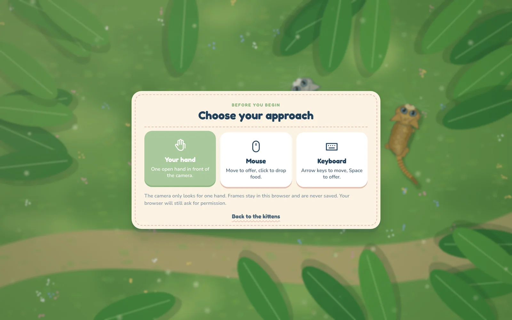
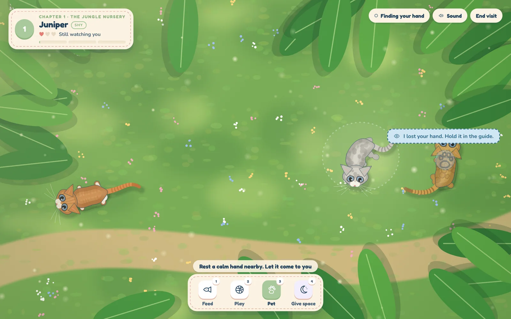

<p align="center">
  
</p>

<p align="center">
  <a href="https://katherine0292.github.io/wildling/"><b>▶ Play Wildling</b></a> &nbsp;·&nbsp;
  <a href="docs/prd/prd-v2.md">PRD V2</a> &nbsp;·&nbsp;
  <a href="docs/decisions/README.md">Decisions</a> &nbsp;·&nbsp;
  <a href="docs/STATUS.md">Status</a>
  <br><br>
  <a href="https://github.com/katherine0292/wildling/actions/workflows/test.yml"></a>
  
  
  
</p>

**Wildling** is an explainable AI creature for a public exhibition. A visitor meets a litter of wild kittens, chooses one, and builds a short relationship with it by hand gesture, mouse or keyboard: offering food, play, a calm hand, or simply space. The kitten has its own needs and boundaries. It can say no, rest, or step back. And it always makes clear **whether the system lost your hand or the kitten itself made a choice**.

<p align="center"></p>

## At a glance

| | |
|---|---|
| **Project** | An interactive installation for a Sydney game and interaction exhibition. The project lead issued two briefs: [Brief V1](docs/brief/brief-v1.md), and an AI-experience upgrade, [Brief V2](docs/brief/brief-v2.md). |
| **My role** | Product and interaction designer and developer. I translated each brief into a PRD ([V1](docs/prd/prd-v1.md), [V2](docs/prd/prd-v2.md)), designed the AI behaviour and the visitor experience, built the prototypes and the V2 build, and kept requirements, decisions and evidence aligned in writing. |
| **How requirements are written** | Every requirement is tagged **[Client]**, **[Proposal]** or **[To confirm]**. A [traceability matrix](docs/traceability.md) links each brief goal to a spec and an acceptance case; [11 decision records](docs/decisions/README.md) explain the trade-offs. |
| **What's built** | Two V1 prototypes (A: autonomous life, B: care tools) and the **V2 build**: tracking-quality gate, windowed intent with `unknown`, hard constraints + utility, reason codes, bounded in-session adaptation, a full session lifecycle, an event-cited journal, a staff diagnostics panel and a procedural kitten body. |
| **Evidence** | 40+ replay tests mapped to PRD acceptance cases, run in CI. Planned, implemented, verified and confirmed are tracked separately on the [status board](docs/STATUS.md). |

## The product problem

The first prototypes read hand **speed** as intent: slow meant petting, fast meant threat. In a public room that breaks. Tracking jumps, someone adjusting their posture or a passer-by all looked deliberate, so the cat either punished the visitor or obeyed a button. Trust was one number, and nobody could say which of their actions had changed it.

Brief V2 asked for an AI experience people can **understand and trust**. My answer in PRD V2: separate **evidence, intent and choice**, so every response has a checkable cause.

<p align="center"></p>

## From brief to product

<p align="center"></p>

| Stage | The project lead asked for | I proposed | Agreed in review |
|---|---|---|---|
| **V1** | Care builds trust; first-timers understand; the creature has its own rhythm; three habitats | Three explicit tools where **the tool states the request and the cat decides**; a readable state machine; a recap at adulthood; ecology and genetics later | Short session over full life cycle · browser prototype first · duration and language |
| **V2** | Trained, evaluable gesture classes with `unknown`; hard constraints + utility; bounded adaptation after ≥ 3 events; turnover; Processing + JS | Three-layer cause model; 600 ms windowed classifier with rejection; 8 behaviours with inertia and request boost; three bounded preferences; reason-code copy; participant-split data plan; 18 acceptance cases; a litter of three with one relationship | Devices, venue light, recruitment, anonymous statistics, final copy |

## Key product decisions

1. **Tools are requests, not commands.** Feed, Play and Pet say what you are *offering*; the kitten may still decline. *Give space* is a fourth, equally valid way to care. ([ADR-005](docs/decisions/README.md#adr-005-tools-are-requests-not-commands))
2. **System uncertainty never becomes a relationship penalty.** Lost or unclear tracking stops contact and stops penalties, and shows on the cursor as a dashed blue note, never on the kitten. ([ADR-004](docs/decisions/README.md#adr-004-separate-system-uncertainty-from-character-refusal))
3. **Safety from rules, character from utility.** Exhaustion, stress and eating are hard constraints; the rest is scored, and every decision records its candidates, blocked reasons and winner. ([ADR-006](docs/decisions/README.md#adr-006-hard-constraints-then-utility))
4. **Adaptation is small, bounded and honest.** A preference moves only after three valid events, by 20 % toward the median, within a hard range, and is cleared at the end. The copy says *"I'm getting used to this rhythm"*, never *"I know your personality"*. ([ADR-007](docs/decisions/README.md#adr-007-bounded-statistical-adaptation-not-online-learning))
5. **Hearts, not a trust bar.** Visitors see *Still watching you · Warming up to you · Comes to you*; exact numbers are for staff. ([ADR-009](docs/decisions/README.md#adr-009-no-trust-bar-on-the-public-screen))
6. **A litter of three, one relationship.** Choosing a kitten is a warm first moment; temperament changes only starting values, and the siblings never react to the hand. ([ADR-010](docs/decisions/README.md#adr-010-a-litter-of-three-one-relationship))

## The experience

<table>
  <tr>
    <td width="50%"></td>
    <td width="50%"></td>
  </tr>
  <tr>
    <td><b>Three equal ways in.</b> The camera note is plain: frames stay in the browser and are never saved, and the browser will still ask for permission.</td>
    <td><b>Contact is accepted, not taken.</b> The kitten walks over, a soft ring shows where it is welcome, and hearts float up while it purrs.</td>
  </tr>
  <tr>
    <td width="50%"></td>
    <td width="50%"></td>
  </tr>
  <tr>
    <td><b>When the system can't see, it says so.</b> The note sits by the cursor in dashed blue; the kitten's mood and trust are untouched.</td>
    <td><b>An honest goodbye.</b> At most three journal lines, each backed by a real event. The visit then clears itself for the next person.</td>
  </tr>
  <tr>
    <td width="50%"></td>
    <td width="50%"></td>
  </tr>
  <tr>
    <td><b>Chapter 2 · The Snowfields.</b> Growth comes only from balanced, low-stress care; one neglected need pauses it.</td>
    <td><b>Chapter 3 · The Desert.</b> Grown, and still free to say no.</td>
  </tr>
</table>

## What staff see

<p align="center"></p>

Press <kbd>D</kbd>. The panel answers the three questions Brief V2 asks staff to be able to answer: **what the system observed**, **what the kitten needs**, and **how the two produced this choice**. Here Play is blocked by `NEED_REST`; the visitor sees a sleeping kitten and one sentence.

## Architecture and AI boundaries

<p align="center"></p>

| Capability | What it is |
|---|---|
| Hand keypoints | **Pre-trained model** (ml5.js HandPose) |
| Gesture intent | **Rule baseline**, labelled `rule_baseline`, behind the same rejection gate the trained model will use. Training (WP03) is the next milestone; the capture page and evaluator are ready |
| Behaviour | **Rules + hand-written utility**, explainable and replayable |
| Adaptation | **Statistical estimate** (median, smoothing, hard bounds), not online learning |
| Journal | **Templates** citing event IDs; no generative text in P0 |

Full statement: [`docs/ai-boundaries.md`](docs/ai-boundaries.md).

## Success metrics

PRD V2 sets acceptance targets for the venue phase:

| Metric | Target | Where it stands |
|---|---|---|
| First meaningful action | 8 / 10 first-time visitors within 30 s | Study ready ([plan](docs/research/usability-test-plan.md)) |
| Reason understood | 8 / 10 explain one accept or refuse | Study ready |
| Adaptation noticed | 7 / 10 cite a concrete change and event | Study ready; on/off ablation already replays |
| Gesture model | Macro F1 ≥ 0.85 on held-out participants, with coverage and false-contact rate | Data plan, capture page and evaluator ready (WP03) |
| No unfair penalty | 0 trust lost to invalid tracking | ✅ Verified in replays (AT02, AT09) |
| Clean turnover | 30 rounds with no carry-over | ✅ Logic verified (AT12, AT14); hardware run in WP06 |

## Repository map

| Path | What |
|---|---|
| [`docs/brief/`](docs/brief) · [`docs/prd/`](docs/prd) | Both briefs and both PRDs, Markdown and PDF |
| [`docs/traceability.md`](docs/traceability.md) · [`docs/decisions/`](docs/decisions/README.md) | Brief → spec → acceptance · decision records |
| [`docs/design/experience-spec.md`](docs/design/experience-spec.md) | Two-layer state model, feedback mapping, recovery |
| [`docs/research/`](docs/research) | Usability and adaptation study · gesture dictionary and data plan |
| [`docs/ai-boundaries.md`](docs/ai-boundaries.md) · [`docs/STATUS.md`](docs/STATUS.md) | Model, rule or statistics · planned, implemented, verified, confirmed |
| [`v2/`](v2) | The V2 build ([README](v2/README.md)) |
| [`test/`](test) | Replay tests mapped to acceptance cases |
| [`tools/`](tools) | Research capture page and gesture evaluator |
| [`prototypes/`](prototypes) | Prototype A, autonomous life ([page](docs/prototype-a.md)) · Prototype B, care tools |

## Run it

```bash
python3 -m http.server 8790
```

Open <http://localhost:8790/> in Chrome; it opens the V2 build (Prototype A is at <http://localhost:8790/prototypes/a-autonomous-life/>). The camera needs `localhost` or `https`; p5.js and the fonts ship locally, so mouse and keyboard work offline.

```bash
npm test
```

Node 22 or later; no dependencies to install.

## Roadmap

| Work package | Next step |
|---|---|
| WP03 Perception | Capture with 16 participants, train the temporal model, evaluate on held-out participants |
| WP02 / WP05 Exhibition | Move the core into the local Node.js authority; build the Processing exhibition display |
| WP06 Venue | 10-person usability and adaptation study; 4-hour run, 30 turnovers and latency on the target device |
