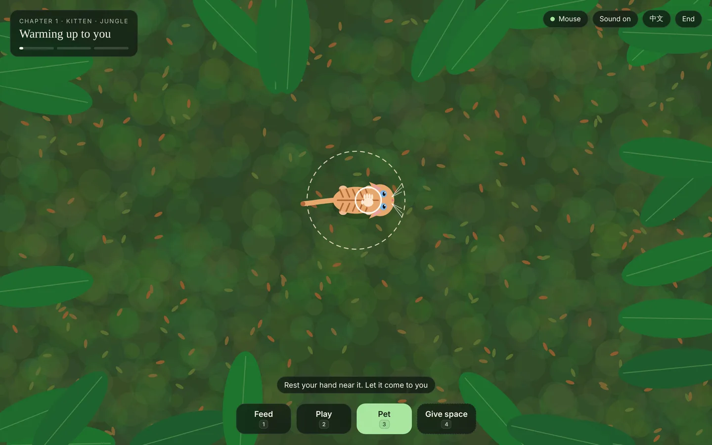
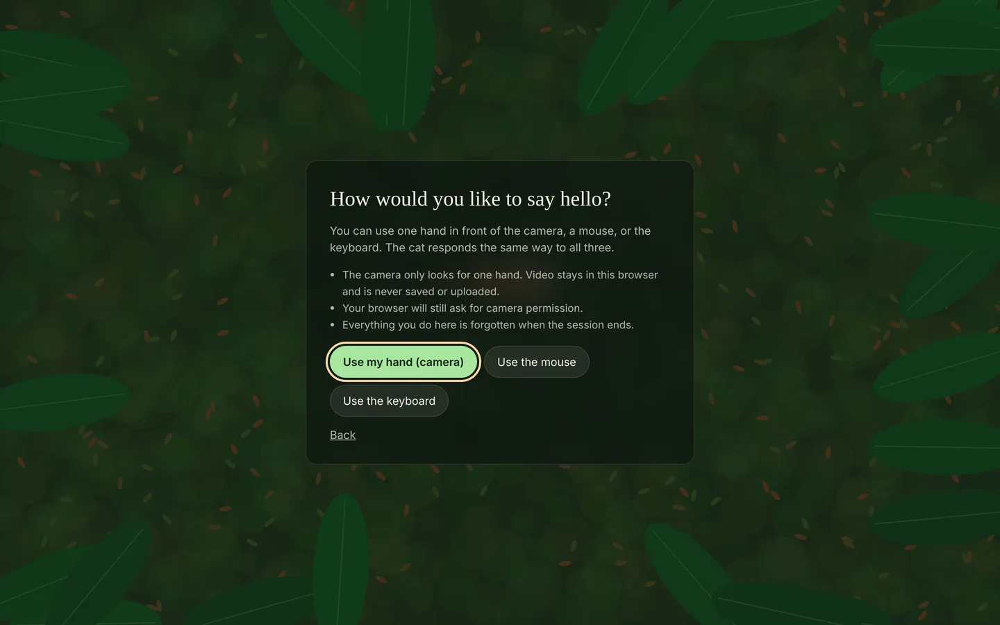
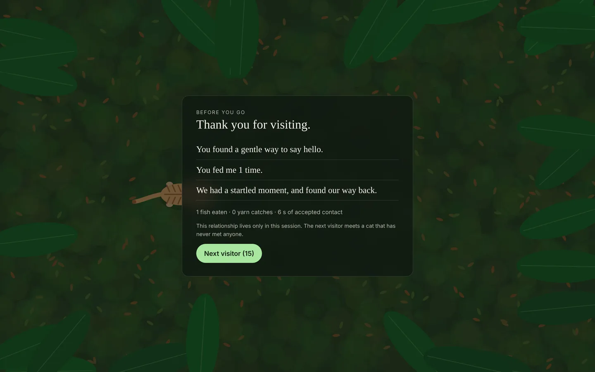
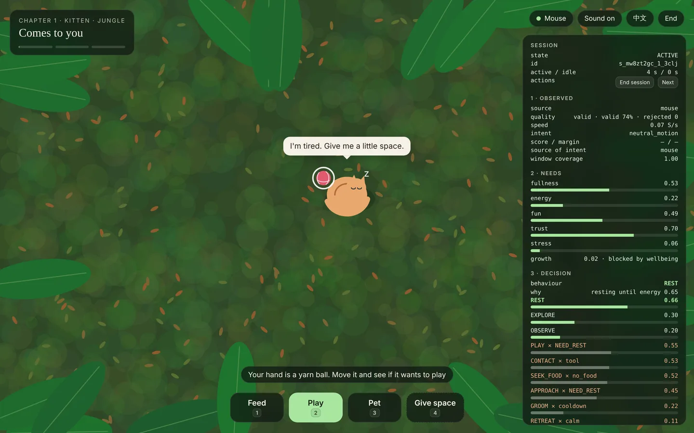

<p align="center">
  
</p>

<h1 align="center">Wildling</h1>

<p align="center"><em>An explainable AI creature: you build a short relationship with it through hand gestures.</em></p>

<p align="center">
  <a href="https://katherine0292.github.io/wildling/v2/"><b>▶ Play the V2 slice</b></a> ·
  <a href="https://katherine0292.github.io/wildling/">Prototype A</a> ·
  <a href="docs/prd/prd-v2.md">PRD V2</a> ·
  <a href="docs/STATUS.md">Status</a>
</p>

Wildling is a top-down wild kitten for a public game and interaction exhibition. A visitor feeds it, plays with it,
pets it, or gives it space, using one hand in front of a webcam, a mouse or the keyboard. Over a few minutes it grows
through three habitats. The cat has its own needs and limits: it can refuse, rest, or step back, and it **always tells
you whether the system lost your hand or the cat itself said no**.

## At a glance

| | |
|---|---|
| **Context** | Simulated client project for a Sydney game-and-interaction exhibition. The project lead issued **two briefs**: [Brief V1](docs/brief/brief-v1.md) and an AI-experience upgrade, [Brief V2](docs/brief/brief-v2.md). |
| **My role** | Sole designer and developer. I translated each brief into a PRD ([V1](docs/prd/prd-v1.md), [V2](docs/prd/prd-v2.md)), designed the interaction and AI behaviour, built the prototypes, and kept requirements, decisions and evidence aligned in writing. |
| **How the PRDs are written** | Every requirement is tagged **[客户] client requirement**, **[方案] my proposal**, or **[待确认] trade-off needing sign-off**. A [traceability matrix](docs/traceability.md) links brief goals to specs and acceptance cases. |
| **What's built** | Two Brief V1 prototypes (A: autonomous life, B: care tools), plus a **V2 vertical slice** that implements the PRD V2 core loop: quality gate, intent with `unknown`, hard constraints + utility, reason codes, bounded adaptation, session lifecycle and an evidence-cited recap. |
| **Evidence** | 36 replay tests mapped to PRD acceptance cases (`npm test`, CI). Planned, implemented, verified and client-confirmed are tracked separately in the [status board](docs/STATUS.md). |
| **Stack** | p5.js · ml5.js HandPose · Web Audio API · Node test runner. PRD V2 plans a Processing Java exhibition renderer and a local Node.js authority. |

## The problem I was solving

The two Brief V1 prototypes read hand **speed** as intent: slow meant petting, fast meant threat. In a public room that
breaks down. Tracking jumps, someone adjusting their posture, or a bystander's hand all looked like deliberate actions,
and the cat either punished the visitor or obeyed a button. Trust was one number that went up and down, and nobody
could say which of their actions had changed it.

Brief V2 asked for an AI experience that people can **trust and understand**. My framing in PRD V2: *separate evidence,
intent and choice*, so every "no" has a checkable cause.

| Why it didn't respond | Who owns it | What the visitor sees | Effect on the relationship |
|---|---|---|---|
| The system lost your hand | System | The cursor turns dashed: *"I lost your hand. Hold it in the guide."* | **None** |
| The gesture is not clear yet | System | *"Hold still for a moment."* | **None** |
| The cat is tired, full or stressed | Cat | Body language and a reason: *"I'm tired. Give me a little space."* | None. Refusals never cost trust. |

## From brief to product

```
Brief V1 ──► PRD V1 ──► Prototype A (autonomous life) + Prototype B (care tools)
  "care builds trust"     tool route chosen for round one;      │
                          A's ecology and IK deferred           ▼
                                                     findings: speed ≠ intent, tools = commands,
                                                     single trust number, average-based growth, no session
Brief V2 ──► PRD V2 ──► V2 slice (browser) ──► planned: trained gesture model · Node authority · Processing exhibit
  "AI interaction upgrade"   quality gate · utility + constraints · bounded adaptation · reason codes · session
```

| Stage | Client asked | I proposed | Needed sign-off |
|---|---|---|---|
| **V1** | Care builds trust; first-timers must understand; the creature has its own rhythm; three habitats | Three explicit tools, but **the tool states the request and the cat decides**; a state machine for readability; a recap on reaching adulthood; ecology and genetics deferred | Q1 short session vs full life cycle · Q2 browser prototype vs Processing main screen · Q3 duration and language |
| **V2** | Trained, evaluated gesture classes with `unknown`; hard constraints + utility; bounded in-session adaptation after ≥ 3 events; session turnover; Processing + JS | Three-layer cause model; 600 ms windowed classifier with rejection thresholds; 8 candidate behaviours with inertia and request boost; three bounded preferences; reason-code copy; participant-split data plan; acceptance cases AT01–AT18 | Devices, venue light, test recruitment, anonymous statistics, final public copy |

## Key product decisions

1. **Tools are requests, not commands.** Feed, Play and Pet signal what you are *trying*. The cat may still refuse. *Give space* is a fourth, equally valid action. ([ADR-005](docs/decisions/README.md#adr-005-工具从命令改为请求))
2. **System uncertainty never becomes a relationship penalty.** Lost or uncertain tracking stops contact and stops penalties, and it shows on the cursor rather than on the cat. ([ADR-004](docs/decisions/README.md#adr-004-区分系统不确定与角色拒绝))
3. **Safety comes from rules; character comes from utility.** Exhaustion, stress and eating locks are hard constraints. The remaining choices are scored, and every decision records its candidates, blocked reasons and winner. ([ADR-006](docs/decisions/README.md#adr-006-硬约束--效用选择))
4. **Adaptation is small, bounded and honest.** A preference moves only after three valid events, by 20 % toward the median, within a hard range, and it is cleared when the session ends. The copy says *"I'm getting used to this rhythm"*, never *"I know your personality"*. ([ADR-007](docs/decisions/README.md#adr-007-有界统计适应而非在线学习))
5. **No trust bar on the public screen.** Visitors see *Still watching you · Warming up to you · Comes to you*. Exact numbers are for staff only. ([ADR-009](docs/decisions/README.md#adr-009-信任不作为主屏数值奖励))
6. **No generative text in P0.** The recap is built from templates, and each line cites real event IDs. ([ADR-003](docs/decisions/README.md#adr-003-不做开放对话不用生成式文本作为结语))

## What visitors see

<table>
  <tr>
    <td width="50%"></td>
    <td width="50%"></td>
  </tr>
  <tr>
    <td><b>Consent before the camera.</b> Three equal ways in. The copy says plainly that inference is local <i>and</i> that the browser will still ask for permission.</td>
    <td><b>An honest goodbye.</b> At most three sentences, each backed by an event. If little happened, it says <i>"We spent a quiet moment together."</i> The session then clears itself after 15 s.</td>
  </tr>
</table>

## What staff see

<p align="center"></p>

Press <kbd>D</kbd>. The panel answers the three questions Brief V2 asks a staff member to be able to answer:
**what did the system observe**, **what does the creature need**, and **how did the two produce this choice**.
Here, Play is blocked with `NEED_REST`. The visitor sees only the sleeping cat and one sentence.

<sub>Screenshots were captured in mouse mode at 1440×900. Some states (low energy, chapter 2) were reached faster by setting needs from the browser console.</sub>

## AI capability boundaries

| Capability | What it actually is |
|---|---|
| Hand keypoints | **Pre-trained model** (ml5.js HandPose). Not yet tested on a real exhibition camera. |
| Gesture intent | PRD: a trained time-series model. **Today: a rule baseline**, clearly labelled `rule_baseline`, behind the same rejection gate. No data has been collected and **no accuracy figure exists**. |
| Behaviour | **Rules + hand-written utility functions.** Explainable and replayable. |
| Adaptation | **Statistical estimate** (median, smoothing, hard bounds). Not online learning. |
| Recap | **Templates** citing event IDs. |

Full statement: [`docs/ai-boundaries.md`](docs/ai-boundaries.md).

## Success metrics and where they stand

The PRD V2 targets are **design targets, not results**:

| Metric | Target | Status |
|---|---|---|
| First meaningful action | 8 / 10 first-time visitors within 30 s | Study planned ([plan](docs/research/usability-test-plan.md)) |
| Reason understood | 8 / 10 correctly explain one accept or refuse | Study planned |
| Adaptation noticed | 7 / 10 cite a concrete change and event | Study planned; on/off ablation already replays |
| Gesture model | macro F1 ≥ 0.85 on held-out participants, with coverage and false-contact rate | Data plan, capture page and evaluator ready; **model not trained** |
| No unfair penalty | 0 trust loss from invalid tracking | ✅ Verified on synthetic replays (AT02, AT09); not yet on a real camera |
| Clean turnover | 30 rounds with no state carried over | ✅ Logic verified (AT12, AT14); 30-round hardware run planned |

## Repository map

| Path | What |
|---|---|
| [`docs/brief/`](docs/brief) | Both client briefs (Markdown + original PDF) |
| [`docs/prd/`](docs/prd) | PRD V1 and V2 (Markdown + original PDF), with source tags on every requirement |
| [`docs/traceability.md`](docs/traceability.md) · [`docs/decisions/`](docs/decisions/README.md) | Brief → spec → acceptance matrix · product decision records |
| [`docs/design/experience-spec.md`](docs/design/experience-spec.md) | Two-layer state model, feedback mapping, recovery |
| [`docs/research/`](docs/research) | Usability and adaptation study plan · gesture dictionary and data plan |
| [`docs/ai-boundaries.md`](docs/ai-boundaries.md) · [`docs/STATUS.md`](docs/STATUS.md) | What is model, rule or statistics · what is planned, implemented or verified |
| [`v2/`](v2) | The V2 browser slice ([README](v2/README.md)) |
| [`test/`](test) | Replay tests mapped to acceptance cases |
| [`tools/`](tools) | Research capture page and gesture evaluator |
| [`prototypes/`](prototypes) · root `*.js` | Prototype B (care tools) · Prototype A (autonomous life, [page](docs/prototype-a.md)) |

## Run

```bash
python3 -m http.server 8790
```

Then open <http://localhost:8790/v2/> for the V2 slice, or <http://localhost:8790/> for Prototype A, in Chrome. The camera needs `localhost` or `https`.

```bash
npm test
```

Node 22 or later. No dependencies need installing.

## Known limits

- The camera path has **not been tested on real hardware**. Thresholds are PRD starting values.
- Gesture intent is a rule baseline. The trained model, the Node.js authority, the Processing exhibition renderer and the offline package are **planned** (see [status](docs/STATUS.md)).
- Four implementation deviations from the PRD formulas are listed for review in [`docs/STATUS.md`](docs/STATUS.md#与-prd-的已知偏差需评审).
- This is a simulated client project. Briefs, budgets and timelines are part of the exercise. No real user research has been run yet.
