<p align="center">
  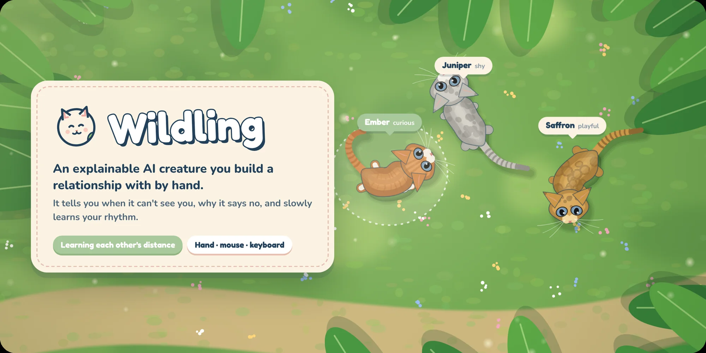
</p>

<p align="center">
  <a href="https://katherine0292.github.io/wildling/"><b>▶ Play Wildling</b></a> &nbsp;·&nbsp;
  <a href="docs/prd/prd-v2.md">PRD V2</a> &nbsp;·&nbsp;
  <a href="docs/decisions/README.md">Decisions</a> &nbsp;·&nbsp;
  <a href="docs/ai-boundaries.md">AI boundaries</a> &nbsp;·&nbsp;
  <a href="docs/STATUS.md">Status</a>
  <br><br>
  <a href="https://github.com/katherine0292/wildling/actions/workflows/test.yml"></a>
  
  
  
  
</p>

**Wildling** is an explainable AI creature for a public exhibition. A visitor meets a litter of wild kittens, picks one, and raises it through three chapters using their hand, a mouse or a keyboard. The visitor can feed it, play with it, pet it, give it space, and teach it a trick of their own. The kitten has its own needs, its own relationships with its siblings, and the right to say no. Whatever happens, it is clear **whether the system lost your hand or the kitten made a choice**.

<p align="center">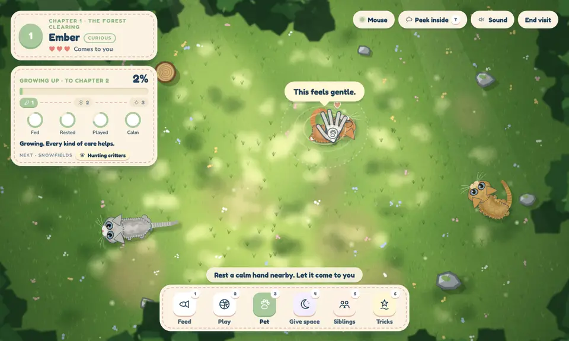</p>

## At a glance

| | |
|---|---|
| **Project** | An interactive installation for a Sydney game and interaction exhibition. The project lead issued two briefs: [Brief V1](docs/brief/brief-v1.md) (care, trust, a creature with its own rhythm), then [Brief V2](docs/brief/brief-v2.md), an AI-experience upgrade (evaluable gestures, explainable decisions, bounded adaptation). |
| **My role** | AI product and interaction designer, and developer. I turned each brief into a PRD ([V1](docs/prd/prd-v1.md), [V2](docs/prd/prd-v2.md)), designed the AI behaviour and the visitor experience, built two prototypes and the V2 build, and kept requirements, decisions and evidence aligned in writing. |
| **How requirements are written** | Every requirement is tagged **[Client]**, **[Proposal]** or **[To confirm]**. A [traceability matrix](docs/traceability.md) links each brief goal to a spec and an acceptance case. [23 decision records](docs/decisions/README.md) give the options, the trade-off and what would overturn each one. |
| **What's built** | The V2 build: a tracking-quality gate, motion intent and hand shapes with `unknown`, hard constraints + utility over 13 behaviours, reason codes, bounded adaptation, visible growth, a litter with bonds, **few-shot trick learning on the device**, keepsakes and a postcard, a staff panel and a fully procedural world. |
| **Evidence** | 67 replay tests across 10 suites, mapped to the PRD's acceptance cases and run in CI. Planned, implemented, verified and confirmed are tracked separately on the [status board](docs/STATUS.md). What is not yet measured is labelled as such. |

## The product problem

The first prototypes read hand **speed** as intent: slow meant petting, fast meant threat. In a public room that broke down. Tracking jumps, someone shifting their weight and a passer-by all looked deliberate, so the cat either punished the visitor or obeyed like a button. Trust was a single number, and nobody could say which of their actions had changed it. And after Feed, Play and Pet had each been tried once, there was little left to discover.

Brief V2 asked for an AI experience people can **understand and trust**. My answer in PRD V2 was to separate **evidence, intent and choice**, so that every response has a checkable cause. The build review then added the other half: **depth worth staying for**. The kitten needed to grow in ways you can see, to have relationships of its own, and to learn something from you.

<p align="center">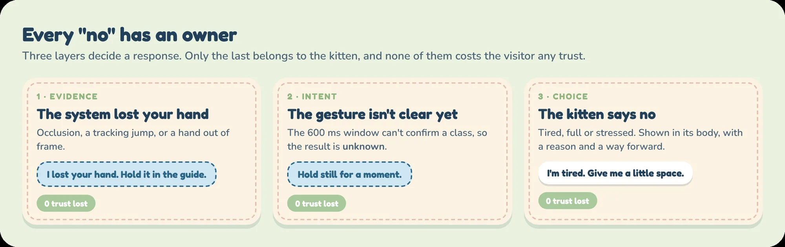</p>

## Design principles

1. **Requests, not commands.** Every tool, hand shape and trick cue is an *offer*. The kitten may decline, and it always says why ("I'm tired", "We're not close enough for that yet"). [ADR-005](docs/decisions/README.md#adr-005-tools-are-requests-not-commands)
2. **System uncertainty is never the creature's fault.** Lost or unclear tracking stops contact and penalties, and shows on the *hand* in dashed blue, never on the kitten. [ADR-004](docs/decisions/README.md#adr-004-separate-system-uncertainty-from-character-refusal)
3. **Explainable by default, not on request.** Every decision records its candidates, blocked reasons and winner. Visitors can *Peek inside*; staff can read the exact numbers. [ADR-006](docs/decisions/README.md#adr-006-hard-constraints-then-utility) · [ADR-014](docs/decisions/README.md#adr-014-peek-inside-the-decision-trace-as-a-visitor-feature)
4. **Learning you can see, check and forget.** Adaptation is small and bounded. Tricks are learned from your own three examples, with the distance shown. Everything clears at turnover. [ADR-007](docs/decisions/README.md#adr-007-bounded-statistical-adaptation-not-online-learning) · [ADR-019](docs/decisions/README.md#adr-019-teach-a-trick-few-shot-learning-on-the-device)
5. **Progress that rewards balance, not grinding.** Growth needs every need met; bursts are capped per kind of care, so varied care grows fastest. [ADR-013](docs/decisions/README.md#adr-013-growth-the-visitor-can-see-and-work-towards)
6. **Privacy by architecture.** Frames stay in memory. The venue keeps nothing between visitors, and a returning web visitor is remembered only in their own browser. [ADR-016](docs/decisions/README.md#adr-016-keepsakes-stay-with-the-visitor-not-the-venue)

## From brief to product

<p align="center">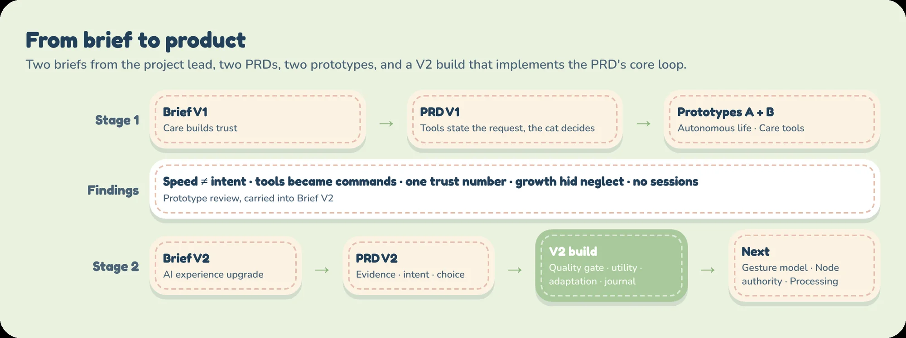</p>

| Stage | The project lead asked for | I proposed | Agreed in review |
|---|---|---|---|
| **V1** | Care builds trust; first-timers understand; the creature has its own rhythm; three habitats | Three explicit tools where **the tool states the request and the cat decides**; a readable state machine; a recap at adulthood | Short session over full life cycle · browser prototype first · duration and language |
| **V2** | Trained, evaluable gesture classes with `unknown`; hard constraints + utility; bounded adaptation after ≥ 3 events; turnover; Processing + JS | Three-layer cause model; 600 ms windowed classifier with rejection; utility with inertia and request boost; reason-code copy; participant-split data plan; 18 acceptance cases | Devices, venue light, recruitment, anonymous statistics, final copy |
| **V2 build review** | More to do and to feel; visible growth; interaction between the kittens; a stronger AI hook; exhibition pull | Growth meter with capped bursts; distinct life stages; litter bonds and hand-shape requests; few-shot tricks; keepsakes and postcard; passers-by; Peek inside | Recorded as **[Proposal]** revisions in PRD V2, pending sign-off |

## The experience

<table>
  <tr>
    <td width="50%">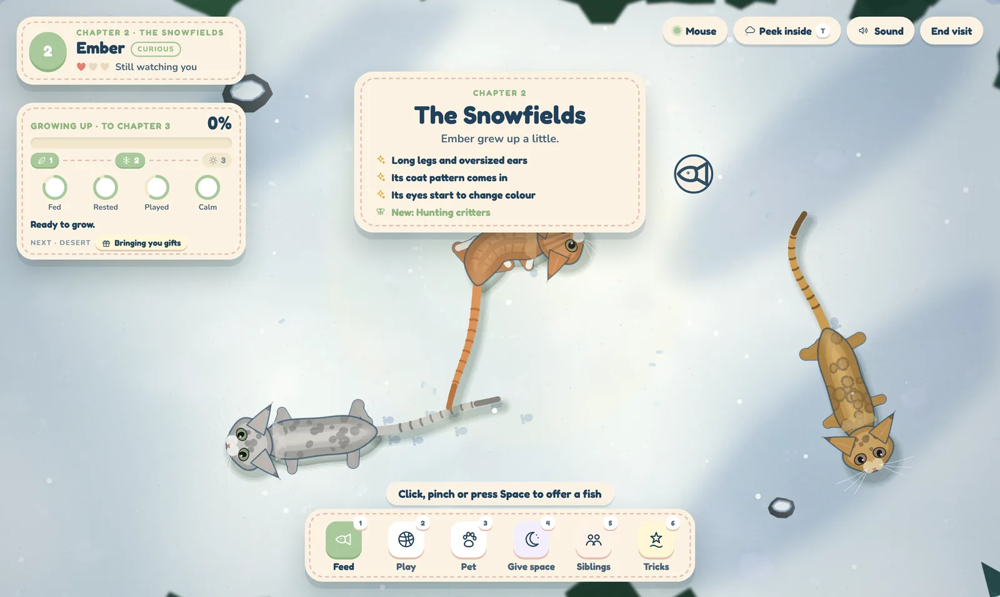</td>
    <td width="50%">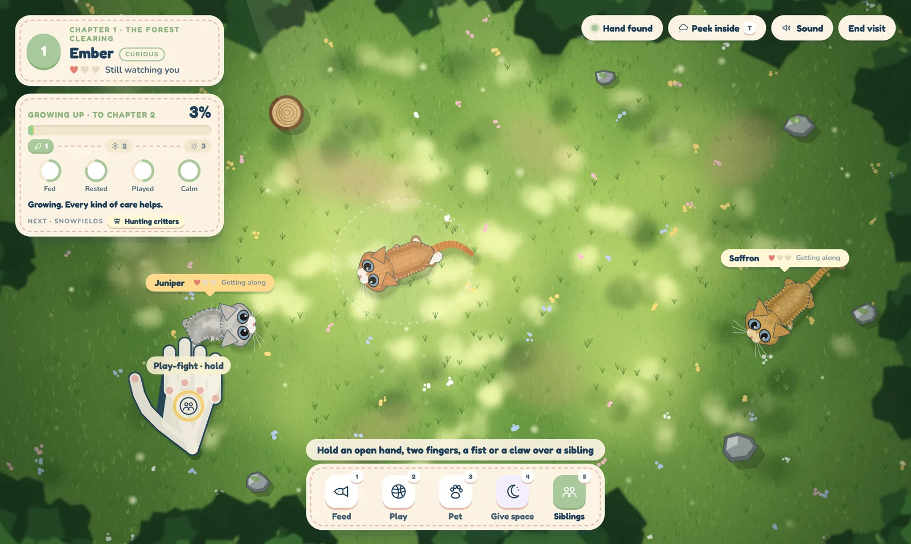</td>
  </tr>
  <tr>
    <td><b>Growing up you can see.</b> The meter shows the percentage to the next chapter, the four needs that gate it and what the next chapter unlocks. Each chapter changes the kitten's body and adds an ability.</td>
    <td><b>The hand the system sees.</b> The cursor is your tracked hand, five fingers and all. Hold a hand shape over a sibling to ask for something; the ring shows it is being read.</td>
  </tr>
  <tr>
    <td width="50%">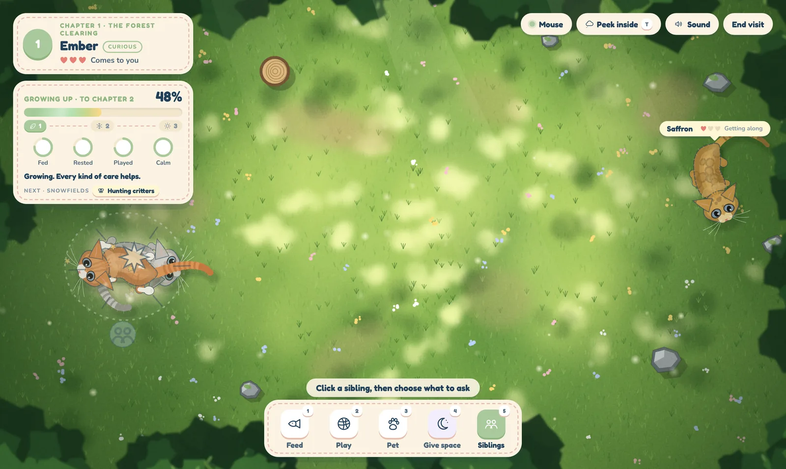</td>
    <td width="50%">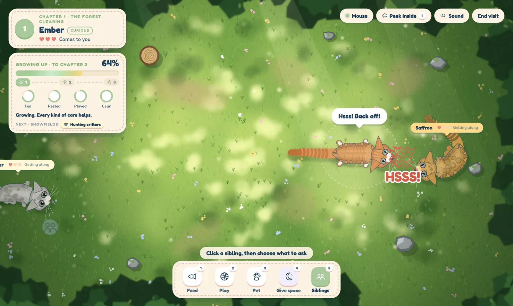</td>
  </tr>
  <tr>
    <td><b>A litter with relationships.</b> Ask your kitten to make friends, cuddle up, play-fight or hiss. Each act moves its bond with that sibling, and the bond decides what it will agree to.</td>
    <td><b>Boundaries, between kittens too.</b> It won't hiss at a close friend, and it hisses on its own at a sibling who crowds it while it eats or sleeps. None of it costs the visitor anything.</td>
  </tr>
  <tr>
    <td width="50%">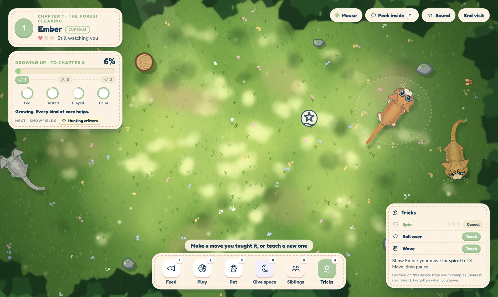</td>
    <td width="50%">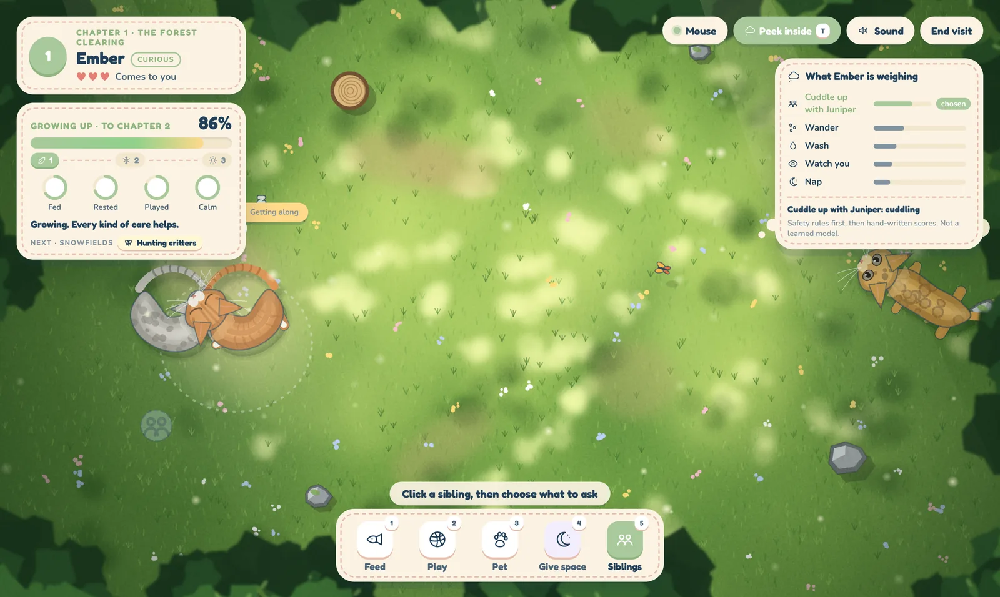</td>
  </tr>
  <tr>
    <td><b>Teach it a trick.</b> Show any move three times. The kitten learns it on the device (nearest neighbour), shows how alike your examples were, and does the trick when you make the move again, if it's up for it.</td>
    <td><b>Peek inside.</b> Press <kbd>T</kbd> to see what the kitten is weighing, what won, and why the others are blocked, in plain words. The footer says what it is: rules first, then hand-written scores.</td>
  </tr>
  <tr>
    <td width="50%">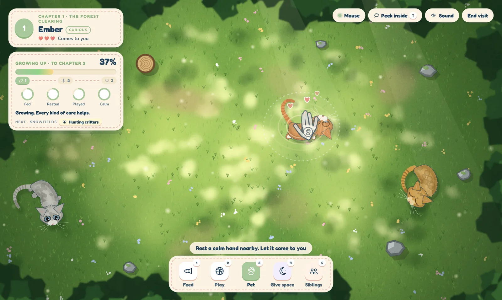</td>
    <td width="50%">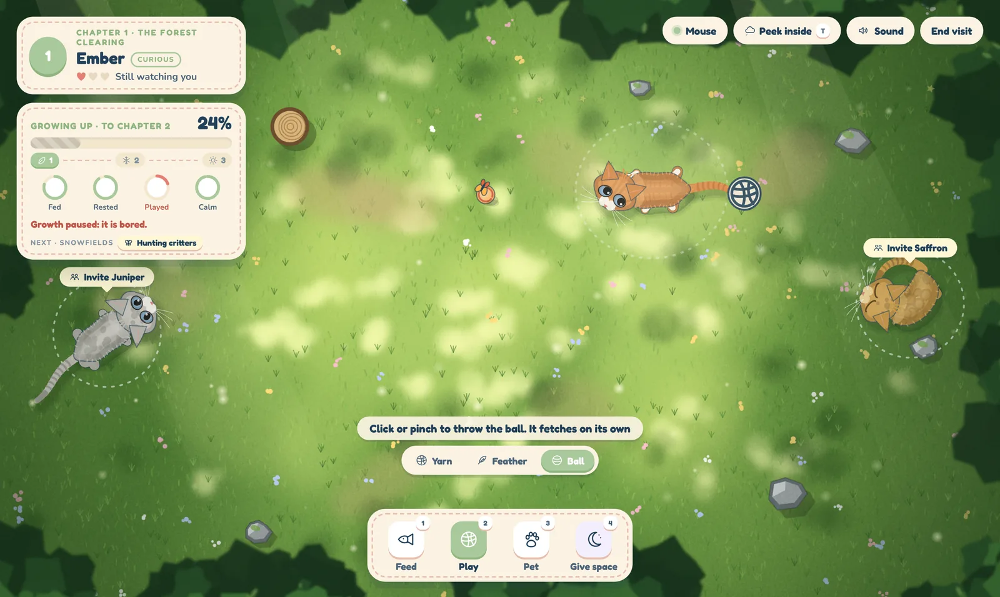</td>
  </tr>
  <tr>
    <td><b>Contact is accepted, not taken.</b> The kitten comes to a calm hand. Strokes brush its fur, it purrs and half-closes its eyes.</td>
    <td><b>Three toys, one set of rules.</b> Yarn (your hand), a feather on a springy string (flick it too fast and it misses) and a ball that rolls on its own.</td>
  </tr>
  <tr>
    <td width="50%">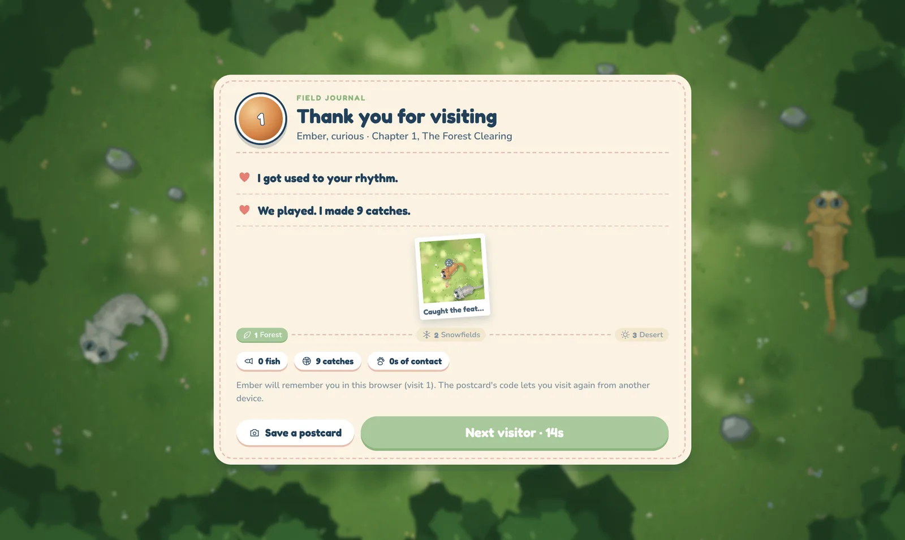</td>
    <td width="50%">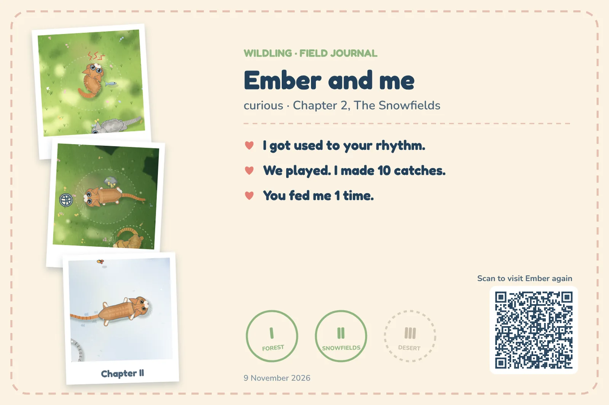</td>
  </tr>
  <tr>
    <td><b>An honest goodbye.</b> At most three journal lines, each backed by a real event, and photos taken automatically at moments that mattered.</td>
    <td><b>Something to take home.</b> A postcard drawn in the browser, never uploaded. On the website its code lets the kitten remember you next time; in the venue nothing is kept.</td>
  </tr>
  <tr>
    <td width="50%">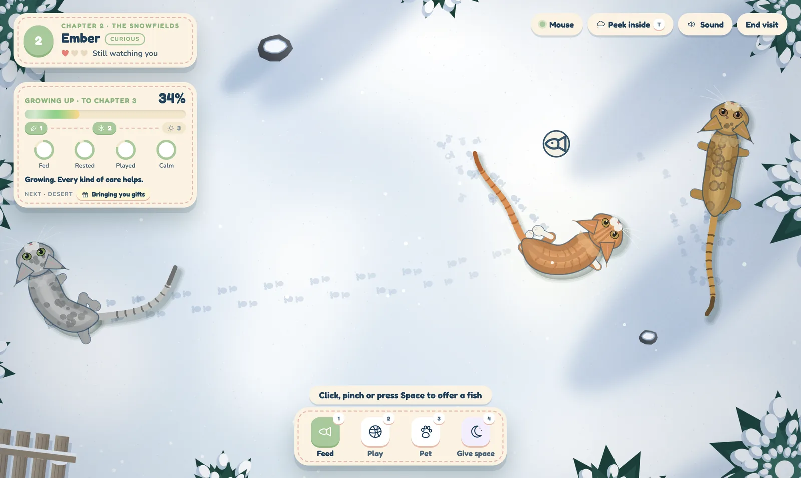</td>
    <td width="50%">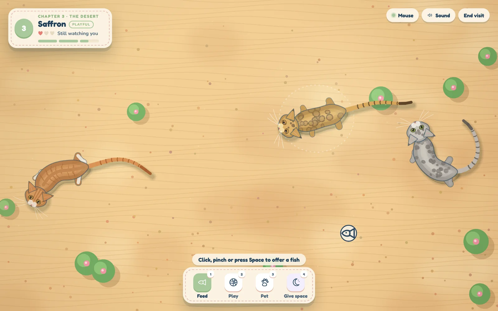</td>
  </tr>
  <tr>
    <td><b>Chapter II · The Snowfields.</b> Lanky, big-eared, starting to hunt. Paw prints fill slowly with snow.</td>
    <td><b>Chapter III · The Desert.</b> Grown, bringing gifts to someone it trusts, and still free to say no.</td>
  </tr>
</table>

## What staff see

<p align="center">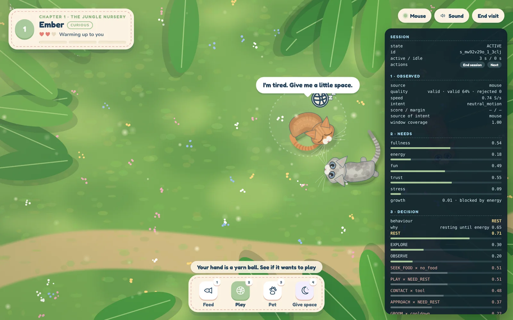</p>

Press <kbd>D</kbd>. The panel answers the three questions Brief V2 asks staff to be able to answer: **what the system observed**, **what the kitten needs**, and **how the two produced this choice**. Here the visitor offers the yarn and sees one sentence, "I'm tired. Give me a little space." Staff see REST forced by the energy rule, with every other candidate scored or blocked.

## AI system design

<p align="center">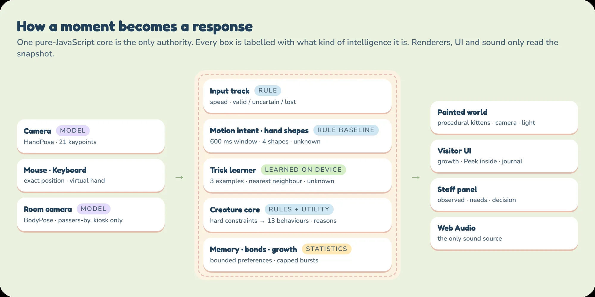</p>

**What kind of intelligence each part is.** The full statement is in [`docs/ai-boundaries.md`](docs/ai-boundaries.md).

| Capability | Kind | Why this kind |
|---|---|---|
| Hand keypoints · people in the room | **Pre-trained model** (ml5 HandPose, BodyPose) | Solved problems; run locally; only keypoints or positions leave them |
| Tracking quality · motion intent · hand shapes | **Rules** with `unknown`, behind the same output contract a trained model will use | Explainable, testable today; the trained gesture model (WP03) drops in behind the contract |
| Teach a trick | **Learned on the device**: 1-nearest-neighbour over the visitor's own examples, with a distance threshold | Real learning from three examples in under a second, inspectable by the visitor, forgotten at turnover |
| Choosing what to do | **Hard constraints → hand-written utility** over 13 behaviours | Safety is provable; character comes from scores; every choice is replayable |
| Adaptation · bonds · growth | **Bounded statistics** (medians, capped counters) | Visible within one visit without pretending to know the visitor |
| Journal · dreams | **Templates and replays** of real events | Nothing can be claimed that did not happen |

**One decision, as the core makes it** (`v2/core/creature.js`, every 250 ms):

```text
freeze if the session is not ACTIVE
forced  ← eating lock | pressure retreat | energy < 0.15 → REST | social moment | trick in progress
else    candidates ← 13 behaviours, each scored from needs, or blocked with a reason code
        a request (tool, hand shape, trick cue) adds +0.25 if it is allowed
        switch only if the best beats the current by 0.15 after a 600 ms hold
record  { candidates, blocked reasons, winner, why } → staff panel, Peek inside, tests
```

**Key parameters** (all in [`v2/core/config.js`](v2/core/config.js), each a PRD starting value or a recorded tuning note):

| Area | Values |
|---|---|
| Tracking quality | sample age ≤ 200 ms · jump > 0.35 S rejected · lost after 500 ms |
| Motion intent | 600 ms window · top ≥ 0.80 and margin ≥ 0.20 for 2 cycles, else `unknown` |
| Hand shapes | 3D joint bend (2D reach fallback) · soft per-finger scores · smoothed α 0.35 · top ≥ 0.55, margin ≥ 0.15 · 500 ms hold · 1.5 s cooldown |
| Tricks | 3 examples · 16 points → 32 features · 1-NN · reject beyond 0.32 or margin < 0.05 |
| Adaptation | after 3 valid events · 0.8 / 0.2 smoothing · hard ranges · cleared at turnover |
| Growth | gate: each need ≥ 0.20, mean ≥ 0.55, stress ≤ 0.40 · drift 1/150 per s · bursts capped at 0.24 of a chapter per cause per minute |

## Trust, safety and privacy

- **No unfair penalties.** Invalid tracking never costs trust and never counts as success. A refusal never costs trust. Hissing between kittens never touches the visitor.
- **Honest copy.** "I'm getting used to this rhythm", never "I know your personality". "Learned from your three examples", never "understands your gestures".
- **Nothing kept at the venue.** Frames live in memory. At turnover the session, memory, bonds, tricks and keepsake state are destroyed and the camera is released. The next visitor meets a kitten that has never met anyone.
- **The visitor owns their keepsake.** On the website a small record (visits, furthest chapter, gifts) stays in their own browser, with "Forget me". The postcard is drawn locally.
- **Accessible paths.** Mouse and keyboard reach every feature: tools, toys, sibling requests, tricks. The ball toy plays on with no hand on screen.

## Evaluation

| What | How | Where it stands |
|---|---|---|
| Product logic | 67 deterministic replay tests in CI (fixed seed, fixed 60 Hz clock) | ✅ AT01–AT17 that need no hardware, plus growth, litter, toys, tricks, keepsakes |
| No unfair penalty | Replays with occlusion, flicker and pause | ✅ 0 trust lost to invalid tracking (AT02, AT09) |
| Clean turnover | Replays across sessions | ✅ Logic verified (AT12, AT14); 30 rounds on the target device in WP06 |
| First meaningful action | 8 / 10 first-time visitors within 30 s | 📝 Study ready ([plan](docs/research/usability-test-plan.md)) |
| Reason understood | 8 / 10 explain one accept or refuse | 📝 Study ready |
| Gesture model | Macro F1 ≥ 0.85 on held-out participants, with coverage and false-contact rate | 📝 Capture page and evaluator ready (WP03) |
| Hand shapes · tricks on real hands | Recognition at venue distance and light | 📝 Not yet measured; no accuracy figure is claimed |

## Key decisions and trade-offs

| Decision | Trade-off accepted |
|---|---|
| Separate system uncertainty from character refusal ([ADR-004](docs/decisions/README.md#adr-004-separate-system-uncertainty-from-character-refusal)) | Two kinds of feedback to design and explain |
| Hard constraints, then utility ([ADR-006](docs/decisions/README.md#adr-006-hard-constraints-then-utility)) | Hand-tuned scores instead of learned behaviour, in exchange for provable safety and replayability |
| Bounded statistics, not online learning, for adaptation ([ADR-007](docs/decisions/README.md#adr-007-bounded-statistical-adaptation-not-online-learning)) | Smaller visible change, but nothing claimed that the data can't support |
| No trust bar, but a growth meter ([ADR-009](docs/decisions/README.md#adr-009-no-trust-bar-on-the-public-screen), [ADR-013](docs/decisions/README.md#adr-013-growth-the-visitor-can-see-and-work-towards)) | Progress is the kitten's wellbeing, never a score of the visitor |
| Hand shapes as requests with bonds ([ADR-017](docs/decisions/README.md#adr-017-hand-shapes-ask-the-kitten-about-its-siblings)) | Visitors sometimes hear "no", which is the point |
| Few-shot nearest neighbour for tricks ([ADR-019](docs/decisions/README.md#adr-019-teach-a-trick-few-shot-learning-on-the-device)) | Less general than a trained network, but instant, local and inspectable |
| Keepsakes with the visitor, not the venue ([ADR-016](docs/decisions/README.md#adr-016-keepsakes-stay-with-the-visitor-not-the-venue)) | No cross-visit analytics for the venue |

## Roadmap

| Work package | Next step |
|---|---|
| WP03 Perception | Capture with 16 participants; train the temporal gesture model and a hand-shape model; evaluate on held-out participants |
| WP02 / WP05 Exhibition | Move the core into the local Node.js authority; build the Processing exhibition display |
| WP06 Venue | 10-person usability and adaptation study; hand shapes and tricks on real hands; 4-hour run, 30 turnovers and latency on the target device |

## Repository map

| Path | What |
|---|---|
| [`docs/brief/`](docs/brief) · [`docs/prd/`](docs/prd) | Both briefs and both PRDs, Markdown and PDF |
| [`docs/traceability.md`](docs/traceability.md) · [`docs/decisions/`](docs/decisions/README.md) | Brief → spec → acceptance · 23 decision records |
| [`docs/design/experience-spec.md`](docs/design/experience-spec.md) | Two-layer state model, feedback mapping, recovery |
| [`docs/research/`](docs/research) | Usability and adaptation study · gesture dictionary and data plan |
| [`docs/ai-boundaries.md`](docs/ai-boundaries.md) · [`docs/STATUS.md`](docs/STATUS.md) | Model, rule, learned or statistics · planned, implemented, verified, confirmed |
| [`v2/core/`](v2/core) | The authority: pure ES modules, no DOM, run in the page and under `node --test` ([V2 README](v2/README.md)) |
| [`v2/browser/`](v2/browser) | Camera, rendering, UI, staff panel, sound, keepsakes |
| [`test/`](test) | Replay tests mapped to acceptance cases |
| [`tools/`](tools) | Research capture page and gesture evaluator |
| [`prototypes/`](prototypes) | Prototype A, autonomous life ([page](docs/prototype-a.md)) · Prototype B, care tools |

## Run it

```bash
python3 -m http.server 8790
```

Open <http://localhost:8790/> in Chrome. The camera needs `localhost` or `https`; p5.js, fonts and the QR library ship locally, so mouse and keyboard work offline. Add `?kiosk=1` for exhibition mode, or `?watch=demo` to see the litter notice a demo passer-by.

```bash
npm test
```

Node 22 or later; no dependencies to install.
