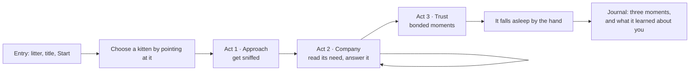

# Experience spec V3: a first meeting

This spec replaces the tool-driven flow of the V2 build. It follows the [self-audit](../redesign/self-audit.zh.md), which found that the weak part of V2 was the flow and the interaction, more than the picture. The hand-painted world and the kitten from V2 stay; what changes is what the visitor does, in what order, and how the kitten answers.

## 1 What changes, in one table

| V2 | V3 |
|---|---|
| Six tools side by side; the visitor picks one, the kitten reacts | No tools. The kitten has one need at a time; the visitor's job is to read it and answer |
| A field guide with four tabs of text before play | One screen: the litter, a title and Start. Everything else is taught during play |
| A growth meter with a percentage, three chapters and four need rings | Three bond stages, shown as three hearts. No percentage |
| The kitten speaks in English sentences | The kitten answers with its body and, when needed, one pictogram. Words are for the system only |
| A visit ends on a timer | A visit ends when the kitten falls asleep beside the hand, or when the visitor leaves |
| A text tutorial of seven steps, four of them hand shapes for siblings | The first act is the tutorial: one goal, shown by a ghost hand in the scene |

## 2 Flow

### Entry
- The litter is already moving in the clearing. Pointing at a kitten shows its name and temperament; a click or pinch chooses it.
- One Start button. The input choice (camera or mouse) is asked once, in place; the keyboard path stays available.
- The Care, Habitats and Journal tabs are removed. The privacy lines move to the input choice, where they are relevant.

### Act 1 · Approach (about a minute; this is the tutorial)
- **Goal:** get the kitten to come and sniff the hand.
- **The comfort ring.** A faint ring on the ground shows how much room the kitten wants. A slow or still hand shrinks it and the kitten walks over. A fast hand widens it: the kitten flicks its ears, takes two steps back and recovers in about three seconds. It never leaves the frame.
- **Teaching.** A see-through hand in the scene shows "come in slowly, then hold still", with one short line of text. The next thing is only taught once this one has been done.
- **Never stuck.** After 20 seconds without progress the kitten lowers the bar itself and comes a little closer.

### Act 2 · Company (two to three minutes; the core loop)
The kitten moves through a cycle taken from real cat behaviour: wants to play → hungry → washes → wants touch → sleepy. One need at a time, shown by the body first (it stares at the treat pouch, wiggles, rubs towards the hand, yawns). If the visitor has not answered after eight seconds, one pictogram appears above its head.

| The visitor | How (nothing to switch) | The game inside it |
|---|---|---|
| Pets | Rests the hand on the kitten and strokes slowly | Head and back feel good; the tail does not. After a while the tail starts to flick: that is the warning. Stopping in time is rewarded; carrying on earns a soft swat |
| Feeds | Picks a treat from the pouch (pinch, or click and hold), drops it or offers it on an open hand | Eating from the hand needs trust, and is a small milestone |
| Plays | Takes the feather wand from the pouch; the feather trails the hand | Move like prey: dart, then pause. Let it catch the feather sometimes; a kitten that never catches loses interest |
| Gives space | Moves the hand to the edge of the frame | When the kitten is tired or has had enough, backing off is the right answer. Later it walks back by itself, which is the strongest reward in the piece |

A right answer brings the bond closer. A wrong answer costs nothing; the kitten simply does not respond.

### Act 3 · Trust (about a minute)
- Moments that only happen now: it rubs its head into the hand, rolls over, falls asleep by the hand.
- **The kitten ends the visit.** When it falls asleep beside a still hand, the visit closes. On the website there is no time limit; the exhibition keeps its timers.
- **Journal.** Three real moments, each backed by an event, and a short "what it learned about you" drawn from the bounded adaptation (for example: you like to stroke its head; you stopped sooner by the end).

## 3 Interface

| Always on screen | Where |
|---|---|
| Kitten's name and three bond hearts | Top left |
| Sound, help, end | Top right, three icon buttons |
| The treat pouch (treat, feather wand) | Bottom right |

- **System and character stay apart** (ADR-004). A lost hand changes the hand cursor and shows one system line; the kitten only looks puzzled.
- **AI view.** Holding a key shows what the kitten perceives: the hand skeleton, the current reading (slow, fast, still, unclear) and what it is weighing. Releasing the key hides it. The comfort ring is the always-visible form of the same judgement.
- **Look.** The V2 hand-painted world and kitten, with contact shadows and light added. The interface uses the dark, thin-line kit in `v2/assets/ui/`.

## 4 What is kept from V2

Tracking quality gate · `unknown` rejection · hard constraints then utility · reason codes · bounded adaptation · the replay tests · the staff panel · the keyboard path · teach-a-gesture (few-shot), reused for a personal "come here" gesture in Act 3.

## 5 What is set aside

Siblings requests and their four hand shapes, the three habitats and life stages, hunting, the Tricks tool, dreams. The code stays in the repository; these are no longer part of the visitor's path.

## 6 Build order

1. Repairs on V2: pointer speed, staying in view, untimed web visits, narrow screens, development keys.
2. Toolless input: petting, the pouch, the wand and giving space by context.
3. The need cycle and the three acts, with bond stages in place of growth.
4. The new interface and the in-scene tutorial.
5. Sound from recordings.
6. A five-person usability test against the V2 baseline.

## 7 Build status

| Part | State |
|---|---|
| Entry screen: the litter is the menu, How it works, input card | Built |
| Corner controls, bond hearts, the pouch, toolless care (`toolless: true`) | Built |
| Growth switched off in favour of the bond (`growth: false`) | Built |
| Act 1: comfort ring, demonstration hand, four steps taught by doing | Built |
| Pictogram replies instead of sentences; system messages stay in words | Built |
| See what it sees: hold V (or the eye button / T to keep it open). The scene dims; the comfort ring turns solid with a line to the hand; labels name the ring's trend and the hand reading; the panel sits on the side away from the kitten | Built |
| Journal that stays open on the website | Built |
| Need cycle (Act 2): one need at a time, shown by the body first, a pictogram after 8 s, the matching pouch slot lit; each episode logged with how long the answer took | Built (`v2/core/needs.js`) |
| The kitten falls asleep to end the visit; "what it learned about you" | To come |

The layout mockups that preceded the build are in [`mockups/`](mockups/README.md).
