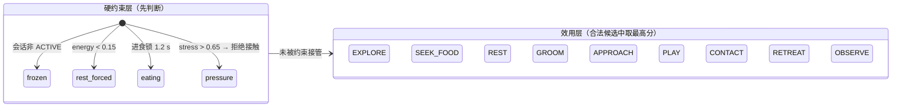

# 体验规格：双层状态、反馈映射与失败恢复

Brief V2 §10 要求“会话与角色双层状态图、反馈和失败恢复规范、声音映射”。本页是 v2 切片实现时使用的设计规格。

## 1 双层状态

**外层：会话**（谁在用、能不能记忆）。完整定义见 [PRD V2 §10](../prd/prd-v2.md#10-会话状态机-方案)。

**内层：角色**（它此刻在做什么）。只在会话 ACTIVE 时推进需要、记忆与成长；ATTRACT 使用一只**独立的演示猫**。

| 角色行为 | 触发（主要） | 退出 |
|---|---|---|
| OBSERVE | 无更优候选；或输入不确定时停下观察 | 任一候选超过门槛 |
| EXPLORE | 默认自主活动 | 其他候选 +0.15 胜出 |
| SEEK_FOOD → EAT | 有食物且 fullness < 0.85 | 吃完（1.2 s 锁）或食物消失 |
| REST | energy < 0.15（强制）或效用胜出 | energy ≥ 0.65 且至少 3 s |
| GROOM | 冷却完成且低压力 | 3 s 动作完成 |
| APPROACH | 温和靠近 + 信任/压力允许 | 进入邀请半径后等待接触 |
| CONTACT | Pet + stable_contact + 已邀请 + dwell 满足 | 6 s 上限、丢手、手离开、压力升高 |
| PLAY | Play 工具 + energy > 0.35 + stress < 0.40 | 精力不足、20 s 自然停顿、工具切换 |
| RETREAT | 近身快速刺激确认 / 接触超时 / 高压力 | 压力 < 0.40 |

## 2 反馈映射（静音时仍可读）

| 状态 / 事件 | 身体 | 屏幕文字（EN） | 声音 |
|---|---|---|---|
| OBSERVE | 停下、头朝向手、耳朵竖起 | — | — |
| APPROACH | 慢走向手，尾巴高举 | “Let me come closer first.”（若此时申请接触） | 短促轻 mew |
| CONTACT 接受 | 眯眼、尾巴放松慢摆、身体下沉 | “This feels gentle.” | 呼噜 |
| RETREAT / 压力高 | 后退、耳朵后压、尾巴蓬起 | “A little more distance, please.” | 嘶声（仅首次惊扰） |
| REST | 蜷缩、呼吸变慢、z 符号 | “I'm tired. Give me a little space.”（若被请求玩耍） | — |
| TOO_FULL | 转头离开食物 | “I'm full. Let's slow down.” | — |
| pounce_success | 前扑、尾巴快速摆动 | — | 铃铛 |
| eat_completed | 低头咀嚼 | — | 咀嚼 |
| RHYTHM_ADAPTED | 下次邀请更快 / 半径变化 | “I'm getting used to this rhythm.” | 柔和和弦 |
| SPACE_RESPECTED | 放松伸展 | “Thanks for giving me time to rest.” | — |
| TRACKING_LOST | **猫不变**；光标变虚线淡出 | “I lost your hand. Hold it in the guide.” | — |
| INTENT_UNCERTAIN | **猫不变**；光标环闪烁 | “Hold still for a moment.” | — |

规则：系统层反馈只作用在**光标与追踪指示**上，角色层反馈只作用在**猫的身体**上——观众从“哪里在变”就能分辨原因归属。

## 3 关系状态短语（替代信任条）

| 内部 trust | 主屏短语 |
|---|---|
| < 0.35 | Still watching you |
| 0.35–0.60 | Warming up to you |
| ≥ 0.60 | Comes to you |

## 4 提示调度
- 优先级：系统恢复 > 角色身体边界 > 照料结果 > 一般引导。
- 同一 reasonCode 4 s 内不重复；同时只显示一条主提示；问题解除后旧提示立即淡出。

## 5 失败恢复速查（工作人员）

| 症状 | 看诊断面板哪里 | 操作 |
|---|---|---|
| 观众说“它不理我” | `input.quality` 与 `reason` | lost → 引导手回到画面；角色原因 → 无需处理 |
| 摄像头无画面 | `camera` 状态 | 点击 “Use mouse” 继续；检查权限与占用 |
| 体验卡住 | `session` 与计时 | `Esc` → End，进入回顾与清场 |
| 需要换下一位 | — | 回顾页 “Next visitor” 或等待 15 s 自动清场 |
