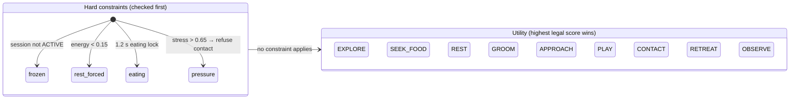

# Experience spec: two-layer state, feedback mapping and recovery

Brief V2 §10 asks for a two-layer session and character state diagram, a feedback and failure-recovery spec, and a sound mapping. This is the spec the V2 build implements.

## 1 Two layers of state

**Outer layer: the session** (who is using the piece, and whether anything may be remembered). Full definition in [PRD V2 §10](../prd/prd-v2.md#10-session-state-machine-proposal).

**Inner layer: the character** (what it is doing right now). Needs, memory and growth advance only while the session is ACTIVE. The attract screen uses **its own litter** that never sees the hand.

| Behaviour | Main trigger | Exit |
|---|---|---|
| OBSERVE | No better candidate; or stops to watch an uncertain input | Any candidate beats the margin |
| EXPLORE | Default autonomous activity | Another candidate wins by +0.15, or the bout ends |
| SEEK_FOOD → EAT | Food present and fullness < 0.85 | Meal finished (1.2 s lock) or food gone |
| REST | energy < 0.15 (forced) or utility | energy ≥ 0.65 and at least 3 s |
| GROOM | Cooldown done and low stress | 3 s action completes |
| APPROACH | Gentle approach, trust and stress allow | Inside the invitation radius, waiting for contact |
| CONTACT | Pet + stable_contact + invited + dwell met | 6 s limit, lost hand, hand leaves, stress rises |
| PLAY | Play tool + energy > 0.35 + stress < 0.40 | Tired, 20 s natural pause, tool change |
| RETREAT | Confirmed close fast approach, contact timeout or high stress | stress < 0.40 |

## 2 Feedback mapping (readable with sound off)

| State / event | Body | On-screen words | Sound |
|---|---|---|---|
| OBSERVE | Sits, head toward the hand, ears forward | — | — |
| APPROACH | Walks slowly to the hand, tail up and curled | "Let me come closer first." (if contact is asked too early) | Soft mew |
| CONTACT accepted | Sits, eyes half-closed, slow tail, little hearts float up | "This feels gentle." | Purr |
| RETREAT / high stress | Backs off, ears flat, tail puffed | "A little more distance, please." | Hiss (first scare only) |
| REST | Curls up, slow breathing, floating z's | "I'm tired. Give me a little space." (if asked to play) | — |
| TOO_FULL | Turns away from the fish | "I'm full. Let's slow down." | — |
| pounce_success | Crouch and spring, fast tail | — | Bell |
| eat_completed | Head down, chewing | — | Crunch |
| RHYTHM_ADAPTED | Next invitation comes faster or the zone changes size | "I'm getting used to this rhythm." | Soft chord |
| SPACE_RESPECTED | Relaxed stretch | "Thanks for giving me time to rest." | — |
| TRACKING_LOST | **The cat does not change**; the cursor turns blue and dashed | "I lost your hand. Hold it in the guide." | — |
| INTENT_UNCERTAIN | **The cat does not change**; the cursor pulses | "Hold still for a moment." | — |

Rule: system feedback lives on the **cursor and a dashed blue note**; character feedback lives on the **cat's body and a white speech bubble**. Visitors can tell who "owns" a response from where it appears.

## 3 Relationship phrases (instead of a trust bar)

| Internal trust | Main-screen phrase | Hearts |
|---|---|---|
| < 0.35 | Still watching you | ♥ |
| 0.35–0.60 | Warming up to you | ♥♥ |
| ≥ 0.60 | Comes to you | ♥♥♥ |

## 4 Hint scheduling
- Priority: system recovery > character boundary > care result > guidance.
- The same reasonCode never repeats within 4 s; one main hint at a time; a resolved problem's hint disappears immediately.

## 5 Recovery quick reference (staff)

| Symptom | Where to look in the staff panel | Action |
|---|---|---|
| "It's ignoring me" | `quality` and the hint owner | lost → guide the hand back into view; character reason → nothing to fix |
| No camera picture | `cam` status | Click "Use the mouse instead"; check permission and other apps |
| Stuck | session state and timers | `Esc` → End visit for the recap and turnover |
| Next visitor waiting | — | "Next visitor" on the journal, or wait 15 s for automatic turnover |
