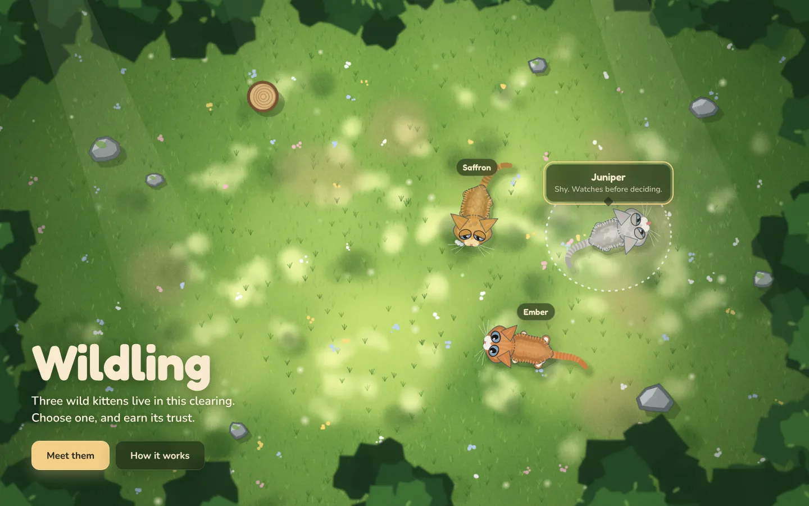
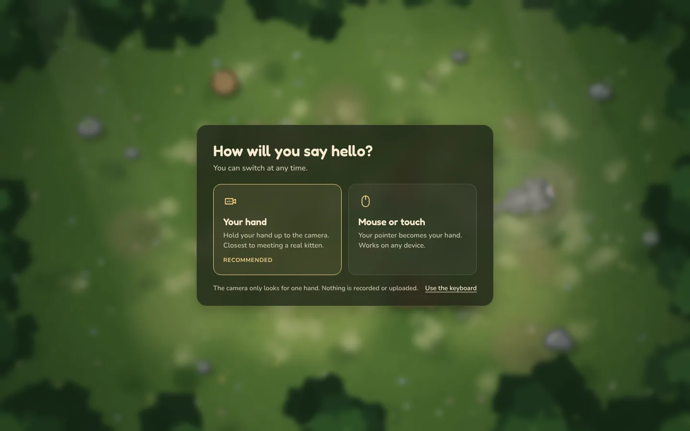
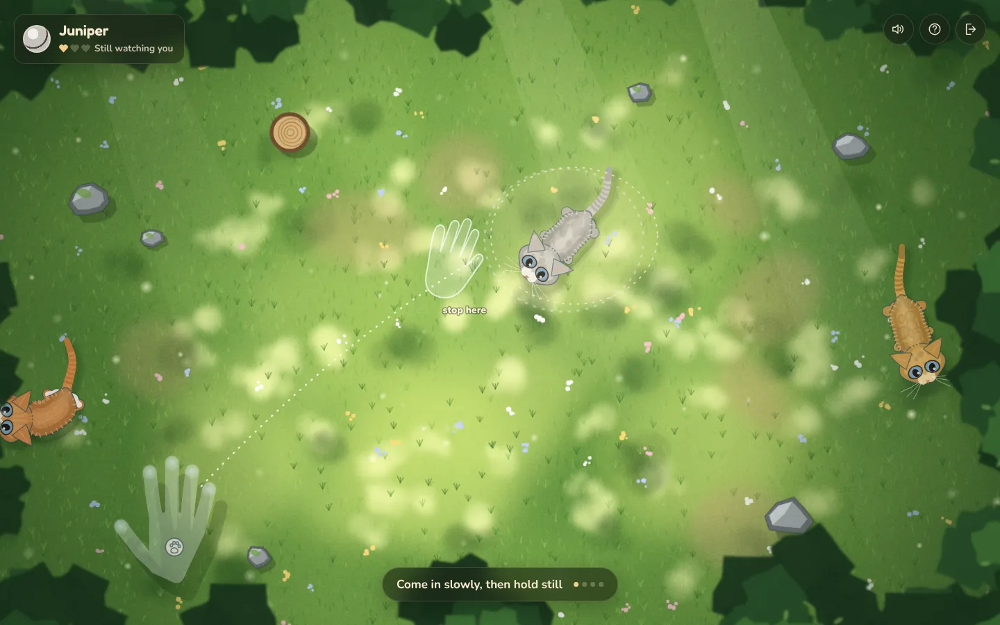
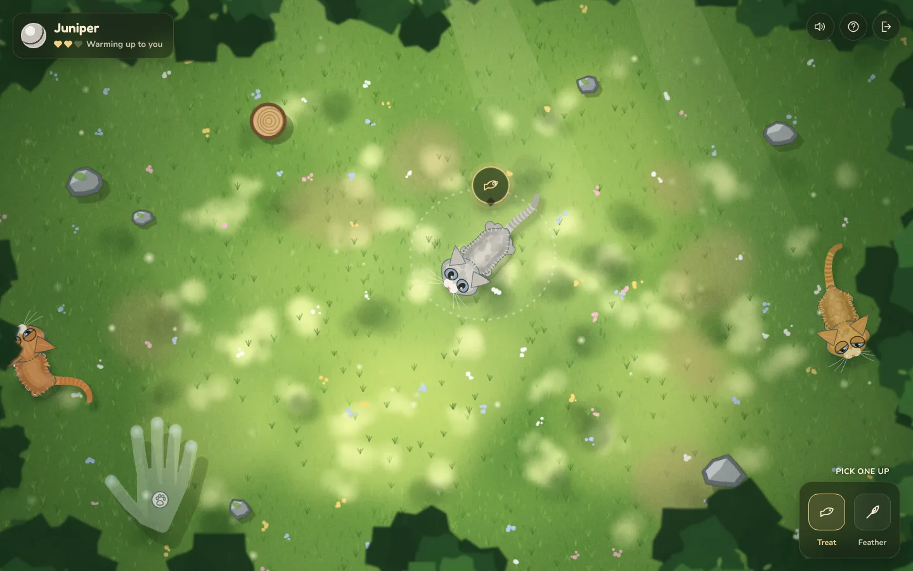
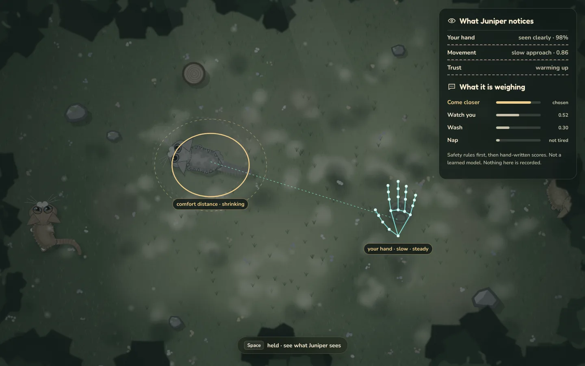
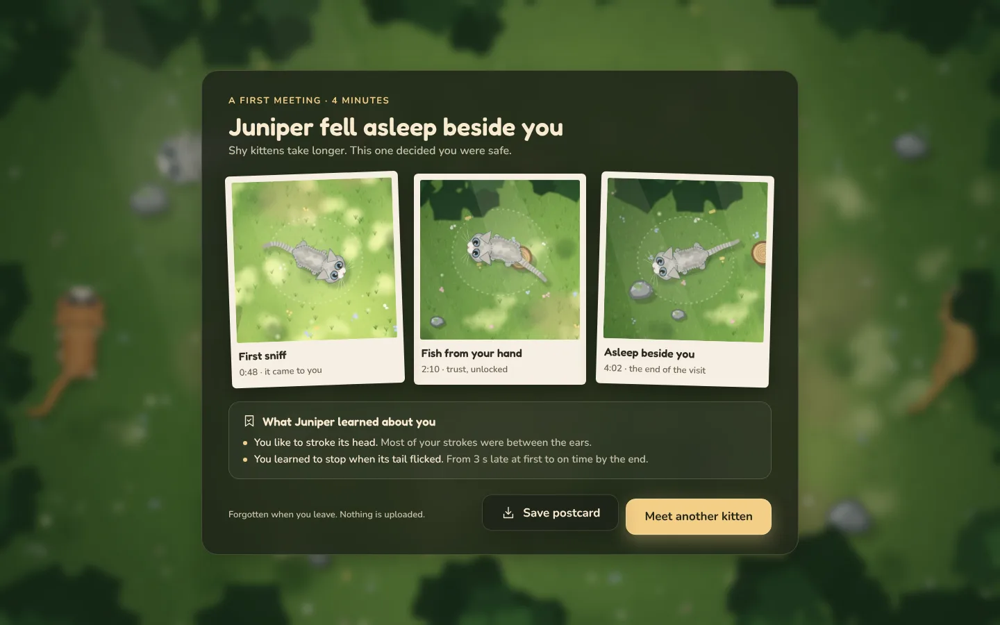
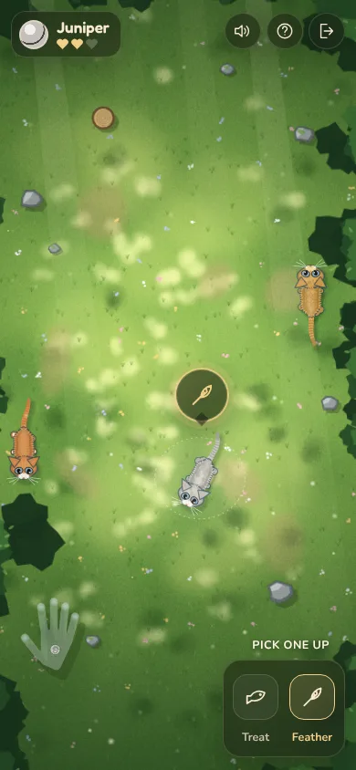

# V3 layout mockups

Drawn over the live V2 scene before the build, to agree the layout and the flow in [`experience-spec-v3.md`](../experience-spec-v3.md). The interface here is an overlay; the clearing and the kittens are the real renderer.

| | |
|---|---|
|  **1 Entry.** The litter is the menu: point at a kitten to meet it, click to choose. |  **2 Input.** One question, asked over the scene. The privacy line sits where it matters. |
|  **3 Act 1.** The comfort ring and a see-through hand show the move; one line of text. |  **4 Act 2.** Name and bond top left, controls top right, the pouch bottom right. The kitten asks with a pictogram. |
|  **5 AI view.** What the kitten notices and what it is weighing, on demand. |  **6 Journal.** Three moments, and what the kitten learned about you. |
|  **7 Phone.** The same three corners. | |
