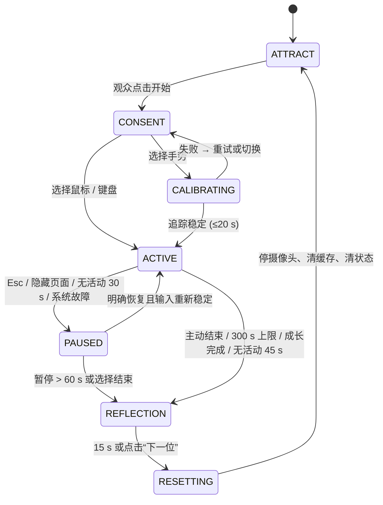

# Wildling 产品需求文档 V2

> 提交项目负责人 · AI 交互体验升级与独立实施方案 · 对应 [Brief V2](../brief/brief-v2.md)
> 编制日期 2026-10-16 · 状态：提交评审 · 原件 [`pdf/prd-v2.pdf`](pdf/prd-v2.pdf)
> 延续 [PRD V1](prd-v1.md) 的产品命题，并在本轮范围内取代其行为、输入和技术规格。
>
> 标注约定同 V1：**[客户]** 客户要求 · **[方案]** 我的方案 · **[待确认]** 需双方确认的取舍。
> 所有新指标均为**待实测目标**，范围确认不等于功能已经完成。实现进度见 [`../STATUS.md`](../STATUS.md)。

**一句话：** 我建议将 Wildling 升级为一套能可靠理解限定动作、表达角色选择并在本轮相处中有限适应的公众互动体验。重点是解决观众无法区分**“系统没有看清”**与**“角色现在不愿接受”**的问题，再把相处历史转成可以被感知和验证的行为变化。

---

## 1 我对升级任务的判断 [方案]

第一轮关注“观众能否理解照料与关系”。新 brief 把问题推进到：**当系统会识别、拒绝和适应时，观众能否理解并信任这种回应。** 因此我保留三工具带来的清晰度，同时把工具从操作命令改为**互动请求**，让输入证据、角色需要和本轮历史共同决定回应。

我的问题判断来自两套原型的代码结构和新 brief，**尚不是用户研究结论**：

| 观察到的问题（来源） | 体验后果 |
|---|---|
| 原型 B 用单一平滑速度阈值区分抚摸/威胁 | 跳点、调整姿势、无意经过被当作意图 |
| 原型 B 中 `tool !== 'PLAY'` 免除所有压力处理 | 工具变成“按下就服从”的开关 |
| 两个原型的信任都是单一累加值 | 观众说不出哪次行为改变了关系 |
| 原型 B 成长用三项平均值 | 单项长期匮乏被平均数掩盖 |
| 两个原型都没有会话概念 | 无法观众轮换，上一位的关系会串入下一位 |

**本轮核心假设：**
1. 明确表达识别状态，可以减少观众自责和重复误操作；
2. 有恢复路径的拒绝，可以增强角色自主性；
3. 三次以上有效相处形成的小幅节奏适应，比单一信任条更能传达关系。

**[方案]** 我建议 P0 完成单人 3–5 分钟体验，Processing Java 正式展示，JavaScript 完成感知和唯一权威逻辑；真正训练并评估一个限定动作模型，同时采用可解释规则和统计适应。生成式语言、多人、完整生态和代际不是本轮核心前置条件。

## 2 与 PRD V1 的变化 [方案]

| 维度 | PRD V1 方案 | V2 中的调整 |
|---|---|---|
| 验证重点 | 理解照料和成长 | 理解识别状态、角色边界与有限适应 |
| 输入理解 | 位置、距离、速度与停留规则 | 手形和时序特征、训练分类、质量门控及拒识 |
| 角色选择 | 优先级状态机 | 硬约束 + 效用选择，**工具只是请求** |
| 需要与关系 | 四项需要和运行内信任 | 新增压力，分离身体需要、关系和输入可靠性 |
| 记忆 | 照料计数和短期信任 | 可核查语义事件、偏好摘要和有界更新 |
| 成长 | 平均需要达到条件 | 增加单项最低值和压力条件，限制重复奖励 |
| 解释反馈 | 气泡与需要条 | 系统原因和角色原因分别反馈，回顾引用事件 |
| 替代输入 | 鼠标完整体验 | 鼠标和键盘完整体验，不依赖捏合 |
| Processing 职责 | 视觉与运动回放验证 | 正式公众画面，接入实时权威状态 |
| 运行方式 | 人工启动和重置的演示 | 会话、离场、自动清场、断连恢复和运维 |
| 交付证据 | 小规模体验与原型演示 | 模型独立测试、适应对比、4 小时与 30 轮验证 |

上表描述方案的递进关系，**不追认 PRD V1 的所有内容均已开发或验收**。前一阶段未完成的部分不能在第二阶段重复算作已具备能力。

## 3 我的关键设计决策 [方案]

### 3.1 先解决误解来自哪里
将**输入证据、意图判断和角色决定**分成三层。看见手 ≠ 知道要做什么；知道动作 ≠ 角色此刻愿意接受。同一次“不响应”必须有可核查的原因：

| 原因层 | 例子 | 反馈方式 | 是否影响关系 |
|---|---|---|---|
| 系统没看清 | 丢手、遮挡、跳点 | 光标/追踪提示 | **否** |
| 动作不确定 | 分类分数不足 | “Hold still for a moment.” | 否 |
| 角色边界 | 疲惫、饱腹、压力高 | 身体姿态 + 短句 | 否（拒绝不扣分） |

只有最后一种属于角色。这是我对 **AI 产品信任问题**的主要回应。

### 3.2 保留工具以降低推断风险
完全自然交互更沉浸，但在短时公众体验中难以判断观众是在调整姿势还是表达照料。工具提供明确上下文，让模型只需辨认限定动作质量。若后续研究证明自然交互足够可靠，再逐步弱化工具界面。

### 3.3 用混合行为系统维护自主性
疲惫、过高压力和无效输入用**硬约束**处理，不能交给概率输出；多个合理需求之间的取舍用**效用评分**。同一动作在不同状态下可以得到不同回应，但相同有效证据不能无原因地得到随机惩罚。每个选择记录候选、禁用条件、惯性和最终原因，可回放、可讨论。

### 3.4 记忆选择少量可验证事实
不在短时展览中建立跨人长期档案。P0 只保存本轮语义事件和少量节奏偏好，结束清除。适应使用**有界统计更新**，不在线训练神经网络。模型负责识别动作，规则负责角色边界，统计负责有限适应，三者在交付中分别说明（见 [AI 能力边界](../ai-boundaries.md)）。

### 3.5 把可解释性放进身体和反馈
不把实时效用分数放在公众主屏。普通观众需要知道“它累了”或“系统丢失了手”，而不是读算法参数。工作人员端保留精确状态与评分。关系回顾从真实语义事件选句，避免角色说出没有发生过的相处。

### 3.6 两种语言采用一份角色状态
Processing Java 升级为正式展示端，但**不复制角色大脑**。浏览器负责相机与模型；本机 JavaScript 服务统一需要、效用、记忆和会话。增加了协议和连接管理工作，却消除了双端信任、成长和判定区不一致的风险。

## 4 需求来源与验收追踪

**[客户]** 目标定义本轮必须解决的问题；**[方案]** 具体参数、模型、反馈和实现路线由我提出。完整矩阵见 [`../traceability.md`](../traceability.md)。

| 编号 | [客户] Brief V2 目标 | [方案] 对应产品规格与证据 |
|---|---|---|
| B2-01 | 公众快速进入体验 | 会话与引导；10 人首次有效操作测试 |
| B2-02 | 理解限定动作并表达不确定 | F2-01–05；独立参与者模型评估与误触报告 |
| B2-03 | 角色保留选择和边界 | F2-06–11；疲惫、饱腹、压力和恢复用例 |
| B2-04 | 本轮历史影响回应 | F2-12；适应开关回放与顺序平衡体验 |
| B2-05 | 解释系统与角色行为 | F2-14–15；原因编码和回顾事实核查 |
| B2-06 | 有效照料推动三章成长 | F2-13；平均值与单项低值的边界测试 |
| B2-07 | Processing 与 JavaScript 协作 | 双端架构和 F2-16；断连和状态一致性测试 |
| B2-08 | 单人轮换和信息清理 | 会话及 F2-17；30 轮无串入与摄像头释放 |
| B2-09 | 无障碍与替代输入 | 鼠标键盘全流程、静音、无捏合验收 |
| B2-10 | 离线和现场持续运行 | 性能与运维规格；断网启动和 4 小时测试 |

## 5 我的职责与实施方式

- **我负责**：需求澄清、产品结构、AI 交互逻辑、界面与动态反馈、模型特征与训练流程、JavaScript 核心、Processing 展示整合、声音、测试和交付说明。文中“必须”描述双方拟采用的产品行为；“我负责”描述承接方拟承担的工作，均不表示已获得未记录的确认。
- **[客户] 项目负责人负责**：策展方向、场地和设备、正式公开文案、范围取舍与阶段验收，并提供测试招募和现场条件。
- **[待确认]** 训练标签 20% 的第二人复核需要客户安排协作者或另行约定资源，不默认我已拥有额外研究团队。
- 先做可回放的鼠标闭环，再接感知与适应，随后完成 Processing 主屏与展场联调。增加多人、账号、长期记忆、完整生态或生成式服务时，先说明增量工作和验收变化。

---

## 6 本轮范围与交付层级

**[方案]** 产品定位：以身体动作建立关系的**可解释 AI 虚拟生命体验**。核心价值三项：能可靠感知观众正在做的限定动作；能根据角色需要选择合适回应；能把本轮互动历史转化为可观察、可重置的微小偏好。开放对话和通用智能不属于核心价值验证。

| 层级 | 范围 |
|---|---|
| **P0** | 单人会话；等待与开始；输入选择与摄像头告知；轻量校准；Feed / Play / Pet 与等待；自主探索、休息和整理；三章成长；动作分类与 unknown；角色状态、效用选择、压力与信任；会话内有限适应；原因反馈；可提前结束；关系回顾；自动清场；工作人员诊断；离线包；Processing 正式展示；浏览器备用展示；操作与测试文档 |
| **P1** | 完整 IK 身体、捕猎子系统、基因花纹、长者与下一代、长时观察模式、主动保存匿名档案 |
| **P2** | 受约束生成式文本、多观众协作、更复杂的在线学习。默认关闭，不得通过隐藏依赖使 P0 必须联网或必须使用账户 |
| **不做** | 真实情绪或人格判断；人脸识别、年龄估计和身份追踪；医疗或动物护理建议；账号、社交和支付；云端原始视频分析 |

## 7 成功定义与指标口径

**[客户]** 指标门槛来自 Brief V2 §9；**[方案]** 测量口径与覆盖率等补充要求由我细化。

| 指标 | 目标 | 测量方法 |
|---|---|---|
| 首次有效操作 | 10 名首次参与者至少 8 名在 30 s 内完成 | 从选择输入且可操作时计时；不含首次系统安装；无口头教学 |
| 原因理解 | 至少 8 名正确说明一次接受或拒绝原因 | 体验后问“刚才为什么没有继续玩”，与 reasonCode 比对 |
| 适应可感知 | 至少 7 名指出具体适应及对应事件 | 排除只说“更喜欢我”；需说到停留、节奏或距离变化 |
| 动作分类 | 独立测试集 macro F1 ≥ 0.85 | 四个已知动作类别；unknown 计作该真实类别漏检，同时报告混淆矩阵 |
| 有效分类覆盖率 | 标准条件下已知动作窗口 ≥ 80% 得到确定分类 | 不能靠全部输出 unknown 获得低误触 |
| 接触误触 | 无接触意图任务中每分钟 ≤ 1 次误入接触 | 至少 20 分钟中性移动与调整姿势任务 |
| 误惩罚 | 无效追踪导致信任下降为 0 | 30 组遮挡、丢手、跳点回放；逐个比对状态与原因 |
| 指针响应 | 输入样本到画面反馈 p95 ≤ 150 ms | 目标设备高帧率录像或时间戳回环 |
| 意图响应 | 动作起始到确认反馈 p95 ≤ 900 ms | 包括 600 ms 观察窗口；不能只报告模型单次推理时间 |
| 运行与轮换 | 4 小时无崩溃，30 轮无会话串入 | 记录构建、模型、设备、温度与模式 |

上述人数是原型评估规模，不能证明总体人群的普适性。低光、背光、不同肤色、手型、左右手与坐姿应分别记录；样本不足的条件列为限制。

## 8 用户角色与关键情境 [方案]

| 角色 | 需要 | 设计回应 |
|---|---|---|
| U01 首次观众 | 立刻知道怎么开始 | 一个清晰主动作、替代输入与即时光标 |
| U02 谨慎或小幅动作的观众 | 不被错误惩罚 | 尺度归一化、校准、较宽有效范围和 unknown |
| U03 不用摄像头或无法捏合 | 完成完整体验 | 鼠标与键盘进入相同决策逻辑，不降低结局质量 |
| U04 旁观者 | 理解发生了什么 | 主画面用姿态与一行解释呈现角色选择 |
| U05 工作人员 | 启动、判断故障和恢复 | 诊断端显示输入、模型、连接与会话状态，可切换模式和重置 |

**关键故事：**
- **US01** 我缓慢靠近时，它能看见我，但在紧张时先观察。
- **US02** 它累了拒绝陪玩，我退后后它休息并放松。
- **US03** 手被遮挡后，我可以继续，不会因系统失误失去关系进度。
- **US04** 相处几次后，它对我稳定的节奏更快作出回应。
- **US05** 我离开后，下一位看到独立的新一轮。

## 9 用户旅程与界面结构 [方案]

| 阶段 | 观众行为 | 主画面 | 系统行为 |
|---|---|---|---|
| 待机 | 观看或经过 | 自主活动的猫与开始入口 | 演示世界无关系记忆，不推进正式成长 |
| 选择 | 选手势或替代输入 | 摄像头用途、输入选项、静音 | 新建会话，初始化配置 |
| 校准 | 把手放到提示区域并移动 | 追踪轮廓、可达范围、跳过 | 检测质量和左右手映射 |
| 探索 | 选工具并尝试 | 角色、工具、短提示、需要线索 | 分类动作，作出行为选择 |
| 调整 | 接受拒绝、放慢或退后 | 姿态与具体原因 | 压力恢复，按有效事件更新记忆 |
| 成长 | 继续照料与观察 | 三章过渡与外观变化 | 校验成长条件并更换环境 |
| 结束 | 主动结束或接受收尾 | 事件支持的关系回顾 | 关闭输入，准备销毁本轮数据 |
| 清场 | 下一人准备 | 回到开始 | 清除状态、缓存、音频及会话标识 |

### 9.1 观众主界面
- 中央为角色与世界；底部是 Feed、Play、Pet 三个大按钮及“给它空间”的说明；角落显示当前输入与可理解的追踪状态；关键原因在角色附近显示。
- 可达、安全距离或可接触区域使用**形状与文字**，不能仅用红绿区分。
- **信任不以百分比作为主要奖励**。P0 用“还在观察、逐渐放松、主动靠近”等角色状态提示；精确数值仅在工作人员端，减少刷数值的游戏策略。

### 9.2 输入替代与键盘
- 鼠标移动控制位置，点击确认；`1` `2` `3` 选择工具；方向键移动虚拟手，空格确认或投放；按住空格并选择 Pet 执行稳定接触；`Esc` 暂停并显示继续、切换输入、结束。
- 替代输入生成显式 intent，`source` 为 `mouse` 或 `keyboard`，**不伪造摄像头模型分数**。
- 焦点顺序与按钮状态可见；捏合不是开始或退出作品的唯一途径；公众主屏优先显示抽象手势而非观众影像。

## 10 会话状态机 [方案]

| 状态 | 进入条件 | 允许行为 | 离开条件 |
|---|---|---|---|
| ATTRACT | 启动或清场结束 | 独立演示循环，等待开始 | 明确开始进入 CONSENT |
| CONSENT | 观众点击开始 | 选择摄像头或替代输入 | 手势进 CALIBRATING，替代进 ACTIVE |
| CALIBRATING | 选择手势 | 质量检查、位置示范，最多 20 s | 稳定后 ACTIVE；失败可重试或切换 |
| ACTIVE | 输入可用且开始本轮 | 正式模拟、记忆、成长 | 暂停、结束、无活动或时间到 |
| PAUSED | 用户暂停、隐藏页面或系统故障 | 显示原因；冻结正式模拟 | 明确恢复后重新稳定输入；或结束 |
| REFLECTION | 用户结束、300 s 上限或成长完成 | 展示回顾，停止接触与成长 | 15 s 或“下一位”进入 RESETTING |
| RESETTING | 收尾完成 | 停摄像头、清缓存、清状态 | 清理确认后 ATTRACT |

- 会话从 ACTIVE 开始计时；同轮暂停超过 60 s 进入 REFLECTION。ACTIVE 达到 180 s 时提供收尾入口，300 s 自动进入回顾；**不要求每轮都长成成年猫**。
- 无活动 = 无有效输入且无人点击控制界面：15 s 显示 “Still there?”，30 s 进入暂停提示，45 s 直接进入回顾。camera 丢手不会立即结束；鼠标停在画面中不代表持续活动。
- **ATTRACT 演示不得共用 ACTIVE 的角色实例或记忆。** 暂停冻结 needs、trust、stress、成长和有效互动时长；渲染仍可保持呼吸动画。断连期间禁止积累动作、投喂或适应事件。

---

## 11 输入处理与感知需求 [方案]

### 11.1 F2-01 输入选择与权限
- 选择手势后才请求摄像头，仅请求视频。拒绝、无设备、占用、库失败和加载超时分别显示可行动提示，并提供立即切换鼠标。**12 s** 无有效视频或模型未就绪即提示失败，不让加载永久占据主流程。
- 退出手势、结束会话或重置时停止 MediaStream 所有 track 并停止检测循环。切换输入须清除速度滤波、捏合锁、动作窗口和待处理命令，防止旧事件沿用。
- 浏览器摄像头需要安全上下文与权限。本机使用 localhost；**不能用“本地运行”替代权限流程**。

### 11.2 F2-02 坐标与时间
- 所有跨程序位置使用归一化内容坐标 x、y ∈ [0,1]，原点左上。输入模块只进行一次镜像变换；Processing 不再镜像。
- 速度单位统一为 **S/s**（屏幕短边/秒），不再混用原型 A 的 U/s 与原型 B 的像素 unit。手形特征以掌宽或腕到中指掌指关节距离归一化。
- 输入带单调递增 seq 与采样时间；窗口按时间重采样，不按渲染帧数取样。模拟步长固定 1/60 s，最多补 5 步；超出视为暂停间隔，**不能用大 dt 扣完精力**。

### 11.3 F2-03 追踪质量门控
- **valid** 必须同时满足：21 个关键点可用；坐标有限且结构合理；掌尺度在可用范围；样本距接收时间 ≤ 200 ms；连续窗口中缺失占比 ≤ 20%；没有超出校准范围的瞬时跳变。
- 在无效或缺失时**立即停止新接触判定与信任惩罚**，冻结相关记忆事件。保持最后位置最多 200 ms 只用于视觉淡出，不可继续喂食、抚摸或计成功。超过 500 ms 显示丢手提示；恢复后稳定 300 ms 再重建动作窗口，第一帧速度初始化为 0。
- 两只手出现时优先保持当前追踪轨迹；无法持续则暂停意图确认并提示“只保留一只手”，不直接采用另一人的手。

### 11.4 F2-04 捏合与显式操作
- 捏合只用于按钮与投放，不作为所有互动的前提。闭合阈值：拇指食指间距 / 掌尺度 < 0.25；释放 > 0.45；闭合需维持 100 ms；冷却 400 ms。命令使用当前已映射样本位置。
- 工具栏优先命中；工具栏上的确认只切换工具，不向世界投放食物。长按、持续捏合和重复包只能产生一个确认，必须释放后重置。切源或丢手时取消未完成捏合。

## 12 动作模型与数据要求 [方案]

### 12.1 F2-05 标签与输出

| 标签 | 可观察定义 | 角色语义 |
|---|---|---|
| `gentle_approach` | 稳定张手缓慢靠近角色交互区 | 允许观察或发出接触邀请 |
| `stable_contact` | 张手在接触区持续低速稳定停留 | Pet 工具下可申请接触 |
| `fast_approach` | 高质量轨迹快速朝角色近身区域移动 | 可能引起警觉，结合工具与角色状态判断 |
| `neutral_motion` | 普通移动、离角色较远或调整姿态 | 不构成照料或惩罚 |
| `unknown` | 无法可靠区分已知类别或超出质量范围 | 不作情绪解释，不扣信任 |
| `lost` | 无手或过期输入 | 停止互动，必要时提示恢复 |

前四类是训练类别。`unknown` 是质量与分数拒识结果，`lost` 是跟踪状态，两者不冒充训练类别。`withdraw` 由高质量轨迹到远离区域持续 1 s 的**几何规则**产生，并明确标识 rule 来源。模型不输出“观众善意、愤怒、喜欢我”等心理判断；工具选择与角色上下文在模型后融合。

### 12.2 输入特征与建议模型
- 以最近 600 ms 为一个窗口，按 20 Hz 重采样为 12 个时间点，100 ms 运行一次分类。每点提取掌心位置、速度与加速度、朝角色方向的速度分量、距身体轮廓距离、张手程度、捏合比例、轨迹稳定度及关键点有效掩码。
- 建议使用 TensorFlow.js 的小型时序网络（一维卷积 + 全局池化 + 四类 softmax）；同时保留**归一化统计特征 + 小型全连接网络**作为复杂度基线。架构通过独立验证集比较，不能凭网络更深认定更好。训练与推理均可用 JavaScript。
- 每个模型包含 `labelMap, featureVersion, windowMs, sampleRateHz, normalization, modelVersion` 和模型文件校验值。模型缺失或版本不兼容时进入明示的**规则备用模式**，并标记评估数据，不把备用结果算作 ML 指标。

### 12.3 数据采集与划分
- 首轮招募 16 名明确同意采集的参与者，四类动作每人每类 20 个独立片段，至少 1,280 个片段；覆盖左右手、快慢幅度、站坐姿和目标展场光照。
- **按参与者划分**：10 人训练、3 人验证、3 人测试。同一人同一次动作及其重叠窗口只能属于同一分区，防止连续帧泄漏。
- 标签来自脚本指示加人工复核，不能用旧速度阈值自动标注后又验证自己。随机抽取 20% 片段由第二人复核。
- 默认只保存匿名参与者编号、时间、标签和归一化关键点；不保存面部、音频或原始视频。原始关键点只在明确的训练采集模式下保存；交付后 30 天删除临时研究副本。

### 12.4 分类确认与拒识
- 初始阈值：最高分 ≥ 0.80，且第一与第二名差 ≥ 0.20，连续两个 100 ms 推理周期满足才确认；否则 unknown。阈值由验证集冻结，必须同时满足覆盖率与误触要求。
- **softmax 分数只是模型输出，不应直接宣称“80% 真实概率”**。观众端只展示确定、待确认、丢失三种状态。
- 600 ms 窗口 + 一个确认周期的起步延迟约 700 ms，再计推理、通信和显示。若 p95 超 900 ms，先优化调度与窗口，不能从指标中删掉观察时间。

### 12.5 模型验收与回退
- 提交四类 precision、recall、F1、macro F1、按人混淆矩阵、unknown 占比、覆盖率、每分钟误触、真实摄像头端到端延迟和低光结果。未知压力集包含遮挡、单帧跳点、手退出再进入、多手切换和普通身体经过。
- 若学习模型对旧阈值基线没有改善，**不自动作为上线默认**。P0 的 AI 感知验收未达标时属于待完成项，规则模式可用于现场备用，但不能把模型工作标成完成。
