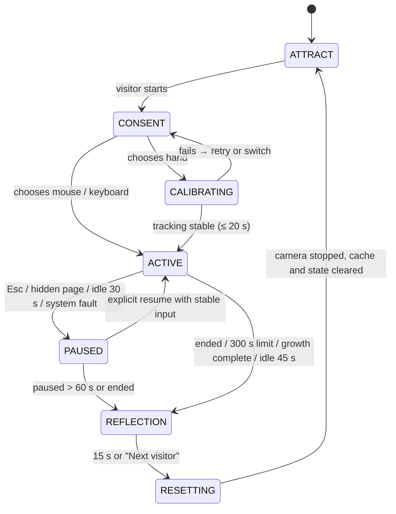

# Wildling: Product Requirements Document V2

> Submitted to the project lead · AI interaction upgrade and implementation plan · Responds to [Brief V2](../brief/brief-v2.md)
> Date 2026-10-16 · Status: submitted for review · PDF [`pdf/prd-v2.pdf`](pdf/prd-v2.pdf)
> Continues the product claim of [PRD V1](prd-v1.md) and, within this round's scope, replaces its behaviour, input and technical specs.
>
> Source tags as in V1: **[Client]** project lead's requirement · **[Proposal]** my proposal · **[To confirm]** trade-off needing sign-off.
> New figures are targets for acceptance testing. Implementation progress is tracked in [`../STATUS.md`](../STATUS.md).

**In one sentence:** I propose turning Wildling into a public interactive experience that reliably understands a small set of actions, expresses the character's choices, and adapts within limits during the session. The priority is solving visitors' inability to tell **"the system didn't see clearly"** from **"the character doesn't want this right now"**, then turning shared history into behaviour changes people can notice and verify.

---

## 1 My assessment [Proposal]

Round one asked "can visitors understand care and relationship?". The new brief asks: **when the system recognises, refuses and adapts, can visitors understand and trust that response?** I keep the clarity that the tools gave, but turn tools from commands into **requests**, so that input evidence, the character's needs and this session's history decide the response together.

My assessment comes from analysing both prototypes against the new brief. The usability study in §24 validates it.

| Observed issue (source) | Experience consequence |
|---|---|
| Prototype B separates petting from threat with a single smoothed speed threshold | Jumps, posture changes and passers-by are read as intent |
| Prototype B's `tool !== 'PLAY'` exempts all stress handling | A tool becomes a "press to obey" switch |
| Both prototypes keep trust as one running number | Visitors cannot say which action changed the relationship |
| Prototype B grows on the average of three needs | Long-term neglect of one need is hidden by the average |
| Neither prototype has a session | No visitor turnover; one visitor's relationship leaks into the next |

**Core hypotheses for this round:**
1. Clearly showing recognition state reduces visitor self-blame and repeated wrong actions.
2. Refusals with a path to recovery strengthen the character's autonomy.
3. A small rhythm adaptation formed by three or more valid encounters conveys the relationship better than a single trust bar.

**[Proposal]** P0 is a 3–5 minute single-visitor experience with a Processing Java exhibition display and JavaScript for perception and the single authoritative logic. A bounded gesture model is genuinely trained and evaluated, alongside explainable rules and statistical adaptation. Generative language, multiple visitors, full ecology and generations are not prerequisites for this round.

## 2 Changes from PRD V1 [Proposal]

| Dimension | PRD V1 | PRD V2 |
|---|---|---|
| Validation focus | Understanding care and growth | Understanding recognition state, character boundaries and bounded adaptation |
| Input understanding | Position, distance, speed and dwell rules | Hand-shape and temporal features, a trained classifier, quality gating and rejection |
| Character choice | Priority state machine | Hard constraints + utility selection; **tools are requests** |
| Needs and relationship | Four needs and session trust | Adds stress; separates physical needs, relationship and input reliability |
| Memory | Care counts and short-term trust | Verifiable semantic events, preference summaries and bounded updates |
| Growth | Average of needs crosses a threshold | Adds per-need minimums and a stress condition; caps repeated rewards |
| Explanation | Bubbles and need bars | System reasons and character reasons shown separately; recap cites events |
| Alternative input | Full mouse experience | Full mouse and keyboard experience, no pinch required |
| Processing role | Visual and motion replay study | Exhibition display connected to live authoritative state |
| Operation | Manually started and reset demo | Sessions, exits, auto-turnover, disconnect recovery and operations |
| Evidence | Small experience test and prototype demo | Held-out model testing, adaptation comparison, 4-hour and 30-round runs |

The table shows how the plan progresses. Work not finished in the first stage is counted as work for this stage, not as an existing capability.

## 3 Key design decisions [Proposal]

### 3.1 Find out where misunderstanding comes from
Separate **input evidence, intent and character decision** into three layers. Seeing a hand is not knowing what it wants; knowing the action is not the character agreeing to it. Binding all three together makes technical faults look like the character's mood and makes refusals inconsistent. Every "no response" therefore has a checkable cause:

| Cause layer | Example | Feedback | Affects relationship? |
|---|---|---|---|
| The system did not see clearly | Lost hand, occlusion, jump | Cursor and tracking cue | **No** |
| The action is not clear yet | Classifier score too low | "Hold still for a moment." | No |
| Character boundary | Tired, full, stressed | Posture + a short line | No (refusals are free) |

Only the last belongs to the character. This is my main answer to the AI product trust problem.

### 3.2 Keep the tools to reduce inference risk
Fully natural interaction is more immersive, but in a short public session it is hard to tell whether a visitor is adjusting posture or offering care. Tools give the model clear context, so it only needs to judge the quality of a few actions. Visitors need not memorise many gestures, and no single hand shape becomes everyone's only input. If research later shows natural interaction is reliable enough, the tool UI can be reduced step by step.

### 3.3 Protect autonomy with a hybrid behaviour system
Exhaustion, high stress and invalid input are handled by **hard constraints**, not probabilistic output. Trade-offs between several reasonable needs use **utility scoring**. The same action can get different responses in different states, but the same valid evidence never gets an unexplained random penalty. Every choice records its candidates, blocked conditions, inertia and final reason, so it can be replayed and discussed.

### 3.4 Remember a few verifiable facts
No cross-visitor long-term profiles in a short exhibition. P0 keeps only this session's semantic events and a few rhythm preferences, cleared at the end. Adaptation uses **bounded statistical updates**, not online neural training. The model recognises actions, rules hold character boundaries, statistics drive bounded adaptation, and the deliverables describe each separately (see [AI capability boundaries](../ai-boundaries.md)).

### 3.5 Put explainability into the body and feedback
Live utility scores stay off the public screen. Visitors need to know "it's tired" or "the system lost your hand", not algorithm parameters. The main screen uses posture and short hints; the staff view keeps exact state and scores. The recap chooses lines from real semantic events, so the character never describes time together that did not happen. Free chat and generative stories are deferred: they cannot prove that body-based interaction is reliable, and they add content and latency risk.

### 3.6 One character state across two languages
Processing Java becomes the exhibition display but does not get its own copy of the brain. The browser handles camera and model; a local JavaScript service owns needs, utility, memory and sessions; Java and the browser show the same state. This adds protocol and connection work but removes the risk of the two clients disagreeing on trust, growth or contact zones. It also keeps the browser as a backup display and lets one anonymous replay separate interaction issues from rendering issues.

## 4 Requirement sources and acceptance tracking

**[Client]** goals define the problems this round must solve; **[Proposal]** the parameters, model, feedback and route are mine. Changes update this table and the acceptance cases, not just a chat thread. Full matrix: [`../traceability.md`](../traceability.md).

| ID | [Client] Brief V2 goal | [Proposal] Spec and evidence |
|---|---|---|
| B2-01 | Visitors get started quickly | Sessions and guidance; 10-person first-action test |
| B2-02 | Understand bounded actions and express uncertainty | F2-01–05; held-out-participant model evaluation and false-trigger report |
| B2-03 | The character keeps its choices and boundaries | F2-06–11; tired, full, stressed and recovery cases |
| B2-04 | This session's history shapes responses | F2-12; adaptation on/off replay and counterbalanced study |
| B2-05 | Explain system and character behaviour | F2-14–15; reason codes and recap fact checks |
| B2-06 | Effective care drives three-chapter growth | F2-13; boundary tests for average versus per-need minimum |
| B2-07 | Processing and JavaScript work together | Two-client architecture and F2-16; disconnect and state-consistency tests |
| B2-08 | Single-visitor turnover and data clearing | Sessions and F2-17; 30 rounds with no leakage and camera release |
| B2-09 | Accessibility and alternative input | Full mouse and keyboard flow, mute, no-pinch acceptance |
| B2-10 | Offline and continuous venue operation | Performance and operations spec; offline start and 4-hour test |

## 5 My role and how I work

- **I own:** requirement clarification, product structure, AI interaction logic, interface and motion feedback, model features and training pipeline, the JavaScript core, Processing display integration, sound, testing and delivery notes. "Must" in this document describes product behaviour both sides intend to adopt; "I own" describes work I intend to take on.
- **[Client] The project lead owns:** curatorial direction, venue and devices, final public copy, scope decisions and phase acceptance, plus test recruitment and venue conditions.
- **[To confirm]** A second reviewer for 20 % of training labels needs a collaborator arranged by the project lead or agreed separately.
- I build the replayable mouse loop first, then perception and adaptation, then the Processing main display and venue integration. Adding multiple visitors, accounts, long-term memory, full ecology or generative services starts with a statement of extra work and acceptance changes.

---

## 6 Scope and tiers

**[Proposal]** Positioning: an **explainable AI virtual-life experience in which relationships are built through body movement**. Three core values: reliably perceiving the bounded action a visitor is making; choosing a fitting response from the character's needs; and turning this session's history into small, observable, resettable preferences. Open dialogue and general intelligence are not part of the core value.

| Tier | Scope |
|---|---|
| **P0** | Single-visitor session; attract and start; input choice and camera notice; light calibration; Feed, Play, Pet and wait; autonomous exploring, rest and grooming; three-chapter growth; gesture classification with `unknown`; character state, utility selection, stress and trust; bounded in-session adaptation; reason feedback; early exit; relationship recap; auto-turnover; staff diagnostics; offline package; Processing exhibition display; browser backup display; operating and test docs |
| **P1** | Full IK body, hunting subsystem, genetic coats, elders and next generation, long observation mode, opt-in anonymous profile |
| **P2** | Constrained generative text, multi-visitor play, more complex online learning. Off by default; P0 must never depend on the network or an account through a hidden dependency |
| **Out** | Real emotion or personality judgement; face recognition, age estimation or identity tracking; medical or animal-care advice; accounts, social and payments; cloud raw-video analysis |

## 7 Success metrics and how they are measured

**[Client]** thresholds come from Brief V2 §9; **[Proposal]** the measurement details, including coverage, are mine.

| Metric | Target | Measurement |
|---|---|---|
| First effective action | At least 8 of 10 first-time participants within 30 s | Timed from input choice to being able to act; excludes first-time system setup; no verbal teaching |
| Reason understood | At least 8 correctly explain one acceptance or refusal | After the session ask "why didn't it keep playing just now?" and compare with the reasonCode |
| Adaptation noticed | At least 7 name a specific adaptation and its event | "It likes me more" does not count; must mention dwell, tempo or distance |
| Gesture classification | Macro F1 ≥ 0.85 on held-out participants | Four known classes; `unknown` counts as a miss for the true class; confusion matrix reported |
| Classification coverage | ≥ 80 % of known-action windows get a confident class under standard conditions | Prevents "refuse everything" from looking accurate |
| False contact | ≤ 1 false contact per minute in no-contact tasks | At least 20 minutes of neutral movement and posture adjustment |
| Unfair penalty | Zero trust loss from invalid tracking | 30 replayed occlusion, lost-hand and jump cases, state and reason compared one by one |
| Pointer response | Sample to on-screen feedback p95 ≤ 150 ms | On target device, high-frame-rate video or timestamp loop-back |
| Intent response | Action start to confirmation feedback p95 ≤ 900 ms | Includes the 600 ms observation window, not only model inference time |
| Run and turnover | 4 hours without a crash; 30 rounds without leakage | Logs build, model, device, temperature and mode |

These sample sizes are prototype-evaluation scale. Low light, backlight, skin tones, hand shapes, left and right hands and sitting are recorded separately; under-sampled conditions are listed as limits. Launch readiness is judged in the target venue, not by one high accuracy figure.

## 8 Users and key situations [Proposal]

| User | Need | Design answer |
|---|---|---|
| U01 First-time visitor | Know immediately how to start | One clear main action, alternative inputs and an instant cursor |
| U02 Cautious or small movements | Not be wrongly penalised | Scale normalisation, calibration, a wider valid range and `unknown` |
| U03 No camera or cannot pinch | Complete the full experience | Mouse and keyboard enter the same decision logic without a worse ending |
| U04 Bystander | Understand what happened | The main screen shows choices through posture and one line |
| U05 Staff | Start, diagnose and recover | Diagnostics show input, model, connection and session; switch modes and reset |

**Key stories:**
- **US01** When I approach slowly, it sees me, but when it's tense it watches first.
- **US02** It's tired and turns down play; I step back, it rests and relaxes.
- **US03** After my hand is occluded I can carry on without losing relationship progress to a system error.
- **US04** After a few encounters it responds faster to my steady rhythm.
- **US05** When I leave, the next person sees a separate new round.

## 9 Journey and interface structure [Proposal]

| Stage | Visitor | Main screen | System |
|---|---|---|---|
| Attract | Watches or passes | The litter living on its own, with an entry point | Demo world with no relationship memory and no formal growth |
| Choose | Picks hand or alternative input | Camera purpose, input options, mute | New session, initial configuration |
| Calibrate | Puts a hand in the guide and moves | Tracking outline, reach, skip | Checks quality and hand mapping |
| Explore | Chooses a tool and tries | Character, tools, short hints, need cues | Classifies actions and chooses behaviour |
| Adjust | Accepts a refusal, slows down or steps back | Posture and a specific reason | Stress recovers; memory updates from valid events |
| Grow | Keeps caring and watching | Chapter transitions and changing appearance | Checks growth conditions and switches environment |
| End | Ends or accepts the close | Event-based relationship recap | Closes input, prepares to destroy session data |
| Turnover | Next visitor gets ready | Back to start | Clears state, cache, audio and session ID |

### 9.1 Visitor screen
- The character and world in the centre; Feed, Play, Pet and "Give space" at the bottom; current input and readable tracking state in a corner; key reasons shown near the character.
- Reachable, safe-distance or contact areas use **shape and words**, never colour alone.
- **Trust is not a percentage reward.** P0 uses character phrases such as "Still watching you", "Warming up to you" and "Comes to you"; exact values are staff-only, which also discourages grinding.

### 9.2 Alternative input and keyboard
- Mouse to move and click to confirm; `1` `2` `3` `4` to choose a tool; arrow keys move a virtual hand; Space confirms or drops; holding Space with Pet means steady contact; `Esc` pauses with continue, switch input and end.
- Alternative inputs produce explicit intent with `source` = `mouse` or `keyboard`, and **never fake camera model scores**.
- Focus order and button states are visible. Pinch is never the only way to start or leave. The camera preview stays in the control view and can be turned off; the public screen shows an abstract hand rather than the visitor's image.

## 10 Session state machine [Proposal]

| State | Enters when | Allows | Leaves when |
|---|---|---|---|
| ATTRACT | Start-up or turnover complete | Independent demo loop, waiting | Explicit start → CONSENT |
| CONSENT | Visitor starts | Choose camera or alternative input | Hand → CALIBRATING; alternative → ACTIVE |
| CALIBRATING | Hand chosen | Quality check, position demo, ≤ 20 s | Stable → ACTIVE; failure → retry or switch |
| ACTIVE | Input usable and round started | Formal behaviour, memory, growth | Pause, end, idle or time limit |
| PAUSED | User pause, hidden page or fault | Show the reason; formal state frozen | Explicit resume with re-stabilised input, or end |
| REFLECTION | User ends, 300 s limit or growth complete | Show recap; contact and growth stop | 15 s or "Next visitor" → RESETTING |
| RESETTING | Close finished | Stop camera, clear cache and state | Clearing confirmed → ATTRACT |

- The clock starts in ACTIVE. A pause longer than 60 s goes to REFLECTION. At 180 s an ending option appears; at 300 s the recap starts automatically. **Not every round needs to reach adulthood.**
- Idle = no valid input and no clicks: "Still there?" at 15 s, a pause prompt at 30 s, the recap at 45 s. A lost camera hand does not end the round at once; a mouse resting on screen is not activity.
- **ATTRACT never shares the ACTIVE character instance or memory.** A pause freezes needs, trust, stress, growth and active time; rendering can keep a breathing animation. While disconnected, no actions, feeding or adaptation events accumulate.

---

## 11 Input and perception [Proposal]

### 11.1 F2-01 Input choice and permission
- The camera is requested only after the hand is chosen, video only. Denied, no device, in use, library failure and load timeout each get an actionable message and an immediate mouse switch. After **12 s** without valid video or a ready model, it reports failure; loading never holds the main flow hostage.
- Leaving hand mode, ending a session or resetting stops every MediaStream track and the detection loop. Switching input clears speed filters, pinch locks, action windows and pending commands so nothing carries over.
- The browser camera needs a secure context and permission. Locally the package uses localhost; **"runs locally" never replaces the permission flow**.

### 11.2 F2-02 Coordinates and time
- All cross-program positions use normalised content coordinates x, y ∈ [0, 1], origin top-left. Only the input module mirrors, once, verified with a raised hand; Processing does not mirror again.
- Speed is always **S/s** (short screen side per second), replacing Prototype A's U/s and Prototype B's pixel unit. Hand-shape features normalise by palm width or wrist-to-middle-knuckle distance; below a minimum palm size the sample is invalid.
- Inputs carry a monotonic `seq` and sample time. The receiver computes timeouts on its own monotonic clock. Windows resample by time, never by frame count. The fixed step is 1/60 s with at most 5 catch-up steps; longer gaps are pauses, never one large dt that drains energy.

### 11.3 F2-03 Tracking-quality gate
- **valid** requires all of: 21 usable keypoints; finite, structurally plausible coordinates; palm size in range; sample age ≤ 200 ms; ≤ 20 % missing in the window; no jump beyond the calibrated range.
- When invalid or missing, **new contact decisions and trust penalties stop at once** and related memory events freeze. The last position may be held up to 200 ms for visual fade only. After 500 ms a lost-hand hint appears; after recovery the action window rebuilds only after 300 ms of stability, with first-frame speed at 0.
- With two hands, the current track is kept; if it cannot continue, intent confirmation pauses with "One hand at a time." It never jumps to another person's hand.

### 11.4 F2-04 Pinch and explicit actions
- Pinch is for buttons and dropping food, not a prerequisite for every interaction. Close at thumb–index gap / palm size < 0.25, release at > 0.45, hold 100 ms, cooldown 400 ms. A command uses the current mapped sample, not the previous frame's cursor.
- The toolbar has priority; a confirm on the toolbar only switches tools and never drops food. Long holds, continuous pinches and repeated packets produce one confirm until released. Switching source or losing the hand cancels a pending pinch.

## 12 Gesture model and data [Proposal]

### 12.1 F2-05 Labels and outputs

| Label | Observable definition | Character meaning |
|---|---|---|
| `gentle_approach` | A steady open hand moving slowly toward the interaction zone | May observe or invite contact |
| `stable_contact` | An open hand staying low-speed and steady in the contact zone | Under Pet, may request contact |
| `fast_approach` | A high-quality trajectory moving quickly into the close zone | May cause alertness, combined with tool and state |
| `neutral_motion` | Ordinary movement, far away, or posture adjustment | Neither care nor penalty |
| `unknown` | Cannot reliably distinguish known classes, or out of quality range | No emotional reading; no trust change |
| `lost` | No hand or stale input | Interaction stops; recovery hint if needed |

The first four are trained classes. `unknown` is a rejection result and `lost` is a tracking state; neither is a trained class. `withdraw` is a **geometric rule** (a high-quality trajectory to a far zone held for 1 s) and is labelled as rule-sourced. The model never outputs "kind, angry, likes me" or any mental judgement; tool and character context are fused after the model, so a label is never directly a character action.

### 12.2 Features and proposed model
- A 600 ms window resampled at 20 Hz to 12 time points, classified every 100 ms. Each point carries palm centre, speed and acceleration, speed toward the character, distance to the body outline, openness, pinch ratio, trajectory stability and a keypoint validity mask.
- Proposed: a small TensorFlow.js temporal network (1D convolution + global pooling + 4-way softmax), with **normalised statistical features + a small dense network** as the complexity baseline. Architecture is chosen on a held-out validation set, not on depth. Training and inference both run in JavaScript.
- Normalisation parameters are fitted on the training set and exported with the model. Each model carries `labelMap, featureVersion, windowMs, sampleRateHz, normalization, modelVersion` and a checksum. A missing or incompatible model falls back to a clearly labelled **rule baseline**, which is never counted as an ML metric.

### 12.3 Data capture and splits
- Round one recruits 16 consenting participants; 20 independent clips per class per person, at least 1,280 clips, covering left and right hands, fast and slow, standing and sitting, and venue lighting.
- **Split by participant:** 10 train, 3 validation, 3 test. All clips and overlapping windows from one person stay in one split. Test is about 240 clips; per-person results and limits are reported.
- Labels come from scripted prompts plus manual review, never from old speed thresholds that would then validate themselves. 20 % of clips get a second reviewer; undecidable clips become ambiguous and go into the rejection stress set.
- Stored by default: anonymous participant code, time, label and normalised keypoints only. No face, audio or raw video. Raw keypoints are kept only in an explicit capture mode; the public exhibit stores no trajectories. Research copies are deleted 30 days after handover.

### 12.4 Confirmation and rejection
- Start thresholds: top score ≥ 0.80 and top-minus-second ≥ 0.20, held for two consecutive 100 ms cycles; otherwise `unknown`. Thresholds are frozen on the validation set and must satisfy coverage and false-trigger targets together.
- **A softmax score is a model output, not "80 % true probability".** Visitors see three states only: confirmed, confirming, lost.
- 600 ms window + one confirmation cycle gives about 700 ms of start latency, plus inference, transport and display. If p95 exceeds 900 ms, scheduling and windowing are optimised first; observation time is never removed from the metric.

### 12.5 Model acceptance and fallback
- Deliver per-class precision, recall and F1, macro F1, per-person confusion matrices, unknown rate, coverage, false triggers per minute, end-to-end latency on a real camera and low-light results. The stress set includes occlusion, single-frame jumps, hands leaving and re-entering, multi-hand switches and ordinary body movement.
- If the learned model does not beat the threshold baseline, it is not made the default. The failure cause, re-collection or narrower conditions are documented. The rule mode can serve as venue backup, but the model milestone is only closed when its targets are met.
