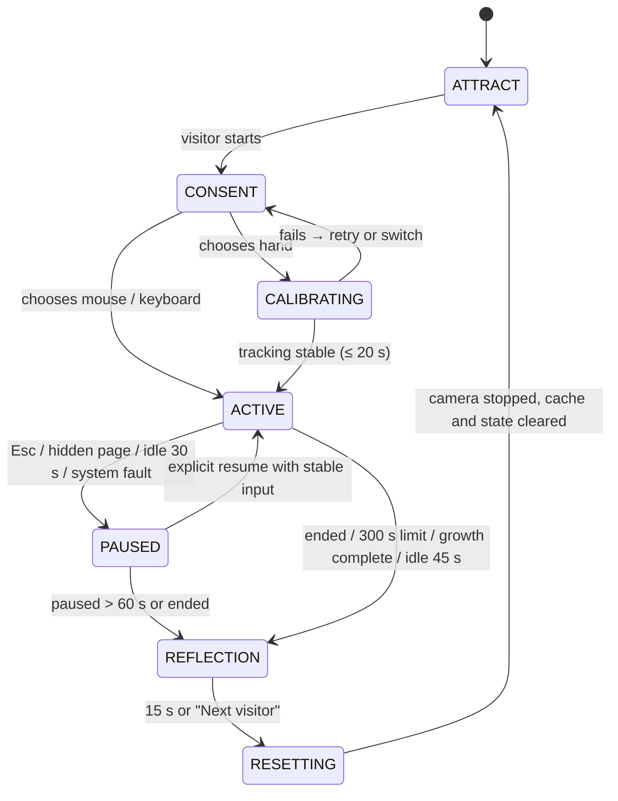
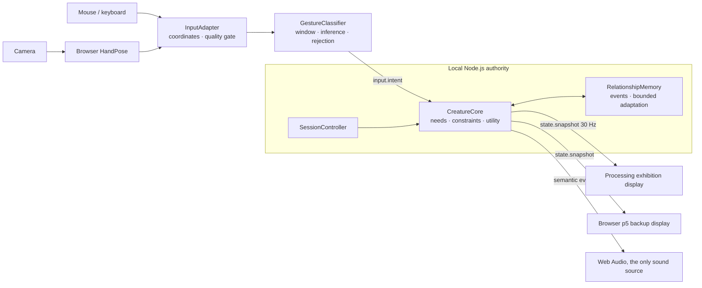

# Wildling: Product Requirements Document V2

> Submitted to the project lead · AI interaction upgrade and implementation plan · Responds to [Brief V2](../brief/brief-v2.md)
> Date 2026-10-16 · Status: submitted for review · PDF [`pdf/prd-v2.pdf`](pdf/prd-v2.pdf)
> Continues the product claim of [PRD V1](prd-v1.md) and, within this round's scope, replaces its behaviour, input and technical specs.
>
> Source tags as in V1: **[Client]** project lead's requirement · **[Proposal]** my proposal · **[To confirm]** trade-off needing sign-off.
> New figures are targets for acceptance testing. Implementation progress is tracked in [`../STATUS.md`](../STATUS.md).

**In one sentence:** I propose turning Wildling into a public interactive experience that reliably understands a small set of actions, expresses the character's choices, and adapts within limits during the session. The priority is solving visitors' inability to tell **"the system didn't see clearly"** from **"the character doesn't want this right now"**, then turning shared history into behaviour changes people can notice and verify.

---

## 1 My assessment [Proposal]

Round one asked "can visitors understand care and relationship?". The new brief asks: **when the system recognises, refuses and adapts, can visitors understand and trust that response?** I keep the clarity that the tools gave, but turn tools from commands into **requests**, so that input evidence, the character's needs and this session's history decide the response together.

My assessment comes from analysing both prototypes against the new brief. The usability study in §24 validates it.

| Observed issue (source) | Experience consequence |
|---|---|
| Prototype B separates petting from threat with a single smoothed speed threshold | Jumps, posture changes and passers-by are read as intent |
| Prototype B's `tool !== 'PLAY'` exempts all stress handling | A tool becomes a "press to obey" switch |
| Both prototypes keep trust as one running number | Visitors cannot say which action changed the relationship |
| Prototype B grows on the average of three needs | Long-term neglect of one need is hidden by the average |
| Neither prototype has a session | No visitor turnover; one visitor's relationship leaks into the next |

**Core hypotheses for this round:**
1. Clearly showing recognition state reduces visitor self-blame and repeated wrong actions.
2. Refusals with a path to recovery strengthen the character's autonomy.
3. A small rhythm adaptation formed by three or more valid encounters conveys the relationship better than a single trust bar.

**[Proposal]** P0 is a 3–5 minute single-visitor experience with a Processing Java exhibition display and JavaScript for perception and the single authoritative logic. A bounded gesture model is genuinely trained and evaluated, alongside explainable rules and statistical adaptation. Generative language, multiple visitors, full ecology and generations are not prerequisites for this round.

## 2 Changes from PRD V1 [Proposal]

| Dimension | PRD V1 | PRD V2 |
|---|---|---|
| Validation focus | Understanding care and growth | Understanding recognition state, character boundaries and bounded adaptation |
| Input understanding | Position, distance, speed and dwell rules | Hand-shape and temporal features, a trained classifier, quality gating and rejection |
| Character choice | Priority state machine | Hard constraints + utility selection; **tools are requests** |
| Needs and relationship | Four needs and session trust | Adds stress; separates physical needs, relationship and input reliability |
| Memory | Care counts and short-term trust | Verifiable semantic events, preference summaries and bounded updates |
| Growth | Average of needs crosses a threshold | Adds per-need minimums and a stress condition; caps repeated rewards |
| Explanation | Bubbles and need bars | System reasons and character reasons shown separately; recap cites events |
| Alternative input | Full mouse experience | Full mouse and keyboard experience, no pinch required |
| Processing role | Visual and motion replay study | Exhibition display connected to live authoritative state |
| Operation | Manually started and reset demo | Sessions, exits, auto-turnover, disconnect recovery and operations |
| Evidence | Small experience test and prototype demo | Held-out model testing, adaptation comparison, 4-hour and 30-round runs |

The table shows how the plan progresses. Work not finished in the first stage is counted as work for this stage, not as an existing capability.

## 3 Key design decisions [Proposal]

### 3.1 Find out where misunderstanding comes from
Separate **input evidence, intent and character decision** into three layers. Seeing a hand is not knowing what it wants; knowing the action is not the character agreeing to it. Binding all three together makes technical faults look like the character's mood and makes refusals inconsistent. Every "no response" therefore has a checkable cause:

| Cause layer | Example | Feedback | Affects relationship? |
|---|---|---|---|
| The system did not see clearly | Lost hand, occlusion, jump | Cursor and tracking cue | **No** |
| The action is not clear yet | Classifier score too low | "Hold still for a moment." | No |
| Character boundary | Tired, full, stressed | Posture + a short line | No (refusals are free) |

Only the last belongs to the character. This is my main answer to the AI product trust problem.

### 3.2 Keep the tools to reduce inference risk
Fully natural interaction is more immersive, but in a short public session it is hard to tell whether a visitor is adjusting posture or offering care. Tools give the model clear context, so it only needs to judge the quality of a few actions. Visitors need not memorise many gestures, and no single hand shape becomes everyone's only input. If research later shows natural interaction is reliable enough, the tool UI can be reduced step by step.

### 3.3 Protect autonomy with a hybrid behaviour system
Exhaustion, high stress and invalid input are handled by **hard constraints**, not probabilistic output. Trade-offs between several reasonable needs use **utility scoring**. The same action can get different responses in different states, but the same valid evidence never gets an unexplained random penalty. Every choice records its candidates, blocked conditions, inertia and final reason, so it can be replayed and discussed.

### 3.4 Remember a few verifiable facts
No cross-visitor long-term profiles in a short exhibition. P0 keeps only this session's semantic events and a few rhythm preferences, cleared at the end. Adaptation uses **bounded statistical updates**, not online neural training. The model recognises actions, rules hold character boundaries, statistics drive bounded adaptation, and the deliverables describe each separately (see [AI capability boundaries](../ai-boundaries.md)).

### 3.5 Put explainability into the body and feedback
Live utility scores stay off the public screen. Visitors need to know "it's tired" or "the system lost your hand", not algorithm parameters. The main screen uses posture and short hints; the staff view keeps exact state and scores. The recap chooses lines from real semantic events, so the character never describes time together that did not happen. Free chat and generative stories are deferred: they cannot prove that body-based interaction is reliable, and they add content and latency risk.

### 3.6 One character state across two languages
Processing Java becomes the exhibition display but does not get its own copy of the brain. The browser handles camera and model; a local JavaScript service owns needs, utility, memory and sessions; Java and the browser show the same state. This adds protocol and connection work but removes the risk of the two clients disagreeing on trust, growth or contact zones. It also keeps the browser as a backup display and lets one anonymous replay separate interaction issues from rendering issues.

## 4 Requirement sources and acceptance tracking

**[Client]** goals define the problems this round must solve; **[Proposal]** the parameters, model, feedback and route are mine. Changes update this table and the acceptance cases, not just a chat thread. Full matrix: [`../traceability.md`](../traceability.md).

| ID | [Client] Brief V2 goal | [Proposal] Spec and evidence |
|---|---|---|
| B2-01 | Visitors get started quickly | Sessions and guidance; 10-person first-action test |
| B2-02 | Understand bounded actions and express uncertainty | F2-01–05; held-out-participant model evaluation and false-trigger report |
| B2-03 | The character keeps its choices and boundaries | F2-06–11; tired, full, stressed and recovery cases |
| B2-04 | This session's history shapes responses | F2-12; adaptation on/off replay and counterbalanced study |
| B2-05 | Explain system and character behaviour | F2-14–15; reason codes and recap fact checks |
| B2-06 | Effective care drives three-chapter growth | F2-13; boundary tests for average versus per-need minimum |
| B2-07 | Processing and JavaScript work together | Two-client architecture and F2-16; disconnect and state-consistency tests |
| B2-08 | Single-visitor turnover and data clearing | Sessions and F2-17; 30 rounds with no leakage and camera release |
| B2-09 | Accessibility and alternative input | Full mouse and keyboard flow, mute, no-pinch acceptance |
| B2-10 | Offline and continuous venue operation | Performance and operations spec; offline start and 4-hour test |

## 5 My role and how I work

- **I own:** requirement clarification, product structure, AI interaction logic, interface and motion feedback, model features and training pipeline, the JavaScript core, Processing display integration, sound, testing and delivery notes. "Must" in this document describes product behaviour both sides intend to adopt; "I own" describes work I intend to take on.
- **[Client] The project lead owns:** curatorial direction, venue and devices, final public copy, scope decisions and phase acceptance, plus test recruitment and venue conditions.
- **[To confirm]** A second reviewer for 20 % of training labels needs a collaborator arranged by the project lead or agreed separately.
- I build the replayable mouse loop first, then perception and adaptation, then the Processing main display and venue integration. Adding multiple visitors, accounts, long-term memory, full ecology or generative services starts with a statement of extra work and acceptance changes.

---

## 6 Scope and tiers

**[Proposal]** Positioning: an **explainable AI virtual-life experience in which relationships are built through body movement**. Three core values: reliably perceiving the bounded action a visitor is making; choosing a fitting response from the character's needs; and turning this session's history into small, observable, resettable preferences. Open dialogue and general intelligence are not part of the core value.

| Tier | Scope |
|---|---|
| **P0** | Single-visitor session; attract and start; input choice and camera notice; light calibration; Feed, Play, Pet and wait; autonomous exploring, rest and grooming; three-chapter growth; gesture classification with `unknown`; character state, utility selection, stress and trust; bounded in-session adaptation; reason feedback; early exit; relationship recap; auto-turnover; staff diagnostics; offline package; Processing exhibition display; browser backup display; operating and test docs |
| **P1** | Full IK body, hunting subsystem, genetic coats, elders and next generation, long observation mode, opt-in anonymous profile |
| **P2** | Constrained generative text, multi-visitor play, more complex online learning. Off by default; P0 must never depend on the network or an account through a hidden dependency |
| **Out** | Real emotion or personality judgement; face recognition, age estimation or identity tracking; medical or animal-care advice; accounts, social and payments; cloud raw-video analysis |

## 7 Success metrics and how they are measured

**[Client]** thresholds come from Brief V2 §9; **[Proposal]** the measurement details, including coverage, are mine.

| Metric | Target | Measurement |
|---|---|---|
| First effective action | At least 8 of 10 first-time participants within 30 s | Timed from input choice to being able to act; excludes first-time system setup; no verbal teaching |
| Reason understood | At least 8 correctly explain one acceptance or refusal | After the session ask "why didn't it keep playing just now?" and compare with the reasonCode |
| Adaptation noticed | At least 7 name a specific adaptation and its event | "It likes me more" does not count; must mention dwell, tempo or distance |
| Gesture classification | Macro F1 ≥ 0.85 on held-out participants | Four known classes; `unknown` counts as a miss for the true class; confusion matrix reported |
| Classification coverage | ≥ 80 % of known-action windows get a confident class under standard conditions | Prevents "refuse everything" from looking accurate |
| False contact | ≤ 1 false contact per minute in no-contact tasks | At least 20 minutes of neutral movement and posture adjustment |
| Unfair penalty | Zero trust loss from invalid tracking | 30 replayed occlusion, lost-hand and jump cases, state and reason compared one by one |
| Pointer response | Sample to on-screen feedback p95 ≤ 150 ms | On target device, high-frame-rate video or timestamp loop-back |
| Intent response | Action start to confirmation feedback p95 ≤ 900 ms | Includes the 600 ms observation window, not only model inference time |
| Run and turnover | 4 hours without a crash; 30 rounds without leakage | Logs build, model, device, temperature and mode |

These sample sizes are prototype-evaluation scale. Low light, backlight, skin tones, hand shapes, left and right hands and sitting are recorded separately; under-sampled conditions are listed as limits. Launch readiness is judged in the target venue, not by one high accuracy figure.

## 8 Users and key situations [Proposal]

| User | Need | Design answer |
|---|---|---|
| U01 First-time visitor | Know immediately how to start | One clear main action, alternative inputs and an instant cursor |
| U02 Cautious or small movements | Not be wrongly penalised | Scale normalisation, calibration, a wider valid range and `unknown` |
| U03 No camera or cannot pinch | Complete the full experience | Mouse and keyboard enter the same decision logic without a worse ending |
| U04 Bystander | Understand what happened | The main screen shows choices through posture and one line |
| U05 Staff | Start, diagnose and recover | Diagnostics show input, model, connection and session; switch modes and reset |

**Key stories:**
- **US01** When I approach slowly, it sees me, but when it's tense it watches first.
- **US02** It's tired and turns down play; I step back, it rests and relaxes.
- **US03** After my hand is occluded I can carry on without losing relationship progress to a system error.
- **US04** After a few encounters it responds faster to my steady rhythm.
- **US05** When I leave, the next person sees a separate new round.

## 9 Journey and interface structure [Proposal]

| Stage | Visitor | Main screen | System |
|---|---|---|---|
| Attract | Watches or passes | The litter living on its own, with an entry point | Demo world with no relationship memory and no formal growth |
| Choose | Picks hand or alternative input | Camera purpose, input options, mute | New session, initial configuration |
| Calibrate | Puts a hand in the guide and moves | Tracking outline, reach, skip | Checks quality and hand mapping |
| Explore | Chooses a tool and tries | Character, tools, short hints, need cues | Classifies actions and chooses behaviour |
| Adjust | Accepts a refusal, slows down or steps back | Posture and a specific reason | Stress recovers; memory updates from valid events |
| Grow | Keeps caring and watching | Chapter transitions and changing appearance | Checks growth conditions and switches environment |
| End | Ends or accepts the close | Event-based relationship recap | Closes input, prepares to destroy session data |
| Turnover | Next visitor gets ready | Back to start | Clears state, cache, audio and session ID |

### 9.1 Visitor screen
- The character and world in the centre; Feed, Play, Pet and "Give space" at the bottom; current input and readable tracking state in a corner; key reasons shown near the character.
- Reachable, safe-distance or contact areas use **shape and words**, never colour alone.
- **Trust is not a percentage reward.** P0 uses character phrases such as "Still watching you", "Warming up to you" and "Comes to you"; exact values are staff-only, which also discourages grinding.

### 9.2 Alternative input and keyboard
- Mouse to move and click to confirm; `1` `2` `3` `4` to choose a tool; arrow keys move a virtual hand; Space confirms or drops; holding Space with Pet means steady contact; `Esc` pauses with continue, switch input and end.
- Alternative inputs produce explicit intent with `source` = `mouse` or `keyboard`, and **never fake camera model scores**.
- Focus order and button states are visible. Pinch is never the only way to start or leave. The camera preview stays in the control view and can be turned off; the public screen shows an abstract hand rather than the visitor's image.

## 10 Session state machine [Proposal]



| State | Enters when | Allows | Leaves when |
|---|---|---|---|
| ATTRACT | Start-up or turnover complete | Independent demo loop, waiting | Explicit start → CONSENT |
| CONSENT | Visitor starts | Choose camera or alternative input | Hand → CALIBRATING; alternative → ACTIVE |
| CALIBRATING | Hand chosen | Quality check, position demo, ≤ 20 s | Stable → ACTIVE; failure → retry or switch |
| ACTIVE | Input usable and round started | Formal behaviour, memory, growth | Pause, end, idle or time limit |
| PAUSED | User pause, hidden page or fault | Show the reason; formal state frozen | Explicit resume with re-stabilised input, or end |
| REFLECTION | User ends, 300 s limit or growth complete | Show recap; contact and growth stop | 15 s or "Next visitor" → RESETTING |
| RESETTING | Close finished | Stop camera, clear cache and state | Clearing confirmed → ATTRACT |

- The clock starts in ACTIVE. A pause longer than 60 s goes to REFLECTION. At 180 s an ending option appears; at 300 s the recap starts automatically. **Not every round needs to reach adulthood.**
- Idle = no valid input and no clicks: "Still there?" at 15 s, a pause prompt at 30 s, the recap at 45 s. A lost camera hand does not end the round at once; a mouse resting on screen is not activity.
- **ATTRACT never shares the ACTIVE character instance or memory.** A pause freezes needs, trust, stress, growth and active time; rendering can keep a breathing animation. While disconnected, no actions, feeding or adaptation events accumulate.

---

## 11 Input and perception [Proposal]

### 11.1 F2-01 Input choice and permission
- The camera is requested only after the hand is chosen, video only. Denied, no device, in use, library failure and load timeout each get an actionable message and an immediate mouse switch. After **12 s** without valid video or a ready model, it reports failure; loading never holds the main flow hostage.
- Leaving hand mode, ending a session or resetting stops every MediaStream track and the detection loop. Switching input clears speed filters, pinch locks, action windows and pending commands so nothing carries over.
- The browser camera needs a secure context and permission. Locally the package uses localhost; **"runs locally" never replaces the permission flow**.

### 11.2 F2-02 Coordinates and time
- All cross-program positions use normalised content coordinates x, y ∈ [0, 1], origin top-left. Only the input module mirrors, once, verified with a raised hand; Processing does not mirror again.
- Speed is always **S/s** (short screen side per second), replacing Prototype A's U/s and Prototype B's pixel unit. Hand-shape features normalise by palm width or wrist-to-middle-knuckle distance; below a minimum palm size the sample is invalid.
- Inputs carry a monotonic `seq` and sample time. The receiver computes timeouts on its own monotonic clock. Windows resample by time, never by frame count. The fixed step is 1/60 s with at most 5 catch-up steps; longer gaps are pauses, never one large dt that drains energy.

### 11.3 F2-03 Tracking-quality gate
- **valid** requires all of: 21 usable keypoints; finite, structurally plausible coordinates; palm size in range; sample age ≤ 200 ms; ≤ 20 % missing in the window; no jump beyond the calibrated range.
- When invalid or missing, **new contact decisions and trust penalties stop at once** and related memory events freeze. The last position may be held up to 200 ms for visual fade only. After 500 ms a lost-hand hint appears; after recovery the action window rebuilds only after 300 ms of stability, with first-frame speed at 0.
- With two hands, the current track is kept; if it cannot continue, intent confirmation pauses with "One hand at a time." It never jumps to another person's hand.

### 11.4 F2-04 Pinch and explicit actions
- Pinch is for buttons and dropping food, not a prerequisite for every interaction. Close at thumb–index gap / palm size < 0.25, release at > 0.45, hold 100 ms, cooldown 400 ms. A command uses the current mapped sample, not the previous frame's cursor.
- The toolbar has priority; a confirm on the toolbar only switches tools and never drops food. Long holds, continuous pinches and repeated packets produce one confirm until released. Switching source or losing the hand cancels a pending pinch.

## 12 Gesture model and data [Proposal]

### 12.1 F2-05 Labels and outputs

| Label | Observable definition | Character meaning |
|---|---|---|
| `gentle_approach` | A steady open hand moving slowly toward the interaction zone | May observe or invite contact |
| `stable_contact` | An open hand staying low-speed and steady in the contact zone | Under Pet, may request contact |
| `fast_approach` | A high-quality trajectory moving quickly into the close zone | May cause alertness, combined with tool and state |
| `neutral_motion` | Ordinary movement, far away, or posture adjustment | Neither care nor penalty |
| `unknown` | Cannot reliably distinguish known classes, or out of quality range | No emotional reading; no trust change |
| `lost` | No hand or stale input | Interaction stops; recovery hint if needed |

The first four are trained classes. `unknown` is a rejection result and `lost` is a tracking state; neither is a trained class. `withdraw` is a **geometric rule** (a high-quality trajectory to a far zone held for 1 s) and is labelled as rule-sourced. The model never outputs "kind, angry, likes me" or any mental judgement; tool and character context are fused after the model, so a label is never directly a character action.

### 12.2 Features and proposed model
- A 600 ms window resampled at 20 Hz to 12 time points, classified every 100 ms. Each point carries palm centre, speed and acceleration, speed toward the character, distance to the body outline, openness, pinch ratio, trajectory stability and a keypoint validity mask.
- Proposed: a small TensorFlow.js temporal network (1D convolution + global pooling + 4-way softmax), with **normalised statistical features + a small dense network** as the complexity baseline. Architecture is chosen on a held-out validation set, not on depth. Training and inference both run in JavaScript.
- Normalisation parameters are fitted on the training set and exported with the model. Each model carries `labelMap, featureVersion, windowMs, sampleRateHz, normalization, modelVersion` and a checksum. A missing or incompatible model falls back to a clearly labelled **rule baseline**, which is never counted as an ML metric.

### 12.3 Data capture and splits
- Round one recruits 16 consenting participants; 20 independent clips per class per person, at least 1,280 clips, covering left and right hands, fast and slow, standing and sitting, and venue lighting.
- **Split by participant:** 10 train, 3 validation, 3 test. All clips and overlapping windows from one person stay in one split. Test is about 240 clips; per-person results and limits are reported.
- Labels come from scripted prompts plus manual review, never from old speed thresholds that would then validate themselves. 20 % of clips get a second reviewer; undecidable clips become ambiguous and go into the rejection stress set.
- Stored by default: anonymous participant code, time, label and normalised keypoints only. No face, audio or raw video. Raw keypoints are kept only in an explicit capture mode; the public exhibit stores no trajectories. Research copies are deleted 30 days after handover.

### 12.4 Confirmation and rejection
- Start thresholds: top score ≥ 0.80 and top-minus-second ≥ 0.20, held for two consecutive 100 ms cycles; otherwise `unknown`. Thresholds are frozen on the validation set and must satisfy coverage and false-trigger targets together.
- **A softmax score is a model output, not "80 % true probability".** Visitors see three states only: confirmed, confirming, lost.
- 600 ms window + one confirmation cycle gives about 700 ms of start latency, plus inference, transport and display. If p95 exceeds 900 ms, scheduling and windowing are optimised first; observation time is never removed from the metric.

### 12.5 Model acceptance and fallback
- Deliver per-class precision, recall and F1, macro F1, per-person confusion matrices, unknown rate, coverage, false triggers per minute, end-to-end latency on a real camera and low-light results. The stress set includes occlusion, single-frame jumps, hands leaving and re-entering, multi-hand switches and ordinary body movement.
- If the learned model does not beat the threshold baseline, it is not made the default. The failure cause, re-collection or narrower conditions are documented. The rule mode can serve as venue backup, but the model milestone is only closed when its targets are met.

## 13 Behaviour and character state [Proposal]

### 13.1 F2-06 State

| Field | Start and range | Meaning |
|---|---|---|
| fullness | 0.55, 0–1 | How fed |
| energy | 0.80, 0–1 | Current energy |
| fun | 0.50, 0–1 | Play satisfaction |
| trust | 0.25, 0–1 | This session's character relationship, **not a rating of the visitor** |
| stress | 0.15, 0–1 | Current stress; recovers with time and space |
| ageProgress | 0, 0–3 | Continuous growth across three chapters |
| phase | kitten / juvenile / adult | From the progress interval; 3 starts the recap |
| behaviour | OBSERVE | Current behaviour |
| acceptedContact | false | Whether the character has accepted current contact |

### 13.2 Hard-constraint order
1. Session freeze and system errors → 2. input validity → 3. close-range stress protection and very low energy → 4. uninterruptible short actions → 5. utility selection among legal candidates. Every constraint emits a `reasonCode` and records the candidate scores it overrode.

- Below 0.15 energy it must rest, and play reopens only at 0.65. Above 0.65 stress it refuses new contact and leaves recovery below 0.40. **High trust never bypasses these.** Invalid tracking never counts as a threat and never lowers trust.
- Eating locks for 1.2 s; it can be interrupted by session end or system pause, not reset by tool switching. Rest holds at least 3 s so visitors never see state flicker.

### 13.3 F2-07 Utility selection
Initial utilities on normalised state, clamped to 0–1. **These are design formulas to tune, not copies of either prototype.**

| Behaviour | Initial utility | Available when |
|---|---|---|
| EXPLORE | 0.25 + 0.10 × fun | Not frozen and able to move |
| SEEK_FOOD | 0.10 + 0.90 × (1 − fullness) | Valid food present and fullness < 0.85 |
| REST | 0.10 + 0.90 × (1 − energy) | Always; forced at very low energy |
| GROOM | 0.15 + 0.15 × fullness − 0.10 × stress | Cooldown finished |
| APPROACH | 0.20 + 0.40 × trust − 0.50 × stress | A valid gentle invitation |
| PLAY | 0.15 + 0.50 × (1 − fun) + 0.20 × trust | Play tool, energy > 0.35 and stress < 0.40 |
| CONTACT | 0.35 + 0.30 × trust − 0.40 × stress | Pet tool, stable intent, character has invited |
| RETREAT | 0.20 + 0.70 × stress − 0.20 × trust | High-quality close stimulus or contact timeout |

- Decide every 250 ms. The current behaviour gets +0.10 inertia; a new behaviour must beat the current score by 0.15 and the current one must have held for 600 ms.
- An explicitly confirmed care request adds a **+0.25 request boost** to its legal candidate, so valid invitations are not buried under exploring inertia. The boost never re-enables a behaviour a hard constraint has blocked.
- Ties keep the current behaviour, otherwise a fixed order. **Randomness only changes exploration paths and visual detail; it never removes trust or skips needed rest.**
- If no active candidate is legal, OBSERVE or REST is chosen; there is never an empty state. Staff see the top two candidates, blocked reasons, inertia and the winning reason; visitors see no numbers.

### 13.4 Threat versus play
- `fast_approach` can raise stress only when a high-quality trajectory really moves toward the body, enters the radius and is confirmed. Fast movement far away, leaving the frame and jumps are not threats. Start radius 0.18 S, speed reference 1.1 S/s, checked against calibration and validation data.
- In Play mode, with low stress and the character showing a play invitation, fast movement is chasing the toy. If the toy keeps crossing the body and stress rises, the character can still end play. **A tool is never a blanket exemption from stress handling, unlike `tool !== 'PLAY'` in Prototype B.**

## 14 Care and boundaries [Proposal]

| ID | Feature | Rule | Refusals and boundaries |
|---|---|---|---|
| F2-08 | Feed | Drops a fish after an explicit confirm; at most 3 at once; 600 ms confirm cooldown. On a completed meal: fullness +0.25, trust +0.025, each from a single `eat_completed` event | At fullness ≥ 0.85 it refuses with "I'm full. Let's slow down." and no relationship change. Food cannot land on the toolbar or unreachable edges. Dropped, accepted and eaten are different events; the recap counts eaten. Below fullness 0.20 new contact pauses with a food hint |
| F2-09 | Play | The character accepts the invitation before chasing; each pounce on the toy is one `pounce_success`: fun +0.12, energy −0.04, trust +0.01, at least 1.5 s apart | Refuses when tired or stressed and turns to rest or observing with a reason; moving the toy away is not failure; **at least one natural pause after 20 s of continuous play** |
| F2-10 | Pet | Pet + `stable_contact` is only a **request**. The character first shows where contact is welcome; after the current dwell (start 0.8 s) it enters CONTACT. Accepted contact: trust +0.02/s, stress −0.08/s | At most 6 s per segment, then a reposition or pause. **At most 12 s of trust-earning contact per rolling 60 s.** A fast entry, sleep or high stress means no contact; refusals cost nothing; the first refusal also tells the visitor what to try |
| F2-11 | Wait and step back | A hand beyond 0.25 S, steady for 1 s, ends contact and lets the character recover. Waiting: stress −0.05/s (ordinary calm −0.02/s; not cumulative) | Stepping back and recovering to low stress records one `space_respected`, never per frame. Waiting costs neither trust nor growth; there is no death penalty |

### 14.5 Base decay and trust
- In ACTIVE: fullness −0.004/s, fun −0.003/s, energy −0.003/s; resting +0.035/s. Extra play cost comes from pounce events and active play drain; no two modules subtract the same cost.
- A valid close scare adds stress +0.15 with a 2 s cooldown. A high-quality scare still continuing after 2 s lowers trust by 0.01/s, **at most 0.05 per episode**, and stops the moment tracking becomes uncertain. All fields clamp to 0–1 and the log records each source. Parameters are checked by full-round replay so no loop of hunger, exhaustion and refusal can become unrecoverable.

## 15 Bounded memory and adaptation [Proposal]

### 15.1 F2-12 What is remembered and for how long
- Each round keeps only **the last 20 semantic events** and three preference summaries: successful contact dwell, successful play tempo and accepted approach distance. Events carry `id, type, simulationTime, source, validity`, before and after state, `reasonCode` and the measurement. Unconfirmed input, incomplete actions, pauses and lost tracking are **never success or failure samples**.
- Role memory is live in ACTIVE, read-only in REFLECTION and destroyed in RESETTING. Trust, stress, preferences and raw action data never carry to the next visitor.

### 15.2 Update rules
Each preference computes a target median only after **at least 3 independent valid events**; new = old × 0.8 + target × 0.2, at most once per 10 s. Without enough evidence the default stays; random numbers never fill history.

| Preference | Start / range | Target source | Product meaning |
|---|---|---|---|
| contactDwell | 0.8 s / 0.5–1.2 s | For a contact held 2 s without stress interruption, palm RMS jitter j → clamp(0.5 + 20j, 0.5, 1.2) | How long the system waits to confirm steadiness, **not a trait of the person** |
| playTempoScale | 1.0 / 0.85–1.15 | Interval t between successful pounces → clamp(2/t, 0.85, 1.15) | Multiplies the character's chase speed |
| approachRadius | 0.10 S / 0.08–0.12 S | Accepted gentle-approach distance, clamped to range | Size of the character's invitation zone |

A session's preferences **cannot change** the trajectory-quality gate, hard energy limits, rejection thresholds or accessibility entry points. The interface says "getting used to this rhythm", **never "I know your personality"**.

### 15.3 Verifying adaptation
- One fixed event replay runs with `adaptation_on` and `adaptation_off`, same initial state and seed. At minimum: no update after events 1–2; a bounded change after the 3rd; no update during pauses or `unknown`; defaults restored at the end. Visual changes must come from the summary parameters, not different random animation.
- The study uses a **counterbalanced** pair of short sessions: one with fixed parameters, one with bounded adaptation. Of 10 participants, 5 start with each. The two use separate sessions and the briefing never hints which is "smarter". Preference votes never replace performance metrics.

## 16 Growth and world [Proposal]

### 16.1 F2-13 Growth conditions
- W = mean(fullness, energy, fun). **Growth accumulates only while W ≥ 0.55, all three ≥ 0.20, stress ≤ 0.40 and the session is ACTIVE.** This fixes the Prototype B weakness where long neglect of one need was hidden by the average.
- Rate: (1/80) × (1 + 0.25 × trust) per second, so 0 → 3 needs about 192–240 s of qualifying time; poor care and pauses make it longer. At the 300 s limit the round still ends normally without padding progress.
- Repeated rewards from one tool cap within a minute; growth never forces all three kinds of care. Waiting, rest and different inputs all complete the experience; visitors with limited mobility are never stuck in a chapter.

- **Revision after the build review [Proposal], see ADR-013:** the gate above is unchanged. Behind it, growth now combines a slower drift (1/150 per second × (1 + 0.25 × trust)) with a burst for each completed act of care (meal 0.08, catch 0.04, quiet contact ≥ 1.5 s 0.10, space given 0.06, wrestle 0.09, hunt 0.06, gift 0.07 of a chapter), capped per cause at 0.24 per minute. Attentive, varied care takes about one minute per chapter; neglect cannot finish within the 300 s limit. A growth meter shows progress to the next chapter, the gating needs and the blocking reason.

### 16.2 Three chapters
0–1 kitten in the forest; 1–2 juvenile in the snowfields; 2–3 adult in the desert. A 1.5 s transition pauses new actions, keeps state and shows a chapter cue; changing scene never clears trust or preferences. P0 does not inherit Prototype A's 1.35× snow energy cost or full hunting, to keep the learning load low.
- **Revision after the build review [Proposal], see ADR-012 and ADR-013:** the transition is 4 s with a title card listing what changed. Each chapter has a distinct body and one new ability: Chapter I yarn play and rough-and-tumble with the litter; Chapter II hunting a passing critter (a simplified, single-pounce hunt, not Prototype A's full hunting); Chapter III bringing a gift to a visitor it trusts. Becoming fully grown is celebrated before the reflection screen.

## 17 Explanation and feedback [Proposal]

### 17.1 F2-14 Reason codes

| reasonCode | Visitor copy | Meaning | Owner |
|---|---|---|---|
| `TRACKING_LOST` | I lost your hand. Hold it in the guide. | The system can't see; no relationship penalty | System |
| `INTENT_UNCERTAIN` | Hold still for a moment. | Action not confirmed yet | System |
| `NEED_REST` | I'm tired. Give me a little space. | Energy boundary refuses play | Character |
| `TOO_FULL` | I'm full. Let's slow down. | Full; refuses food | Character |
| `NOT_READY` | Let me come closer first. | The character hasn't invited contact yet | Character |
| `CONTACT_ACCEPTED` | This feels gentle. | Valid contact confirmed | Result |
| `PRESSURE_HIGH` | A little more distance, please. | High stress; retreats | Character |
| `RHYTHM_ADAPTED` | I'm getting used to this rhythm. | A preference summary updated | Result |
| `SPACE_RESPECTED` | Thanks for giving me time to rest. | One verifiable step back and recovery | Result |

- **"System uncertain" and "character refusing" must look different.** The first uses the cursor and tracking cue; the second uses body movement and a reason. Neither looks like an angry cat.
- Priority: system recovery > character boundary > care result > general guidance. A hint repeats at most every 4 s; one area shows one main hint; resolved errors fade so an old lost-hand hint never covers a current acceptance. Mute keeps all key visual feedback.

### 17.2 F2-15 Recap
- Lines come from event templates, at most three, **each citing a verifiable event type**. Without successful play it cannot say "we played for ages"; one contact cannot become "you were always patient". With little data: "We spent a quiet moment together." It never invents the visitor's motives.
- Show effective feeds, successful play, accepted contact time and one relationship change. No care ranking, empathy score or moral comment. "Next visitor" and restart make clear the new round starts with an empty relationship.

### 17.3 P2 generative recap (not in P0)
If a language model is added later, it receives only an anonymous structured summary and candidate fact IDs, and returns one or two short lines with `evidenceIds`. The server checks length, citations, forbidden inferences and language; a 2 s timeout, an invalid citation or any error falls back to the fixed template. **Generated text never enters the Brain, calls action tools, changes values or decides trust.** API keys stay server-side with a per-round call limit and budget; raw action data never leaves by default. This needs its own scope and data notes.

---

## 18 Architecture across two languages

**[Client]** Processing Java renders the exhibition display; JavaScript handles perception; a local Node.js service owns the single character state; the brain runs once. **[Proposal]** The deployment and module design below are mine.



| Module | Language | Sole responsibility |
|---|---|---|
| InputAdapter | JavaScript, browser | Video permission, keypoints, mouse and keyboard, coordinates and quality |
| GestureClassifier | JavaScript, browser | Features, windows, inference, rejection, model version |
| SessionController | JavaScript, Node.js | Sessions, timers, turnover, connections and input ownership |
| CreatureCore | JavaScript, Node.js | Needs, hard constraints, utility, movement targets, growth, semantic events |
| RelationshipMemory | JavaScript, Node.js | Summaries, bounded adaptation, recap facts |
| ExhibitionRenderer | Processing Java | Body and scenes, interpolation, main-screen cues, state expression |
| BrowserRenderer | JavaScript p5.js | Development and backup display, consuming the same state |
| SoundAdapter | JavaScript Web Audio | Consumes semantic events and state; the only sound source |

- Node.js steps at a fixed 60 Hz, scores behaviour at 4 Hz and snapshots at 30 Hz. Processing targets 60 fps and interpolates the latest snapshot, **never changing trust itself**. Browser input positions are sent at up to 30 Hz, classification at 10 Hz, explicit commands immediately with acknowledgement.
- **Porting to Processing:** p5.Vector, Canvas Path2D, DOM, Web Audio and ml5 do not run in Java mode. The Java side rebuilds visuals with PVector, PGraphics, shapes and a custom skeleton; audio and the hand model stay in the browser. The P0 body at least has heading interpolation, gait, tail, rest pose and stress expression. The eight-joint spine and two-bone IK are P1. Java 11+ uses `java.net.http.WebSocket` as a client; callbacks assemble fragments into a thread-safe queue and `draw` reads the latest snapshot.
- **Proposed repository layout:** `browser/{input,perception,preview,audio}`, `server/{session,core,memory,protocol}`, `processing/WildlingExhibit`, `shared/{schema,reasonCodes,parameters,copy}`, `models/`, `fixtures/`, `docs/`.

## 19 Protocol and state consistency [Proposal]

### 19.1 F2-16 Message contract
Every message carries `protocolVersion, type, sessionId, seq, payload`; commands add `commandId`. The server creates `sessionId`; a new client can never reuse an old one. Snapshots carry `simulationTime` and `stateRevision`.

```json
{
  "protocolVersion": "1.0",
  "type": "input.intent",
  "sessionId": "session_example_01",
  "seq": 241,
  "payload": {
    "source": "camera",
    "valid": true,
    "position": { "x": 0.52, "y": 0.48 },
    "speedSPerSecond": 0.12,
    "intent": "stable_contact",
    "score": 0.88,
    "margin": 0.31,
    "modelVersion": "gesture_1.0",
    "featureVersion": "features_1.0"
  }
}
```

- This input **does not authorise CONTACT by itself**; CreatureCore still checks the tool, the character's invitation, stress and energy. Mouse and keyboard send `score` and `margin` as `null` and never fake network scores.
- Snapshots carry at least `sessionState, creatureId, stateRevision, position, heading, behaviour, phase, needs, ageProgress, acceptedContact, reasonCode, activeTool, displayHint`. Position and collision are decided on the server; the Java body outline follows the shared geometry so a hand never looks as if it touches the cat while the server says it doesn't.

### 19.2 Event semantics and de-duplication
- Continuous positions are latest-wins and stale frames may be dropped. Discrete commands (feeding, tool switches, start, end) are de-duplicated by `commandId` and acknowledged. Without an ack in 1 s, the same ID may be retried at most twice; **never a new ID for the same fish**.
- Sound and eating events carry an `eventId`. Each consumer keeps the IDs it has handled this round, so a reconnect never replays every sound; effects older than 2 s are not replayed.
- The server heartbeats every second; 3 s without a response marks a disconnect. A display without a snapshot for 1 s pauses interaction feedback and shows a recovery hint. After reconnect the server snapshot wins. Old session IDs, decreasing `seq`, invalid enums, NaN and out-of-range fields are rejected and counted.

### 19.3 Local deployment
The service binds only to loopback and uses a temporary connection token generated at start-up; only the expected local pages may connect. Browser and service use matching protocols; an HTTPS page cannot connect to an insecure WebSocket. Packets are limited to 64 KB, and input over the rate limit drops the oldest continuous frames. This is local inter-process communication, not a public service; any public deployment needs its own access, security and operations design.

## 20 Privacy and logs [Proposal]

### 20.1 F2-17 Data minimisation
- In the exhibition, camera frames and continuous keypoints live in memory only; **no video, audio or face images are written**. The relationship lasts only for the session. At the end: tracks stopped; action windows, preferences, events, cursor position, camera preview and old session ID destroyed.
- **Revision after the build review [Proposal], see ADR-016:** the public website may keep a small keepsake (visits, furthest chapter, gifts) in the visitor's own browser, and any visitor may save a postcard drawn locally. Exhibition (kiosk) mode keeps nothing, so turnover is unchanged at the venue.
- **[To confirm]** If anonymous research statistics are collected, the entry point explains purpose and opt-out. Minimum fields: random session ID, build and model version, input mode, completion state, latency buckets, accepted and refused action counts, error types and duration. Kept 7 days by default, then deleted. Different visits by the same person are never linked.

### 20.2 Diagnostics
The staff view shows camera, model, protocol and render connection state, valid-input rate, latest reasons, candidate utilities and current preferences. Diagnostic logs can export anonymous summaries and synthetic replays; public sessions never export continuous trajectories. Capture mode and public mode are clearly separated in UI and configuration. A README saying "nothing is uploaded" is no substitute for runtime checks; only after offline testing confirms that models, fonts and scripts are local can the package claim to need no internet.

## 21 Performance and venue operation [Proposal]

- **NFR01 Target device and budget:** provisional baseline of a recent computer with 8 GB+ RAM, integrated graphics, a 720p camera and a 1920×1080 main display; final acceptance records the exact model, OS, browser, Processing and model versions. Render at 60 fps with 95 % of frames ≤ 33 ms; below 30 fps for 3 s, particles, shadows and resolution drop first. **Lowering effects never changes behaviour timing, action thresholds or adaptation parameters.** Warm start to attract in 5 s; cold start to playable in 15 s. Memory after 4 hours grows ≤ 20 % above the warmed-up baseline.
- **NFR02 Venue layout:** screen and camera placed so sitting and standing both calibrate; a marked single-operator area on the floor or table; no strong backlight or projection on hands. Volume set by staff with a quick mute; the piece never plays a burst of queued sound on recovery.

## 22 Exceptions and recovery [Proposal]

| Situation | Visitor sees | System does | Recovery acceptance |
|---|---|---|---|
| Camera denied or in use | Camera unavailable. Use mouse. | No detection loop; alternative input kept | One click continues the full experience |
| Keypoints occluded | Tracking outline fades with a position guide | Confirmation stops; no trust loss | Window rebuilds after stability with no speed spike |
| Model fails to load | Alternative inputs offered; staff see the cause | Rule fallback, clearly labelled | Data never mixed into ML test results |
| Multiple hands | One hand at a time. | Keeps the track or pauses confirmation | Control never passes to a bystander |
| Character tired | Rest pose and NEED_REST | Refuses play; energy recovers | Reopens after the recovery threshold |
| WebSocket drops | Recovering, interaction paused | Input backlog dropped; formal state paused | Snapshot consistent after reconnect; no duplicate food |
| Processing exits | Staff get a render-disconnect notice | Round paused; switch to browser display | Resumes after stable input when chosen |
| Page goes to background | Pause or operations notice | Explicit pause; needs don't drain silently | Visitor resumes and the window rebuilds |
| Visitor leaves suddenly | Timed close, no blame | Camera and session data cleared | Next visitor has no history |
| Browser blocks audio | Sound off until enabled. | Visual experience unaffected | Resumes on an explicit click without a burst |

## 23 Acceptance cases [Proposal]

| ID | Setup and action | Required result |
|---|---|---|
| AT01 | Decline the camera, choose the mouse and play a round | Care, growth, recap and turnover; no camera step required |
| AT02 | Occlude the hand for 1 s during contact, then recover | Contact timer stops at once; no trust lost; no fast-approach scare on recovery |
| AT03 | Wave fast far away versus approach fast close by | The first is neutral; the second raises stress only when quality and context agree |
| AT04 | Hold a pinch for 5 s and resend the same command | At most one confirm or one fish; another only after release |
| AT05 | Feed repeatedly at fullness 0.90 | No fullness reward; TOO_FULL; no negative relationship change |
| AT06 | Choose Play at energy 0.10 and trust 0.90 | Forced rest; high trust cannot bypass the boundary |
| AT07 | Request contact at stress 0.70, then step back | A refusal with a reason; can invite again once stress recovers |
| AT08 | Two valid contacts, then a third | No preference change after two; a bounded update after the third |
| AT09 | Inject near-successful actions during `unknown` and pause | Memory samples, trust and growth unchanged |
| AT10 | One need at 0.10, the others at 0.90 | No growth despite a high average; the matching need hint |
| AT11 | Repeat a food command while disconnected, then reconnect | Authoritative snapshot restored; no duplicate meal or sound |
| AT12 | Start the next round right after one ends | New sessionId, default trust and preferences, no old trajectories or camera |
| AT13 | Switch scene or resize the display | Content coordinates consistent; no double mirroring; character and contact zone aligned |
| AT14 | Stay on the attract screen 2 minutes, then start | The formal character starts from initial values, no growth carried over |
| AT15 | Mute and use only the keyboard | All core actions and exit possible without sound or pinch |
| AT16 | Cut the internet and restart the whole offline package | Local libraries, fonts and model load; mouse and hand both work |
| AT17 | Reach 300 s without finishing growth | A normal recap based on facts; no padded progress or blame |
| AT18 | 30 rounds and a 4-hour run | No data leakage, crashes or unbounded resource growth |

Every case records build, model and configuration version, test device, steps, actual result and a log or video reference. Failures are fixed or re-agreed through a scope change; unfinished items are tracked as open, not closed as "known limits".

## 24 AI and experience validation plan [Proposal]

1. **Stage 1:** fixed replays verify product logic: invalid input never penalises; hard boundaries recover; state and events are unique; adaptation is bounded. These cases test the causal chain, not just function return values. (The V2 browser build already covers many of them with `node --test`; see [`../../test`](../../test).)
2. **Stage 2:** compare four conditions: the old speed and distance rules; new features with quality rules; the trained model with the same quality gate; the trained model with gating and bounded adaptation. Same hardware and tasks; report false triggers, coverage, response time and understanding separately, to see where improvements come from.
3. **Stage 3:** 10-person usability and counterbalanced adaptation study, recording the first action, one refusal, one lost-hand recovery, one autonomous rest, one explainable change and the ending. Avoid leading questions like "did it learn you?"; ask "what changes did you notice, and why do you think so?".
4. **Stage 4:** real camera tests on the target device; speaker and headphone listening; offline start; disconnects; hidden pages; unplugging the camera; 30 turnovers. Prototype A's README frame-rate note is not performance evidence for this project, and code review never replaces real camera testing.

## 25 Work breakdown and migration order [Proposal]

| Work package | Days | Output and completion criteria |
|---|---|---|
| WP01 Scope and device validation | 3–4 | Freeze defaults; browser-to-Java state and pointer working; dependencies coexist |
| WP02 Authoritative core and mouse loop | 5–6 | Sessions, three tools, needs, boundaries, utility, recap and turnover, replayable |
| WP03 Perception and data model | 7–9 | Recruitment, capture, training, held-out evaluation, `unknown` and backup input |
| WP04 Memory and explanation | 3–4 | Bounded summaries, adaptation ablation, reason codes and event recap |
| WP05 Processing display and sound | 5–6 | Three scenes, body states, interpolation, unified sound and backup rendering |
| WP06 User testing and handover | 5 | Usability revisions, stable runs, operations and delivery evidence |
| Integration and risk buffer | 6–8 | Hardware, data and experience issues; not pre-allocated to new features |

About 34–42 working days, scheduled over 8–10 weeks around feedback and recruitment. One person cannot run every package in parallel; recruitment and dependency-free visual work are interleaved. If both stages were built from scratch, PRD V1's 14–18 days add to this, about 48–60 days in total.

**Migration order:** ① lift Prototype B's tools and clear guidance into a standalone InputAdapter, without inheriting click timing mixed into `draw`; ② lift Prototype A's utility decisions and state inertia, add Prototype B's fun and the hard boundaries; ③ move needs, movement and growth into the authoritative core, verified by replay; ④ connect the new gesture model and bounded memory; ⑤ rebuild an expressive body and scenes in Processing, then assess the P1 skeleton and hunting.

## 26 Risks and decision gates [Proposal]

| Risk | Signal | Response |
|---|---|---|
| Not enough data or classes too close | Held-out F1 or false triggers miss target | Narrow the gesture semantics, add confusable samples, keep explicit tools |
| Two-client performance | Latency over target or sustained low frame rate | Lower visual cost, throttle, async inference; re-test the full chain |
| Adaptation not noticed | Visitors can't name a change or think it's random | Better parameter mapping and factual hints; drop weak dimensions |
| Too many refusals frustrate | 30 s with no effective action | Make possible actions explicit, reduce waiting, guarantee rest recovery |
| Two engines drift apart | Trust, coordinates or growth differ in one round | No duplicate simulation; authoritative snapshot and one protocol version |
| Scope creep | P1 visuals or generations become core dependencies | Freeze P0 first; new features through change requests |
| Venue conditions change | Camera, screen or light outside what was validated | Re-validate those conditions; adjust configuration and commitments |

**Gates:** week 1, communication, camera and model dependencies run together; week 5, independent model and rule testing done and P0 perception reviewable; final, core acceptance, stable turnover and clearing all pass. If a gate fails, report impact, mitigation and schedule; a demo video is never a substitute.

## 27 Delivery and definition of done

- **Done means:** P0 features verifiably implemented; all P0 acceptance passed; no blocking defects; 4-hour and 30-round tests on target hardware; camera permission and data clearing as designed; staff complete a start-up and recovery without a developer; design notes separate ML, rules and statistical adaptation; the project lead receives materials to run and continue the work independently.
- **[To confirm] At kick-off:** actual devices, exhibition dates, target age, viewing distance and light, test recruitment, whether anonymous statistics are recorded, and final language. The defaults support technical and interaction design without implying signed commercial terms.
- **[To confirm] Decisions for review:** accept this round's P0 and extension boundary; provide target devices and test resources; accept the single local authority and the English main interface; record anonymous statistics or not. Confirmations are recorded in the requirements log; **no reply is not agreement to new work**.

## 28 References

- Requirements: [Brief V2](../brief/brief-v2.md); product baseline: [PRD V1](prd-v1.md); code material: Prototype A and Prototype B.
- R01 Processing reference · R02 Processing `loadJSONObject` (local configuration, not a live interface) · R03 MDN getUserMedia · R04 TensorFlow.js training · R05 TensorFlow.js save and load · R06 MDN WebSocket · R07 Java SE 11 `java.net.http.WebSocket` · R08 p5.js and ml5.js references.
- References checked on 2026-11-09. Models, parameters, data plans, performance measures and acceptance gates in this document are my product translation of the brief; implementation, verification and client confirmation are tracked separately in [`../STATUS.md`](../STATUS.md).
